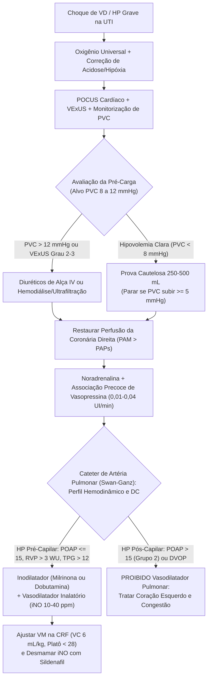

# 🎯 DISFUNÇÃO DE VENTRÍCULO DIREITO (VD) E HIPERTENSÃO PULMONAR (HP)

### 1. FISIOPATOLOGIA, MECÂNICA CARDIOVASCULAR & FARMACOLOGIA
- **Definição Operacional, Etiologia & Classificação Comparativa:**
  - **Tronco Comum:** O VD possui parede fina e alta complacência acoplada a um leito pulmonar de baixa resistência e alta capacitância (opera com pressão sistólica ~20 mmHg [1/6 do VE ~120 mmHg] e gradiente sistólico transseptal normal de 100 mmHg), cuja função primordial é manter a PVC baixa para garantir o retorno venoso (RV ∝ Pms − PVC) e gerar pré-carga ao VE; a HP é definida por PAPm ≥25 mmHg (corte operacional clássico em UTI; consenso atual >20 mmHg), tendo o Grupo 2 como causa #1 geral na UTI.
  - **Classificação Hemodinâmica Invasiva (Pré vs. Pós-Capilar vs. Combinada):**
    - → **HP Pré-Capilar Pura (Grupos 1, 3 e 4):** PAPm ≥25 mmHg + POAP ≤15 mmHg + RVP >3 WU (>240 dina.s.cm⁻⁵) + TPG >12 mmHg.
    - → **HP Pós-Capilar Isolada (Ipc-PH — Grupo 2):** PAPm ≥25 mmHg + POAP >15 mmHg + RVP ≤3 WU (≤240 dina.s.cm⁻⁵) + TPG ≤12 mmHg.
    - → **HP Combinada Pré e Pós-Capilar (Cpc-PH — Grupo 2 remodelado):** PAPm ≥25 mmHg + POAP >15 mmHg + RVP >3 WU (>240 dina.s.cm⁻⁵) + TPG >12 mmHg.
  - **Grupos Clínicos de HP (OMS 1 a 5):**
    - → **Grupo 1 (HAP):** Idiopática, hereditária (mutação BMPR2), associada a colagenoses (esclerose sistêmica), HIV, hipertensão portal, cardiopatia congênita com shunt e Doença Veno-Oclusiva Pulmonar (DVOP).
    - → **Grupo 2 (Doença Cardíaca Esquerda — #1 na UTI):** ICFEr, ICFEp e valvopatias mitrais ou aórticas.
    - → **Grupo 3 (Doenças Pulmonares e/ou Hipóxia):** DPOC, doença intersticial pulmonar, SAOS e hipoventilação alveolar crônica.
    - → **Grupo 4 (HP Tromboembólica Crônica — HPTEC):** Obstrução tromboembólica organizada e remodelamento vascular pulmonar.
    - → **Grupo 5 (Multifatorial/Mecanismos Obscuros):** Distúrbios hematológicos (anemias hemolíticas, mieloproliferativos), sistêmicos (sarcoidose) e metabólicos (doença de Gaucher).
  - **Etiologias da Falência Aguda de VD por Mecanismo Mecânico:**
    - → **Pós-carga Excessiva:** TEP agudo, SDRA grave com hipercapnia/acidose e crise de HP pré-capilar preexistente.
    - → **Inotropia Reduzida:** IAM de VD, miocardite aguda, disfunção pós-CEC (cirurgia cardíaca) e rejeição de transplante cardíaco.
    - → **Pré-carga Excessiva:** Regurgitação tricúspide aguda/maciça, shunts esquerda-direita (CIA, CIV) e fístulas arteriovenosas de alto débito.
    - → **Lusitropia Reduzida / Restrição:** Tamponamento cardíaco, pericardite constritiva e cardiomiopatias restritivas/infiltrativas (amiloidose, sarcoidose).
- **Cascata Fisiopatológica & Interdependência Ventricular:**
  - **Transição Molecular e Estrutural (3 Estágios):**
    - → *Estágio 1 (Hipertrofia Compensada / Adaptação Coaxial):* Ativação neuro-humoral (angiotensina II, endotelina-1, catecolaminas) gera adição paralela de sarcômeros para preservar o volume sistólico.
    - → *Estágio 2 (Gargalo Isquêmico e Metabólico):* Rarefação capilar (hipertrofia supera neoangiogênese) + Chaveamento Glicolítico (*Efeito Warburg Cardíaco* via ↑PDK bloqueando a β-oxidação de ácidos graxos) → disfunção mitocondrial, ↑ROS e lipotoxicidade.
    - → *Estágio 3 (Fibrose e Desacoplamento Ventrículo-Arterial):* Apoptose e ativação de miofibroblastos com deposição de colágeno → perda de contratilidade e desacoplamento VD-AP (TAPSE/sPAP <0,55 mm/mmHg).
  - → **Mecanismo Retrógrado (*Backward Failure*):** Elevação da PAD/PVC reduz o gradiente de retorno venoso (Pms − PVC) e a pressão de perfusão orgânica (PAM − PVC), gerando congestão hepática, esplâncnica/TGI e renal.
  - → **Interdependência Ventricular (Efeito *Bernheim Reverso*):** Dentro do pericárdio rígido, a dilatação aguda do VD desloca o septo interventricular para a esquerda (*D-shape*), restringindo o enchimento diastólico do VE (*LV underfilling* com ↑LVEDP e ↓VDF) → queda crítica do volume sistólico e do débito cardíaco.
  - → **Isquemia Coronariana Direita (*Death Spiral*):** Com ↑PAPs e ↓PAM, a coronária direita (normalmente perfundida na sístole e diástole) passa a ser perfundida apenas na diástole → queda da pressão de perfusão coronariana direita → isquemia de VD e colapso circulatório.
  - **Curva em "U" da RVP na Ventilação Mecânica:** A RVP atinge seu ponto mínimo ótimo na Capacidade Residual Funcional (CRF), subindo nos extremos de baixo volume pulmonar/atelectasia (colapso de vasos extra-alveolares + vasoconstrição hipóxica) e de alto volume/hiperinsuflação (compressão mecânica dos capilares alveolares pela PEEP + queda do retorno venoso quando PEEP > PVC).
- **Fenótipos de Chegada, Cronologia & Estratificação da Congestão:**
  - **Fenótipo Clínico Cardinal:** Sinais de baixo débito sistêmico associados à congestão venosa retrógrada (edema periférico, hepatomegalia congestiva, LRA congestiva, edema de alças) com **ausculta pulmonar limpa e padrão de linhas A ao POCUS** (exceto na doença biventricular/Grupo 2).
  - → **Protocolo VExUS (Avaliação Ultrassonográfica da Congestão Venosa — Graus 0 a 3):**
    - → **Grau 0 (Sem congestão):** VCI <2,0 cm (ou colapsabilidade inspiratória ≥50%).
    - → **Grau 1 (Congestão Leve):** VCI ≥2,0 cm (<50% colapso) + qualquer combinação de padrões normais ou levemente alterados.
    - → **Grau 2 (Congestão Moderada):** VCI ≥2,0 cm + padrão gravemente alterado em **apenas 1** dos 3 órgãos (hepático, portal ou intrarrenal).
    - → **Grau 3 (Congestão Grave):** VCI ≥2,0 cm + padrões gravemente alterados em **≥2** leitos vasculares.
- **PK/PD & Farmacologia Aplicada:**
  - **Vasopressores Sistêmicos (Restauração da Perfusão Coronariana Direita):**
    - → **Noradrenalina:** Agonista α1 e β1 que eleva a PAM e restaura o gradiente de perfusão da coronária direita (titular para manter PAM > PAPs; doses excessivas causam vasoconstrição pulmonar via α1 e ↑RVP).
    - → **Vasopressina (0,01 a 0,04 UI/min):** Agonista V1 sistêmico potente que eleva a RVS/PAM enquanto promove vasodilatação seletiva no endotélio pulmonar mediada por NO (a associação precoce Vasopressina + Noradrenalina reduz a relação RVP/RVS).
  - **Inotrópicos e Inodilatadores:**
    - → **Milrinona:** Inibidor seletivo da PDE-3 (↑AMPc intracelular) que promove inotropismo positivo no VD + vasodilatação pulmonar potente (meia-vida longa de 2–3h e risco de hipotensão sistêmica; **a combinação Milrinona + Vasopressina é sinérgica e superior a Milrinona + Noradrenalina por reduzir a relação RVP/RVS**).
    - → **Dobutamina (2,5 a 10 µg/kg/min):** Agonista β1 e β2 que eleva a contratilidade do VD e o débito cardíaco com leve queda da RVP em baixas doses (doses >10 µg/kg/min induzem taquiarritmias que encurtam o enchimento diastólico do VD).
  - **Vasodilatadores Pulmonares (Iniciar apenas após estabilizar a PAM):**
    - → **Oxigênio:** Vasodilatador pulmonar fisiológico universal (reverte a vasoconstrição pulmonar hipóxica mediada por canais de K+ voltagem-dependentes).
    - → **Óxido Nítrico Inalatório (iNO — 10 a 40 ppm):** Vasodilatador seletivo das unidades alveolares ventiladas (↑GMPc), otimizando a relação V/Q e reduzindo a RVP sem hipotensão sistêmica (inativado pela hemoglobina; meia-vida ultracurta; monitorar **meta-hemoglobina** e **NO2**).
    - → **Prostanoides Inalatórios (Iloprost, Epoprostenol, Treprostinil):** Ativam a via adenilil ciclase/AMPc promovendo vasodilatação pulmonar e efeito antiagregante (podem causar hipotensão sistêmica e tosse/broncoespasmo reflexo).
    - → **Inibidores da PDE-5 (Sildenafil / Tadalafil):** Inibem a degradação do GMPc endógeno, sendo utilizados no desmame de vasodilatadores inalatórios/IV e transição crônica (meia-vida prolongada; evitar início na fase hiperaguda pelo risco de hipotensão e piora do *shunt* por perda da vasoconstrição hipóxica).

---

### 2. PROPEDÊUTICA, MONITORIZAÇÃO INVASIVA (SWAN-GANZ/PAI/PVC) & IMAGEM
- **Exame Físico Dirigido & Pegadinhas Semiológicas:**
  - **Tronco Comum:** Hipotensão e hipoperfusão sistêmica + estase jugular, hepatomegalia, ascite e anasarca contrastando com **campos pulmonares limpos** nas etiologias pré-capilares ou de falência isolada de VD.
  - **Diferenciação Semiológica:** Presença de estertores/congestão pulmonar aponta para HP pós-capilar (Grupo 2); na insuficiência tricúspide grave há pulso venoso jugular com onda C-V gigante e fígado pulsátil.
- **Checklist Mental de POCUS / Ecocardiograma & Curvas Hemodinâmicas:**
  - **POCUS Dimensões, Função & Acoplamento do VD:** Relação VD/VE no apical 4 câmaras >0,6 (normal <0,6; dilatação grave >1,0); TAPSE <17 mm (normal >17 mm; dependente de ângulo e carga); Onda S' do Doppler tecidual tricúspide <9,5 cm/s; FAC = [(ADF − ASF)/ADF] × 100 <35%; e relação **TAPSE/sPAP <0,55 mm/mmHg** (desacoplamento ventrículo-arterial avançado).
  - **POCUS Desvio Septal (*D-Shape*) & Atalho do Átrio Esquerdo:** No eixo curto paraesternal, o Índice de Excentricidade (EI) diferencia **Sobrecarga de Pressão** (*D-shape* presente na **sístole e diástole**, EI >1,0 em ambas) de **Sobrecarga de Volume** (*D-shape* predominante **apenas na diástole**, com EI ≤1,0 na sístole); na HP pré-capilar pura o átrio esquerdo é normal/pequeno (*underfilling*), enquanto **aumento do átrio esquerdo aponta para causa pós-capilar (Grupo 2)**.
  - **Doppler Venoso do Protocolo VExUS (Passos 1 a 4):**
    - → *Passo 1 (VCI):* Diâmetro ≥2,0 cm e colapsabilidade <50%.
    - → *Passo 2 (Veia Hepática):* Normal (S > D) → Leve (S < D) → Grave (**inversão da onda S acima da linha de base**).
    - → *Passo 3 (Veia Porta):* Normal (contínuo, pulsatilidade <30%) → Leve (pulsatilidade 30–50%) → Grave (**pulsatilidade ≥50%**).
    - → *Passo 4 (Veias Intrarrenais):* Normal (contínuo) → Leve (bifásico descontínuo S e D) → Grave (**monofásico exclusivamente diastólico — só onda D**).
  - **Curvas de PVC e Critérios de Cateter de Artéria Pulmonar (Swan-Ganz):**
    - → *Morfologia da PVC:* Onda *a* (sístole atrial), *c* (abaulamento tricúspide), descenso *x* (relaxamento atrial), onda *v* (enchimento atrial) e descenso *y* (esvaziamento rápido ventricular); **Insuficiência Tricúspide Maciça** gera onda V gigante fundida à onda C (onda C-V) com perda do descenso *x*; **Isquemia de VD, Miocardite ou Pericardite Constritiva** geram descensos *x* e *y* profundos formando o padrão em **"M" ou "W"**.
    - → *Cortes do CAP e Fórmulas:* **PVC ≥12 mmHg** em repouso (ou subida ≥5 mmHg pós-prova volêmica); relação **PVC/POAP >0,86** (interdependência ventricular acentuada); **PAPi** = (sPAP − dPAP) / PVC **<1,5** (disfunção grave de VD); **TPG** = PAPm − POAP (>12 mmHg na pré-capilar); **RVP** = [(PAPm − POAP) / DC] × 80 (>3 WU ou >240 dina.s.cm⁻⁵ na pré-capilar; 1 WU = 80 dina.s.cm⁻⁵).
- **Tabela Comparativa de Propedêutica (POCUS / VExUS / Swan-Ganz / Angio-TC):**

| Método / Parâmetro | Achado Comum (Tronco) | Diferenciação por Subtipo / Cortes Exatos | Limitação / O que é PROIBIDO |
| :--- | :--- | :--- | :--- |
| **POCUS Cardíaco** | Dilatação de VD (VD/VE >0,6; grave >1,0) e retificação septal (*D-shape*). | • **Função:** TAPSE <17 mm, Onda S' <9,5 cm/s, FAC <35%, TAPSE/sPAP <0,55 mm/mmHg. • **Pressão vs. Volume:** *D-shape* sistólico e diastólico (EI >1,0 em ambos) vs. *D-shape* só diastólico (EI ≤1,0 na sístole). • **Pré vs. Pós-Capilar:** AE pequeno/normal + Linhas A (Pré) vs. **AE aumentado** + Linhas B (Grupo 2). | TAPSE e Onda S' são dependentes de ângulo e das condições de carga. |
| **Protocolo VExUS** | VCI ≥2,0 cm com colapsabilidade inspiratória <50%. | • **Grau 1:** Padrões normais/leves. • **Grau 2:** Padrão grave em **1** vaso. • **Grau 3:** Padrão grave em **≥2** vasos (Hepática com S reversa, Porta com pulsatilidade ≥50%, Renal monofásica só D). | Se VCI <2,0 cm, considera-se Grau 0 (ausência de congestão venosa sistêmica). |
| **Swan-Ganz (CAP) & Curvas** | PVC ≥12 mmHg (ou ↑ ≥5 mmHg pós-fluido), PVC/POAP >0,86 e PAPi <1,5. | • **Pré-Capilar:** PAPm ≥25, POAP ≤15, RVP >3 WU (>240), TPG >12. • **Pós-Capilar (Ipc-PH):** PAPm ≥25, POAP >15, RVP ≤3 WU (≤240), TPG ≤12. • **Combinada (Cpc-PH):** PAPm ≥25, POAP >15, RVP >3 WU (>240), TPG >12. • **Curva PVC:** Fusão C-V sem *x* (IT grave) vs. padrão em "M/W" (isquemia VD/constrição). | **PROIBIDO** iniciar vasodilatadores pulmonares sem antes excluir POAP >15 mmHg (Grupo 2) ou Doença Veno-Oclusiva Pulmonar (DVOP). |
| **Angio-TC de Tórax** | Sobrecarga morfológica de câmaras direitas e dilatação arterial pulmonar. | • Relação de diâmetro transverso **VD/VE >1,0**. • Retificação ou abaulamento septal para o VE. • Refluxo de contraste iodado para VCI e veias supra-hepáticas. • Tronco da artéria pulmonar **>29–30 mm** ou relação **AP / Aorta Ascendente >1,0**. | Avalia anatomia e sobrecarga estática, mas não substitui a monitorização hemodinâmica dinâmica à beira-leito. |

---

### 3. RACIOCÍNIO CLÍNICO, ALGORITMO MERMAID & DIFERENCIAÇÃO DE SUBTIPOS
- **Abordagem da Síndrome Indiferenciada & Classificação Operacional:**
  - **Estabilização Fisiológica Imediata:** Ofertar oxigênio suplementar (universal em 100% dos casos), corrigir acidose/hipercapnia, instalar monitorização invasiva e avaliar POCUS + VExUS à beira-leito.
  - **Diferenciação Pré-Capilar vs. Pós-Capilar (Regra de Ouro):** Antes de prescrever qualquer vasodilatador pulmonar específico, confirmar pelo ecocardiograma (AE normal e pulmão seco) e pelo Swan-Ganz (**POAP ≤15 mmHg**, **RVP >3 WU** e **TPG >12 mmHg**) que se trata de HP pré-capilar; se **POAP >15 mmHg** (Grupo 2) ou suspeita de **DVOP**, vasodilatadores pulmonares são **proibidos** pelo risco de desencadear edema agudo de pulmão fatal.
  - **Ajuste de Pré-Carga Guiado por PVC e VExUS:** Manter alvo estrito de **PVC entre 8 e 12 mmHg**; na presença de congestão (PVC >12 mmHg ou VExUS 2–3), promover descongestão ativa para descomprimir o VD e reverter o efeito *Bernheim reverso*.
- **Fluxograma Decisório Integrado (Mermaid):**

---

### 4. TERAPÊUTICA ACIONÁVEL CARDIOINTENSIVA (TRONCO COMUM vs. ESPECÍFICA)
1. **Controle da Causa-Base & Oxigenoterapia Universal:**
   - → **Oxigenoterapia:** Única intervenção com indicação universal para **todos (100%)** os pacientes críticos com HP, revertendo a vasoconstrição pulmonar hipóxica sem toxicidade sistêmica.
   - → **Controle Etiológico Direcionado:** Tratar a causa precipitante conforme o mecanismo mecânico (reperfusão na isquemia de VD/TEP, controle de sepse/SDRA, correção cirúrgica valvar/shunt ou drenagem pericárdica quando indicada).
2. **Manejo de Ritmo, Frequência Cardíaca & Sincronia AV:**
   - → **Preservação do Enchimento Diastólico:** Evitar taquiarritmias atriais e ventriculares (inclusive por doses excessivas de dobutamina >10 µg/kg/min), pois o encurtamento da diástole compromete criticamente o enchimento do VD.
   - → **Manutenção da Sístole Atrial:** Preservar o ritmo sinusal e a sincronia atrioventricular, fundamentais para vencer a restrição diastólica do VD rígido/sobrecarregado.
3. **Macro e Micro-Hemodinâmica (Vasopressores, Inotrópicos & Vasodilatadores Pulmonares):**
   - → **Alvos Hemodinâmicos:** Manter **PAM > PAPs** (garantindo perfusão diastólica e sistólica da coronária direita), **PVC entre 8 e 12 mmHg**, **PAPi >1,5** e recuperação do débito cardíaco.
   - → **Suporte Vasopressor (Noradrenalina + Vasopressina):** Iniciar **Noradrenalina** para restaurar rapidamente a PAM e associar precocemente **Vasopressina em baixa dose (0,01 a 0,04 UI/min)** para elevar a RVS via receptores V1 periféricos enquanto induz vasodilatação pulmonar via NO endotelial (reduzindo a relação RVP/RVS).
   - → **Suporte Inodilatador:** Associar **Milrinona** (inibe PDE-3 → ↑inotropismo do VD + ↓RVP; **a associação Milrinona + Vasopressina é a estratégia de escolha por otimizar a relação RVP/RVS** e neutralizar a hipotensão sistêmica da milrinona) ou **Dobutamina** (2,5 a 10 µg/kg/min).
   - → **Vasodilatação Pulmonar Seletiva:** Após estabilizar a PAM na HP pré-capilar, iniciar **Óxido Nítrico Inalatório (iNO 10 a 40 ppm)** ou **Prostanoides Inalatórios** (Iloprost, Epoprostenol, Treprostinil) para reduzir a pós-carga do VD exclusivamente nos alvéolos ventilados, otimizando a relação V/Q.
4. **Manejo de Volemia & Pré-Carga:**
   - → **Alvo Estrito de PVC (8 a 12 mmHg):** Na presença de **PVC >12 mmHg** ou congestão sistêmica (**VExUS Grau 2–3**), instituir **diuréticos de alça IV ou ultrafiltração/hemodiálise** para descomprimir o VD, reduzir o abaulamento septal sobre o VE e restaurar o enchimento esquerdo.
   - → **Prova Volêmica Cautelosa:** Restrita exclusivamente a pacientes com sinais claros de hipovolemia (PVC <8 mmHg), administrando alíquotas de **250 a 500 mL** e interrompendo imediatamente caso a **PVC suba ≥5 mmHg** sem melhora do débito.
5. **Interação Cardiopulmonar (VM), Suporte Mecânico & Transição:**
   - → **Ventilação Mecânica Ancorada na CRF (Menor Ponto da Curva em "U" da RVP):** Ajustar **Volume Corrente em 6 mL/kg** de peso predito, **Pressão de Platô <28 cmH2O**, baixa *driving pressure* e PEEP moderada que reverta atelectasias sem causar hiperinsuflação alveolar e sem superar a PVC.
   - → **Transição e Desmame de Vasodilatadores Inalatórios:** Utilizar **Inibidores da PDE-5 (Sildenafil / Tadalafil)** na fase de estabilidade para permitir o desmame seguro do iNO/vasodilatadores IV e a transição para o manejo crônico.

---

### 5. PROVA (TEMI) & BEIRA-LEITO
- **Gatilhos Imediatos (`Achado → Mecanismo → Conduta Salvadora`):**
  - **Cateterismo cardíaco direito com PAPm = 45 mmHg, POAP = 10 mmHg e DC = 5,0 L/min** → TPG = 35 mmHg (>12) e RVP = [(45 − 10)/5] × 80 = 560 dina.s.cm⁻⁵ (7 WU, >3 WU) → **Confirmar Hipertensão Pulmonar Pré-Capilar pura (ex: HPTEC — Grupo 4) e afastar causas esquerdas (Grupo 2)**.
  - **Paciente crítico admitido na UTI com descompensação de Hipertensão Pulmonar** → Vasoconstrição arterial pulmonar hipóxica mediada por canais de K+ → **Iniciar Oxigenoterapia imediatamente (única terapia indicada em 100% dos pacientes com HP)**.
  - **Ecocardiograma em paciente com HP evidenciando aumento do Átrio Esquerdo** → Hipertensão venocapilar retrógrada (na HP pré-capilar pura o AE é normal/pequeno por *underfilling*) → **Diagnosticar HP Pós-Capilar (Grupo 2) e proibir vasodilatadores pulmonares**.
  - **Choque de VD com PVC ≥12 mmHg, PVC/POAP >0,86, PAPi <1,5, *D-shape* e VExUS Grau 3 (S hepática reversa, porta ≥50%, renal só D)** → Efeito *Bernheim reverso* restringindo o enchimento do VE + congestão venosa orgânica grave → **Suspender fluidos + Diurético de alça IV / Hemodiálise + Milrinona associada à Vasopressina**.
- **Iatrogenias Fatais (NUNCA FAZER):**
  - ❌ **Administrar vasodilatadores pulmonares na HP Pós-Capilar (Grupo 2) ou na Doença Veno-Oclusiva Pulmonar (DVOP):** O aumento súbito do fluxo anterógrado contra um átrio esquerdo hipertenso ou veias pulmonares ocluídas precipita **edema agudo de pulmão fatal**.
  - ❌ **Infundir volume em paciente com PVC ≥12 mmHg (ou manter fluido após subida ≥5 mmHg da PVC):** Agrava a distensão do VD, desloca o septo interventricular contra o VE (*LV underfilling*) e reduz criticamente o débito cardíaco sistêmico.
  - ❌ **Ventilar com extremos de volume pulmonar (atelectasia ou hiperinsuflação com Platô ≥28 cmH2O e PEEP excessiva):** Desloca o pulmão para as extremidades da curva em "U", multiplicando a RVP por colapso de vasos extra-alveolares ou esmagamento de capilares alveolares.
  - ❌ **Usar Milrinona isolada em paciente hipotenso ou escalonar altas doses de Noradrenalina em monoterapia:** A milrinona sem vasopressor causa hipotensão grave (meia-vida de 2–3h), enquanto doses excessivas de noradrenalina elevam a RVP via receptores α1 pulmonares (associar Vasopressina precocemente).
- **Questões & Casos Clínicos da Aula (1 linha por questão/caso):**
  - **Q1 (Cateterismo Direito / Classificação de HP):** **Gabarito C (Hipertensão pulmonar tromboembólica crônica — HPTEC)** — Com PAPm 45 mmHg, POAP 10 mmHg (≤15) e DC 5,0 L/min, temos TPG = 35 mmHg (>12) e RVP = 560 dina.s.cm⁻⁵ (7 WU, >3 WU), definindo HP Pré-Capilar pura (estenose mitral, IC diastólica grau 3 e Cpc-PH exigiriam POAP >15 mmHg).
  - **Q2 (Ecocardiografia na HP):** **Gabarito B (Aumento do átrio esquerdo)** — VE em "D" (*D-shaped LV*), dilatação de VD e insuficiência tricúspide são típicos de HP, mas o **aumento do átrio esquerdo NÃO ocorre pela HP pré-capilar** (que causa *underfilling* de AE), apontando para doença cardíaca esquerda (Grupo 2).
  - **Q3 (Terapêutica Geral na UTI):** **Gabarito C (Oxigênio)** — O **Oxigênio** é a única terapia indicada em **todos** os pacientes críticos com HP; diuréticos são deletérios na hipovolemia, suporte mecânico é restrito ao choque refratário e vasodilatadores pulmonares causam EAP no Grupo 2 e na DVOP.
- **Demais detalhes relevantes que não se encaixaram nos tópicos acima:**
  - Fator de conversão universal para Resistência Vascular Pulmonar: **1 Unidade Wood (WU) = 80 dina.s.cm⁻⁵** (corte de anormalidade pré-capilar: **>3 WU** ou **>240 dina.s.cm⁻⁵**).