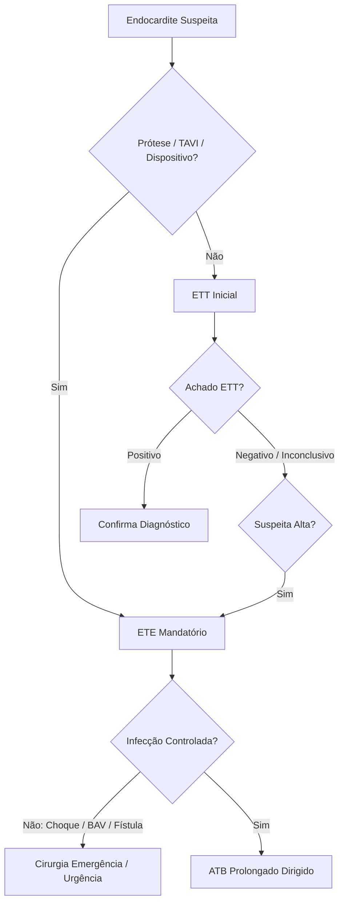

Aqui está o **Cheat Sheet Ultrabizurado** focado em altíssimo rendimento para a prova do TEMI (AMIB) e para a beira do leito na UTI, seguindo rigorosamente a arquitetura exigida.

***

# CHEAT SHEET TEMI / UTI: ENDOCARDITE INFECCIOSA (EI)

## 1. QUADRO CLÍNICO + EPIDEMIOLOGIA INTEGRADOS (FENÓTIPOS DE CHEGADA)

**Definição Operacional & Conceito Chave:** Infecção do endotélio cardíaco, incidência de **1,5 a 11,6 casos/100.000 hab/ano**. Mudança de perfil: menos doença reumática jovem, mais idosos do sexo masculino com valvas degenerativas, próteses e dispositivos (TAVI/Marca-passo).

**Fenótipos Sindrômicos de Chegada + Probabilidade Pré-Teste (Epidemio):**
*   **[Fenótipo 1 - Agudo / Fulminante]:** Sepse rapidamente progressiva + destruição valvar acelerada. **Etiologia:** *S. aureus* (hoje o **patógeno #1, 30-35% dos casos**). Clínica com menos de 4 semanas.
*   **[Fenótipo 2 - Subagudo / Arrastado]:** Febre vespertina, emagrecimento, astenia > 4 semanas. **Etiologia:** *S. viridans*, Enterococo, grupo HACEK.
*   **[Fenótipo 3 - Nosocomial / Cuidados de Saúde]:** Sintomas > 48h de internação, uso de Permcath/PICC, HD, quimioterapia prévia (<30 dias) ou procedimentos nas últimas 4-8 semanas. **Etiologia:** Gram-negativos MDR, MRSA, *Candida*.

**Sinais Clínicos Clássicos & Pegadinhas de Prova:**
*   **Febre** (96%) e **Sopro Cardíaco** (85%). *Pegadinha:* Sopro **NOVO** ocorre em apenas 48% e mudança do sopro em 20%.
*   **Manifestações Vasculares (17%):** **Lesões de Janeway** (5% - *máculas eritematosas indolores palmoplantares* por microêmbolos), hemorragias subungueais (8%), aneurismas micóticos.
*   **Manifestações Imunológicas:** **Nódulos de Osler** (3% - *dolorosos nas polpas digitais* por imunocomplexos), **Manchas de Roth** (2% - *hemorragia retiniana com centro pálido*), glomerulonefrite com **hematúria** (26%) e consumo de complemento.

---

## 2. ETIOLOGIA + PESQUISA DIRECIONADA + PROPEDÊUTICA ARMADA

**O que NÃO fazer / Armadilhas de Investigação:** NUNCA inicie antibiótico empírico antes de colher as hemoculturas (a menos em choque séptico). Em EI subaguda estável, é obrigatório **aguardar 24-48h** colhendo culturas antes do ATB.

**Critérios de Duke Modificados - Microbiologia (Critérios Maiores):**
*   **Microrganismos típicos em 2 amostras** separadas (*S. aureus*, HACEK, *Enterococcus* sem foco).
*   **Hemoculturas persistentemente positivas:** > 12h de intervalo; OU todas as 3; OU maioria de ≥ 4 amostras (1ª e última com ≥ 1h de intervalo).
*   **Sorologia/Atípico:** Hemocultura única ou IgG Fase 1 **> 1:800** para *Coxiella burnetii* (Febre Q).

| Grupo Etiológico / Mecanismo | Particularidade / Prevalência | Quando & Como Pesquisar (Investigação Específica) | Critério / Propedêutica (Armada e Imagem) |
| :--- | :--- | :--- | :--- |
| **S. aureus** | #1 Global / Alta letalidade | Hemoculturas. Agente agressivo, alta embolia. | Avaliar indicação cirúrgica precoce obrigatoriamente. |
| **S. gallolyticus (S. bovis)** | Fenótipo mascarado | Associação clássica com neoplasias/pólipos GI. | **Colonoscopia completa mandatória** durante a internação. |
| **HACEK** | Bacilos Gram-negativos fastidiosos | Cultura de crescimento lento. | Respondentes a Cefalosporinas de 3ª geração. |
| **Germes Atípicos / Hemocultura Negativa** | Zoonoses e Fungos | *Coxiella* (ovinos/laticínios); *Bartonella* (gatos); *T. whipplei* | Sorologias / PCR para rRNA 16S em valva operada. |
| **Prevenção / Extensão** | Fenômenos Embólicos Silenciosos | Angio-TC Crânio, Tórax e Abdome de rotina. | Rastreio sistêmico pontua como Critério Menor vascular (TC). |

*Regra de Ouro Hemoculturas:* Colher **3 sets** (1 aeróbio + 1 anaeróbio = 6 frascos). Volume inóculo é vital: **10 mL por frasco** (20 mL por set) com **30 minutos de intervalo** em sítios anatômicos diferentes.

---

## 3. ESTRATIFICAÇÃO QUE MUDA CONDUTA (GATILHOS DE AÇÃO RÁPIDA)

Associações de bate-pronto à beira do leito (TEMI):
*   🔴 **[Gatilho Clínico]** Choque/EAP refratário **→** [Complicação] Insuficiência aórtica ou mitral aguda grave **→** **[Conduta] Cirurgia de EMERGÊNCIA (< 24h).**
*   🔴 **[Gatilho Imagem]** Pseudoaneurisma / Fístula / Abscesso anelar **→** [Mecanismo] Infecção não controlada (locally uncontrolled) **→** **[Conduta] Cirurgia de URGÊNCIA (3 a 5 dias).**
*   🔴 **[Gatilho Eletrocardiográfico]** Bloqueio Atrioventricular (BAV) Novo **→** [Mecanismo] Abscesso de raiz de aorta invadindo feixe de His **→** **[Conduta] Cirurgia de Urgência (Implante de Eletrodo Epicárdico no intra-op).**
*   🔴 **[Gatilho Neurológico]** AVC Isquêmico **→** [Mecanismo] Embolia séptica **→** **[Conduta] NÃO retardar a cirurgia valvar** se houver indicação hemodinâmica (salvo coma/infarto extenso).
*   🔴 **[Gatilho Neurológico]** AVC Hemorrágico **→** [Mecanismo] Sangramento / Aneurisma micótico **→** **[Conduta] POSTERGAR cirurgia valvar por NO MÍNIMO 1 mês (30 dias)** (risco de conversão maciça na CEC).

---

## 4. WORKUP À BEIRA-LEITO (MONITORIZAÇÃO, GRÁFICOS E POCUS)

**Checklist Mental de POCUS / Ecocardiograma (Critérios Maiores de Duke):**
1.  **[Pergunta 1] O que procuro na valva?** Vegetação móvel oscilante, abscesso perivalvar, pseudoaneurisma, fístula, perfuração ou deiscência de prótese.
2.  **[Pergunta 2 - Atalho Visual / Hemodinâmica Crítica - CAI MUITO NO TEMI]:** O **Fechamento Precoce da Valva Mitral** ao ecocardiograma no contexto de insuficiência aórtica aguda denota elevação crítica e súbita da PDFVE (superando a pressão atrial esquerda antes da sístole). É o marcador de choque cardiogênico irreversível iminente -> **Cirurgia de Emergência!**

**Algoritmo de Imagem (A regra do TEE):**
*   **Sempre iniciar com ETT** (Transtorácico).
*   **ETE (Transesofágico) é MANDATÓRIO se:** Prótese Valvar, Dispositivo Cardíaco (CDI/MP), Implante Transcateter (TAVI), ETT inconclusivo ou ETT negativo com Alta Suspeita Clínica.
*   **Repetição:** ETT/ETE inicial negativo + Alta suspeita → Repetir em **5-7 dias**.

**Padrão-Ouro de Imagem Avançada:**
*   **PET/CT com [18F]-FDG:** Papel central em valvas protéticas **> 3 meses do implante** (evitar falso-positivo cicatricial) e infecção de cabos de marca-passo. (Sens: 86%, Espec: 84%).
*   **TC Cardíaca com Contraste:** Superior ao ETT para abscessos/fístulas de raiz aórtica. Excelente para afastar DAC pré-op, evitando cateterismo (que tem risco de deslocamento de vegetação aórtica).

---

## 5. TRATAMENTO POR PERFIL, INTERAÇÃO MULTISSISTÉMICA E FLUXO DECISÓRIO

### A. Fisiopatologia Aplicada e Fluxo Decisório (O Ciclo a Quebrar)

### B. Escolha Fina de Antimicrobianos e Posologias (PK/PD e Foco)

**Terapia Empírica Inicial:**
*   **Valva Nativa (Aguda):** Foco em *S. aureus*. → **Vancomicina** (15-20 mg/kg IV 12/12h; alvo vale 15-20 mcg/mL) **+ Oxacilina** (2 g IV 4/4h).
*   **Valva Nativa (Subaguda):** Foco em HACEK/Enterococo. → **Ceftriaxona** (2 g IV 24/24h) **+/- Ampicilina** (2 g IV 4/4h se idoso). Se dúvida na nativa: Vanco + Ceftriaxona.
*   **Prótese Valvar TARDIA (> 2 meses):** Foco estafilo/biofilme. → **Vanco + Oxacilina + Gentamicina** (1 mg/kg IV 8/8h) **+ Rifampicina** (300-600 mg VO 12/12h).
*   **Prótese Valvar PRECOCE (< 2 meses / Nosocomial):** Foco MDR/MRSA/Fungo. → **Vanco + Meropenem** (2 g IV 8/8h) **+ Gentamicina + Equinocandina** (Mica/Caspofungina).

**Terapia Dirigida Definitiva:**
*   **O "Pulo do Gato" do Enterococo (Vantagem moderna):** O esquema Padrão-Ouro moderno (Ensaio Clínico) é **Ampicilina** (2g 4/4h) **+ Ceftriaxona** (2g 12/12h) por **6 semanas**. Ocorre sinergismo por saturação diferencial das PBPs, sem a nefrotoxicidade da Gentamicina. Se VRE: **Daptomicina dose alta** (10-12 mg/kg/dia) + Ampi/Ceftarolina.
*   **Estafilococo (MRSA):** Vanco ou Daptomicina (10-12 mg/kg/dia) por 6 semanas.
*   **Estafilococo (MSSA):** Oxacilina (2g 4/4h) ou Cefazolina (2g 8/8h - *evitar Cefazolina se infecção de SNC*).
*   **Prótese com Estafilococos:** Requer adição de Gentamicina (nas 2 primeiras semanas) e Rifampicina (por 6 semanas).

### C. Abordagem de Focos Periféricos
*   **Aneurisma Micótico Intracraniano:** Tto Endovascular (Molas) = Pode operar o coração imediatamente após. Cirurgia aberta neurológica = Esperar 2 semanas para cirurgia cardíaca.
*   **Abscesso Esplênico:** Maioria conservador. Esplenectomia APENAS se: rotura, infarto maciço (> 2/3 ou > 200mL) ou bacteremia persistente.

### D. O QUE É ESTRITAMENTE PROIBIDO NA FASE AGUDA (Iatrogenias Fatais - TEMI)
1.  🚨 **[Erro Fatal 1 - Uso inadequado da Rifampicina]:** NUNCA usar em monoterapia. NUNCA iniciar antes do clareamento da bacteremia (garantir culturas negativas antes de introduzir para não induzir resistência no biofilme da prótese).
2.  🚨 **[Erro Fatal 2 - Daptomicina na UTI]:** NUNCA prescrever Daptomicina se houver Endocardite Direita com êmbolos pulmonares ou pneumonia secundária (a droga é **inativada pelo surfactante pulmonar**).
3.  🚨 **[Erro Fatal 3 - Profilaxia Desnecessária]:** NUNCA prescrever profilaxia de EI para manipulação Gastrointestinal, Respiratória ou Geniturinária isolada (ex: EDA, IOT, SVD). Profilaxia (Amoxicilina 2g VO 30-60min antes) é restrita a procedimentos **Odontológicos** (manipulação gengival) em doentes de **Alto Risco** (Prótese, EI prévia, cardiopatia cianogênica).
4.  🚨 **[Erro Fatal 4 - CEC no AVC Hemorrágico]:** Indicar cirurgia valvar precoce em paciente com AVC hemorrágico documentado. A heparinização sistêmica mata o doente por sangramento maciço.

---

## 6. TRANSIÇÃO DE CUIDADO, REAVALIAÇÃO & FOLLOW-UP

**Infecções de Dispositivos (CDI / Marca-passo - MP):**
*   **Regra de Ouro:** Remoção COMPLETA do sistema (gerador e cabos). Usar MP temporário transvenoso de fixação ativa contralateral até cura microbiológica.
*   **Tempos para Novo Implante (Critérios de Cura):**
    *   Se **Vegetação na Valva**: Aguardar **14 dias** de ATB após a *PRIMEIRA* hemocultura negativa.
    *   Se **Vegetação apenas no Cabo/Eletrodo**: Reimplante após nova hemocultura negativa com **72h de incubação**.
    *   Se sem vegetação / apenas infecção de Loja do Gerador: Tratar 10 a 14 dias.
    *   *Sempre reavaliar se o paciente realmente ainda precisa de MP definitivo.*