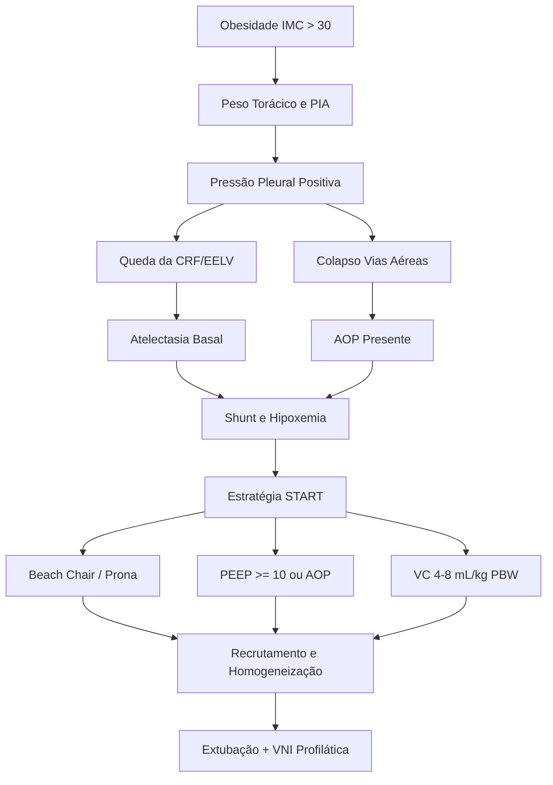

# 📘 ILLNESS SCRIPT UTI: VENTILAÇÃO MECÂNICA EM OBESOS E MECÂNICA RESPIRATÓRIA AVANÇADA

---

## 1. FENÓTIPOS DE CHEGADA, FISIOPATOLOGIA E ESCALAS DE GRAVIDADE (CLÍNICA + EPIDEMIOLOGIA)

No paciente obeso (**IMC $> 30\text{ kg/m}^2$**; obesidade mórbida **IMC $\ge 40\text{ kg/m}^2$**, presente em **20–35%** das UTIs), o problema mecânico primário reside na **Força 2 da Equação do Movimento (Elastância/Complacência)**, especificamente por **redução da complacência da caixa torácica ($C_{cw}$)** e aumento da pressão intra-abdominal (PIA), e não necessariamente por rigidez intrínseca do parênquima pulmonar ($C_L$).

### A. Fenótipos Clínicos de Chegada na UTI e Mortalidade Associada
1. **Fenótipo Hipoxêmico Agudo / Atelectásico ("Paradoxo da Obesidade na SDRA"):**
   * **Fisiopatologia:** Massa abdominal desloca o diafragma cranialmente + gordura mediastinal e peso do gradil costal geram **pressão pleural positiva ($P_{pl} > 0$, ex.: $+4\text{ a }+5\text{ cmH}_2\text{O}$)** $\rightarrow$ queda drástica da Capacidade Residual Funcional (**CRF**), Capacidade Vital (**CV**), Volume Residual (**VR**) e Volume de Reserva Expiratório (**VRE**). 
	   * Em VM, isso equivale à queda do **EELV** (*End-Expiratory Lung Volume*). Ocorre fechamento precoce das pequenas vias aéreas na expiração, compressão de bases, atelectasia de absorção e aumento do <mark style="background: #FFE066;">shunt intrapulmonar</mark> (alvéolos perfundidos e não ventilados).
   * **Epidemiologia e "Paradoxo da Obesidade":** Obesos têm **maior incidência de SDRA** (OR $1,5\text{–}2,0$), porém **mortalidade igual ou menor** que eutróficos (mortalidade de **25–35%** vs. **35–45%** na SDRA moderada/grave geral), pois <mark style="background: #FFE066;">grande parte da $P_{platô}$ elevada deve-se à caixa torácica pesada, gerando menor *strain* (deformação) alveolar real</mark>.
1. **Fenótipo Hipercápnico Crônico Agudizado (Síndrome de Pickwick / SOH e SAHOS):**
   * **Fisiopatologia:** Prevalência de **SAHOS em $> 50\text{–}70\%$** dos obesos mórbidos e **Síndrome de Hipoventilação da Obesidade (SOH / Pickwick)** em **10–20%** dos obesos hospitalizados (definida por IMC $\ge 30\text{ kg/m}^2$ + $\text{PaCO}_2\text{ diurna} > 45\text{ mmHg}$ na ausência de outra causa). 
	   * Hipoxemia noturna e acidose respiratória crônica induzem vasoconstrição pulmonar hipóxica, remodelamento vascular e **Hipertensão Pulmonar (HP) / Cor Pulmonale** 
		   * (presente em **30–50%** das SOH graves, 
		   * com mortalidade em UTI de **18–35%** se choque de VD instalar-se).
1. **Fenótipo Via Aérea Crítica ("Dessaturador Ultrarrápido"):**
   * **Fisiopatologia:** Circunferência cervical aumentada ($> 40\text{–}43\text{ cm}$), mobilidade cervical reduzida, língua volumosa, tecido faríngeo redundante, distância tireomentoniana curta ($< 6\text{ cm}$) e alta incidência de **DRGE**. A perda do tônus muscular na indução anestésica reduz o EELV abaixo do volume de fechamento em segundos, causando hipoxemia crítica ($< 60\text{ segundos}$ de apneia segura sem VNI). Risco de IOT difícil é **2 a 3 vezes maior** na UTI (incidência **10–15%**).
4. **Fenótipo Pseudobstrutivo / Colapso Dinâmico de Vias Aéreas (EDAC / Traqueomalácia):**
   * **Fisiopatologia:** A pressão pleural fortemente positiva comprime as vias aéreas intratorácicas membranosas durante a expiração $\rightarrow$ limitação de fluxo expiratório (LFE), sibilância que não responde a broncodilatador, aprisionamento aéreo e **Auto-PEEP oculta** (presente em até **20–40%** dos obesos mórbidos em decúbito dorsal a $0^\circ$).

### B. Pegadinhas de Exame Físico e Beira-Leito
* **Armadilha da $P_{platô}$ alta:** No obeso sedado e curarizado, uma $P_{platô}$ de $32\text{ cmH}_2\text{O}$ pode refletir uma pressão transpulmonar ($P_L$) perfeitamente segura ($< 20\text{ cmH}_2\text{O}$) devido à contra-pressão externa da parede e do abdome. 
	* <mark>Reduzir o volume corrente cegamente abaixo de $4\text{ mL/kg}$ gera atelectasia maciça e acidose fatal.</mark>
* **Ausculta limpa na Falência de VD vs. Silêncio Basal:** O paciente com Pickwick e choque por falência aguda de VD pode apresentar campos pulmonares médios/superiores limpos (congestão é sistêmica/<mark style="background: #FFF3A3A6;">retrógrada</mark>), enquanto o silêncio auscultatório nas bases frequentemente é panículo adiposo + atelectasia compressiva, e não derrame pleural volumoso.
* **Adaptação Crônica vs. Aguda:** O paciente com Pickwick tolera $\text{PaCO}_2\text{ de } 65\text{–}80\text{ mmHg}$ acordado (bicarbonato basal $> 30\text{–}36\text{ mEq/L}$, pH normalizado); 
	* se intubado e hiperventilado para "normalizar" $\text{PaCO}_2 = 40\text{ mmHg}$, desenvolve alcalose pós-hipercápnica grave, convulsões e falha de desmame.

### C. Escalas Operacionais de Gravidade e Grandes Trials (Pneumointensivismo)

| Escala / Classificação | Critérios Operacionais e Pontos de Corte Exatos | Mortalidade / Evidência (Grandes Trials) |
| :--- | :--- | :--- |
| **Definição de Berlim (2012) para SDRA** | Início $\le 7\text{ dias}$ + Opacidades bilaterais (RX/TC) não explicadas por IC/hipervolemia + **$\text{PEEP/CPAP} \ge 5\text{ cmH}_2\text{O}$**: • **Leve:** $200 < \text{PaO}_2/\text{FiO}_2 \le 300\text{ mmHg}$ • **Moderada:** $100 < \text{PaO}_2/\text{FiO}_2 \le 200\text{ mmHg}$ • **Grave:** $\text{PaO}_2/\text{FiO}_2 \le 100\text{ mmHg}$ | • **Leve:** ~27% • **Moderada:** ~32% • **Grave:** ~45% *(Estudo LUNG SAFE: 35–46%)* |
| **Nova Definição Global de SDRA (2023/2024)** | Inclui pacientes em **CNAF $\ge 30\text{ L/min}$** (sem exigir PEEP $\ge 5$), aceita **POCUS pulmonar** (linhas B/consolidações bilaterais) e oximetria (**$\text{SpO}_2/\text{FiO}_2 \le 315$** se $\text{SpO}_2 \le 97\%$): • **Leve:** $\text{SpO}_2/\text{FiO}_2 \le 315\text{ e } > 235$ • **Moderada:** $\text{SpO}_2/\text{FiO}_2 \le 235\text{ e } > 148$ • **Grave:** $\text{SpO}_2/\text{FiO}_2 \le 148$ | Permite diagnóstico precoce pré-IOT e em locais com recursos limitados. |
| **Subfenótipos Biológicos da SDRA (Calfee)** | • **Hipoinflamatório (Fenótipo 1 - ~70%):** Menor IL-6/IL-8/sTNFR1, menos choque, maior sobrevida; piora com PEEP excessiva. • **Hiperinflamatório (Fenótipo 2 - ~30%):** Tempestade inflamatória, acidose metabólica ($\text{HCO}_3^- \downarrow$), choque vasoplégico; responde melhor à PEEP mais alta e estratégia fluida conservadora. | • **Hipoinflamatório:** ~20% mortalidade • **Hiperinflamatório:** ~45–55% mortalidade |
| **Asma Quase-Fatal vs. DPOC Exacerbado** | • **Asma Quase-Fatal:** Acidose respiratória ($\text{PaCO}_2 > 45\text{ mmHg}$), tórax silencioso, bradicardia/alteração de consciência, $\uparrow\uparrow R_{aw} (> 25\text{ cmH}_2\text{O/L/s})$. • **DPOC Exacerbado Grave:** $\text{pH} < 7,35$ com $\text{PaCO}_2 > 45\text{ mmHg}$ (VNI é padrão-ouro se $\text{pH } 7,25\text{–}7,35$; IOT se $\text{pH} < 7,25$ refratário ou rebaixamento). | Mortalidade Asma em VM: **8–15%** (causa principal: barotrauma/choque por Auto-PEEP). DPOC em VM: **15–25%**. |
| **Grandes Trials que Mudaram Conduta** | • **ARMA (2000):** $V_t\text{ } 6\text{ mL/kg}$ (peso predito) + $P_{platô} \le 30$ vs. $12\text{ mL/kg}$ $\rightarrow$ reduziu mortalidade de **39,8% para 31,0%**. • **PROSEVA (2013):** Prona $\ge 16\text{h/dia}$ na SDRA com $\text{P/F} < 150$ ($\text{FiO}_2 \ge 60\%$, PEEP $\ge 5$) $\rightarrow$ reduziu mortalidade em 28 dias de **32,8% para 16,0%**. • **ACURASYS (2010) / ROSE (2019):** Cisatracúrio por 48h se $\text{P/F} < 150$ reduziu mortalidade no ACURASYS (sedação profunda), mas foi neutro no ROSE (sedação leve). Indicar se assincronia grave, $\text{P/F} < 120$ ou antes de pronar. • **ART (2017):** Manobra de recrutamento alveolar em escada (até PEEP 45/$P_{pico}$ 60) **aumentou mortalidade** (**55,3% vs. 49,3%**) e PCR/pneumotórax. • **FLORALI (2015):** CNAF na IRpA hipoxêmica não-hipercápnica reduziu mortalidade em 90 dias e IOT em pacientes com $\text{P/F} \le 200$. | Base de toda a estratégia protetora atual e do mnemônico **START**. |

---

## 2. DIAGNÓSTICO, MECÂNICA VENTILATÓRIA, FÓRMULAS E PROPEDÊUTICA ARMADA

### A. O Que NÃO Pedir e O Que NÃO Fazer de Rotina
* **NÃO calcular Volume Corrente ($V_t$) pelo peso real:** O pulmão não cresce com a obesidade; o $V_t$ é estritamente calculado pelo **Peso Corporal Predito (PBW)** baseado na altura e sexo.
* **NÃO realizar Manobras de Recrutamento Alveolar de rotina:** Especialmente recrutamento em escada (*staircase*) — contraindicado pelo estudo **ART** (risco de choque obstrutivo e barotrauma).
* **NÃO deixar o paciente obeso em decúbito dorsal horizontal ($0^\circ$):** Provoca colapso imediato das bases, elevação da PIA, hipoxemia refratária e parada cardíaca por hipóxia/Auto-PEEP.
* **NÃO passar cateter de balão esofágico ou Swan-Ganz de rotina em todo obeso:** Usar primeiro
	* ==a **manobra à beira do leito 5/5/5 (AOP)** e 
	* ==a **mensuração da PIA vesical** para ajustar $P_{platô}$ e PEEP.

### B. Pesquisa Guiada e Propedêutica Armada no Obeso Crítico

| Perfil / Suspeita | Prevalência / Letalidade | Workup Não Invasivo Inicial | Critérios Exatos para Propedêutica Armada / Invasiva |
| :--- | :--- | :--- | :--- |
| **Colapso de Vias Aéreas (AOP) e Restrição Torácica Grave** | AOP presente em **30–40%** dos obesos em VM (SDRA) | Curvas do ventilador + **Manobra 5/5/5** em VCV passivo + POCUS pulmonar (linhas B/consolidação basal). | **Manometria Esofágica (Balão Esofágico):** Indicada se IMC $> 40$ com hipoxemia refratária ($\text{P/F} < 150$) ou $P_{platô} > 30\text{ cmH}_2\text{O}$ para titular PEEP mantendo **$P_{L,\text{exp}} \ge 0\text{ a }+2\text{ cmH}_2\text{O}$** e **$P_{L,\text{insp}} < 20\text{–}25\text{ cmH}_2\text{O}$**. |
| **Hipertensão Intra-Abdominal (HIA) / SCA** | HIA basal em obesos: **PIA normal é $7\text{–}14\text{ mmHg}$**; SCA se $> 20\text{ mmHg}$ + disfunção orgânica (Letalidade **> 50%**) | Exame abdominal (baixa sensibilidade no obeso), POCUS renal/VEXUS, balanço hídrico e diurese. | **Mensuração da PIA via Sonda Vesical (Técnica de Kron):** Instilar $\le 25\text{ mL}$ de SF 0,9%, zerar na linha axilar média em decúbito supino ao final da expiração. **Obrigatória** se $P_{platô} > 27\text{ cmH}_2\text{O}$, choque ou oligúria. ($1\text{ mmHg} = 1,36\text{ cmH}_2\text{O}$). |
| **Cor Pulmonale Agudo (SOH / Pickwick + SDRA)** | **20–30%** na SDRA moderada/grave + SOH (Letalidade **30–45%**) | ECG ($S_1Q_3T_3$, V3R/V4R), Gasometria ($\Delta\text{pCO}_2$, lactato), Ecocardiograma transtorácico (POCUS janela subcostal/apical). | **ECOTT Transesofágico (ETE)** se janela transtorácica impossível pelo panículo. **Cateter de Artéria Pulmonar (Swan-Ganz):** Indicado se choque refratário com disfunção de VD + HP para guiar inotrópico/vasopressor/iNO (preferir acesso **jugular interno direito** guiado por US; **poupar femoral** pelo risco de infecção/trombose no intertrigo inguinal e necessidade de ECMO). |
| **Atelectasia Maciça / Rolha / EDAC / PAV** | Atelectasia lobar em **15–25%** pós-extubação/IOT | Ausculta, RX de tórax, curva Fluxo-Tempo (entalhe expiratório no EDAC), perda súbita de volume/aumento de $P_{pico}$. | **Broncoscopia Flexível + LBA:** Indicada apenas se atelectasia lobar/total refratária à fisioterapia/PEEP com hipoxemia, suspeita de obstrução brônquica central ou diagnóstico de colapso dinâmico (EDAC/traqueomalácia com redução $> 50\text{–}70\%$ da luz na expiração). |

### C. Fórmulas Matemáticas Obrigatórias (Mecânica Ventilatória e Hemodinâmica)

| Parâmetro / Índice | Fórmula Matemática | Valor Normal / Alvo Protetor | Aplicação Clínica e Nuance no Obeso |
| :--- | :--- | :--- | :--- |
| **Equação do Movimento do Sistema Respiratório** | $$P_{aw} = (\text{Fluxo} \times R_{aw}) + \left(\frac{V_t}{C_{sr}}\right) + \text{PEEP}_{total}$$ | **Força 1 (Resistiva):** $\text{Fluxo} \times R_{aw}$ **Força 2 (Elástica):** $V_t / C_{sr}$ | No obeso, o aumento de $P_{aw}$ deve-se à **Força 2** por queda da complacência da caixa torácica ($C_{cw}$). |
| **Peso Corporal Predito (PBW - ARDSnet)** | • **Homens:** $50 + 0,91 \times (\text{Altura em cm} - 152,4)$ • **Mulheres:** $45,5 + 0,91 \times (\text{Altura em cm} - 152,4)$ | • **Com SDRA:** $4\text{–}6\text{ mL/kg PBW}$ • **Sem SDRA:** $6\text{–}8\text{ mL/kg PBW}$ | **Regra de Ouro:** O pulmão de um paciente de $160\text{ kg}$ e $1,70\text{ m}$ tem o mesmo tamanho do de um paciente de $65\text{ kg}$ e $1,70\text{ m}$. |
| **Pressão Transpulmonar ($P_L$)** | $$P_L = P_{alv} - P_{pl}$$ *(onde $P_{pl}$ é estimada pela pressão esofágica $P_{es}$)* | • **$P_{L,\text{insp}}$ (platô):** $< 20\text{–}25\text{ cmH}_2\text{O}$ • **$P_{L,\text{exp}}$ (PEEP):** $0\text{ a }+2\text{ cmH}_2\text{O}$ | Se $P_{aw} = 15$ e $P_{pl} = +4\text{ cmH}_2\text{O}$, então $P_L = 15 - 4 = 11\text{ cmH}_2\text{O}$ (menor *strain* alveolar real). |
| **$P_{platô}$ Ajustada pela PIA (Fórmula START)** | $$P_{platô\text{ alvo}} < 27 + \frac{\text{PIA}_{\text{cmH}_2\text{O}} - 13}{2}$$ | Padrão geral: **$< 30\text{ cmH}_2\text{O}$** Obeso com HIA: ajustado pela fórmula | Permite tolerar pressões de platô maiores quando a PIA está elevada (compressão extrapulmonar). |
| **Driving Pressure ($\Delta P$) e Ajuste por AOP** | $$\Delta P = P_{platô} - \text{PEEP}_{total}$$ *(Se $\text{AOP} > \text{PEEP}$, usar: $\Delta P = P_{platô} - \text{AOP}$)* | • **Geral / Sem SDRA:** $< 15\text{ cmH}_2\text{O}$ • **Obeso com SDRA:** $< 17\text{ cmH}_2\text{O}$ | Principal preditor de mortalidade na SDRA (Amato 2015). |
| **Complacência Estática ($C_{st}$) e Particionamento** | $$C_{st} = \frac{V_t}{P_{platô} - \text{PEEP}_{total}} \quad \text{e} \quad \frac{1}{C_{sr}} = \frac{1}{C_L} + \frac{1}{C_{cw}}$$ | • Normal em VM: $50\text{–}80\text{ mL/cmH}_2\text{O}$ • SDRA: $< 40\text{ mL/cmH}_2\text{O}$ | A elastância total ($E_{sr} = E_L + E_{cw}$) é aditiva; as complacências somam-se pelo inverso. |
| **Resistência de Vias Aéreas ($R_{aw}$)** | $$R_{aw} = \frac{P_{pico} - P_{platô}}{\text{Fluxo (em L/s)}}$$ *(Em VCV, onda quadrada, pausa 0,5–2s)* | • **Normal intubado:** $< 10\text{–}15\text{ cmH}_2\text{O/L/s}$ • **Broncoespasmo/Rolha:** $> 15\text{–}20$ | Lembrar de converter o fluxo de $\text{L/min}$ para $\text{L/s}$ (ex.: $60\text{ L/min} = 1\text{ L/s}$). |
| **Mechanical Power (Potência Mecânica)** | $$MP = 0,098 \times FR \times V_t \times \left[ P_{pico} - \frac{\Delta P}{2} \right]$$ | • **Alvo seguro:** $< 17\text{ J/min}$ ($< 12\text{ J/min}$ ideal) | Integra volume, pressão, fluxo e FR como determinantes de VILI. |
| **Índice de Oxigenação (IO) e Gradiente A-a** | $$IO = \frac{\text{FiO}_2\text{ (\%)} \times P_{\text{média VA}}}{\text{PaO}_2} \quad \Big| \quad P_{(A-a)}\text{O}_2 = \left[(\text{FiO}_2 \times 713) - \frac{\text{PaCO}_2}{0,8}\right] - \text{PaO}_2$$ | • **IO $> 16\text{–}20$:** SDRA grave; **$> 25\text{–}40$:** avaliar ECMO • **Gradiente A-a normal:** $< 15\text{ mmHg}$ ($\text{Idade}/4 + 4$) | Na hipoventilação pura (Pickwick sem atelectasia/shunt), o gradiente A-a é normal; no shunt/SDRA, está elevado. |
| **Drive Respiratório ($P_{0.1}$ e $\Delta P_{occ}$) e Stress Index** | • **$P_{0.1}$:** Queda de pressão nos primeiros $100\text{ ms}$ de esforço ocluído • **$P_{mus}$ estimada:** $0,75 \times \Delta P_{occ}$ | • **$P_{0.1}$ alvo:** $1,5\text{ a }3,5\text{ cmH}_2\text{O}$ ($> 4,0$ = drive excessivo / P-SILI) • **$\Delta P_{occ}$ alvo:** $-8\text{ a }-15\text{ cmH}_2\text{O}$ • **Stress Index:** $= 1$ (linear); $> 1$ (hiperdistensão); $< 1$ (recrutamento cíclico) | Em obesos, um $P_{0.1}$ baixo descarta drive deprimido; $P_{0.1} > 3,5\text{–}4,0\text{ cmH}_2\text{O}$ alerta para esforço excessivo contra a parede torácica. |
| **Índice de Tobin (IRRS) e Índices de VD / Choque** | • **Tobin (IRRS):** $\frac{FR}{V_t\text{ (em Litros)}}$ • **CPO:** $\frac{\text{PAM} \times \text{DC}}{451}$ $\big|$ **PAPi:** $\frac{\text{PAPS} - \text{PAPD}}{\text{PVC}}$ $\big|$ **TPG:** $\text{PAPm} - \text{POAP}$ | • **IRRS:** $< 105\text{ irpm/L}$ (prediz sucesso na extubação) • **CPO:** $> 0,6\text{ W}$ $\big|$ **PAPi:** $> 1,85$ ($< 1,0$ = falência de VD) • **TPG:** $\le 12\text{ mmHg}$ ($\text{RVP} = \frac{\text{TPG}}{\text{DC}} < 2\text{–}3\text{ WU}$) $\big|$ **$\Delta\text{pCO}_2$:** $< 6\text{ mmHg}$ | Essenciais quando há Cor Pulmonale associado à SOH ou SDRA com PEEP elevada. |

---

## 3. ESTRATIFICAÇÃO QUE MUDA CONDUTA (GATILHOS $\rightarrow$ DIAGNÓSTICO $\rightarrow$ CONDUTA IMEDIATA)

### A. Emergências e Gatilhos Específicos no Paciente Obeso
* **Gatilho:** Obeso mórbido em IRpA precisando de IOT $\rightarrow$ **Mecanismo:** Perda abrupta do EELV ($< \text{volume de fechamento}$), shunt maciço e dessaturação crítica em $< 60\text{s}$ $\rightarrow$ **Conduta Imediata:** **Pré-oxigenação com VNI** (PSV + PEEP $\ge 8\text{–}10\text{ cmH}_2\text{O}$ por $3\text{–}5\text{ min}$) + **Posição em Rampa** (alinhar meato acústico externo com a fúrcula esternal) + Videolaringoscópio e *Bougie* na mão na 1ª tentativa.
* **Gatilho:** Curva Pressão-Tempo na **Manobra 5/5/5** mostra subida vertical abrupta seguida de platô/inflexão em $14\text{ cmH}_2\text{O}$ antes da rampa alveolar $\rightarrow$ **Mecanismo:** **AOP (*Airway Opening Pressure*)** = $14\text{ cmH}_2\text{O}$ (pequenas vias aéreas colapsadas pela pressão pleural positiva) $\rightarrow$ **Conduta Imediata:** Titular **PEEP $\ge 14\text{ cmH}_2\text{O}$** (igual ou imediatamente acima da AOP) e recalcular a Driving Pressure real como $\Delta P = P_{platô} - \text{AOP}$.
* **Gatilho:** Obeso em VM com $P_{platô} = 33\text{ cmH}_2\text{O}$ e $\Delta P = 16\text{ cmH}_2\text{O}$ apesar de $V_t = 6\text{ mL/kg PBW}$ $\rightarrow$ **Mecanismo:** Sobrecarga elástica extrapulmonar (parede torácica + abdome) $\rightarrow$ **Conduta Imediata:** Colocar em **Posição Cadeira de Praia (*Beach Chair*)** ($30^\circ\text{–}45^\circ$ + pernas pendentes/abduzidas) ou **Trendelenburg Reverso** + aferir PIA vesical + aplicar fórmula de tolerância ($P_{platô} < 27 + \frac{\text{PIA} - 13}{2}$ e $\Delta P < 17\text{ cmH}_2\text{O}$).
* **Gatilho:** Obeso com SDRA ($\text{PaO}_2/\text{FiO}_2 < 150$ com $\text{FiO}_2 \ge 60\%$ e PEEP titulada) $\rightarrow$ **Mecanismo:** Colapso dorsal dependente + distúrbio V/Q grave $\rightarrow$ **Conduta Imediata:** **Posição Prona por 16–20h** com equipe treinada ($\ge 5\text{ profissionais}$, 1 líder exclusivo na cabeça/tubo) e **coxins torácicos e pélvicos obrigatórios deixando o abdome livre/suspenso** (evitar síndrome compartimental abdominal, falência renal e hipercapnia).
* **Gatilho:** Choque e oligúria no POI de cirurgia bariátrica/abdominal ou após pronar sem coxins adequados + subida de $P_{platô}$ $\rightarrow$ **Mecanismo:** **Síndrome Compartimental Abdominal (PIA $> 20\text{ mmHg}$)** comprimindo cava inferior, rins e diafragma $\rightarrow$ **Conduta Imediata:** Reposicionar coxins/leito (Trendelenburg reverso), sedação/curarização profunda, sonda nasogástrica/retal descompressiva, balanço hídrico negativo/neutro e descompressão cirúrgica se refratário.

### B. Alarmes do Ventilador, Falha de Suporte Não Invasivo e Emergências de Beira-Leito
* **Gatilho:** $\uparrow\uparrow P_{pico}$ súbito com **$P_{platô}$ normal** ($\uparrow$ gradiente $P_{pico} - P_{platô}$, $R_{aw} > 15$) $\rightarrow$ **Mecanismo:** Problema **Resistivo** (Força 1: broncoespasmo, rolha de secreção, mordedura do TOT, tubo acotovelado, filtro HME encharcado ou EDAC) $\rightarrow$ **Conduta Imediata:** Checar circuito/filtro, aspirar TOT, broncodilatador inalatório, sedação/bite-block.
* **Gatilho:** $\uparrow\uparrow P_{pico}$ acompanhado de **$\uparrow\uparrow P_{platô}$** (gradiente $P_{pico} - P_{platô}$ normal, queda de $C_{st}$) $\rightarrow$ **Mecanismo:** Problema **Elástico/Complacência** (Força 2: pneumotórax hipertensivo, intubação seletiva, atelectasia lobar aguda, edema agudo de pulmão, Auto-PEEP ou HIA) $\rightarrow$ **Conduta Imediata:** POCUS pulmonar imediato (descartar pneumotórax/ausência de deslizamento $\rightarrow$ toracocentese de alívio), checar altura do TOT e realizar pausa expiratória (Auto-PEEP).
* **Gatilho:** Queda abrupta ou zeramento do **$\text{EtCO}_2$** na capnografia $\rightarrow$ **Mecanismo:** Extubação acidental/esofágica, desconexão/obstrução total do circuito (curva cai a zero imediatamente) OU parada cardiorrespiratória / TEP maciço / choque grave (queda abrupta em degrau mantendo ventilação) $\rightarrow$ **Conduta Imediata:** Checar pulso central, conexões do TOT e ventilar no AMBU com capnógrafo.
* **Gatilho:** Hipotensão grave/PCR em AESP logo após IOT ou em obstrutivo/obeso com fluxo expiratório não zerando $\rightarrow$ **Mecanismo:** **Auto-PEEP / Hiperinsuflação Dinâmica** causando choque obstrutivo (tamponamento gasoso do VD) $\rightarrow$ **Conduta Imediata:** **Desconexão transitória do tubo do ventilador por 15–30 segundos** (deixar esvaziar o tórax), reduzir FR ($8\text{–}12\text{ irpm}$), aumentar tempo expiratório (I:E $1:4\text{ a }1:5$) e expandir/iniciar vasopressor.
* **Gatilho:** Paciente em **CNAF** com **Índice ROX** $=\frac{\text{SpO}_2/\text{FiO}_2}{\text{FR}} < 3,85$ em 12h (ou $< 2,85$ em 2h; $< 3,47$ em 6h) $\rightarrow$ **Mecanismo:** Falha iminente de CNAF e lesão pulmonar autoinfligida (**P-SILI**) $\rightarrow$ **Conduta Imediata:** Não postergar! Indicar **IOT imediata** (ROX $\ge 4,88$ prediz sucesso).
* **Gatilho:** Paciente em **VNI** com **HACOR Score $> 5$** após **1 hora** de suporte (*Heart rate, Acidosis, Consciousness, Oxygenation, Respiratory rate*) ou $V_t\text{ expirado} > 9,5\text{ mL/kg PBW}$ $\rightarrow$ **Mecanismo:** Falha de VNI (> 80% de risco de IOT; atrasar aumenta mortalidade) $\rightarrow$ **Conduta Imediata:** **IOT imediata** mantendo a própria VNI como pré-oxigenação.

---

## 4. WORKUP À BEIRA-LEITO: CURVAS DO VENTILADOR, CAPNOGRAFIA E POCUS

### A. Manobra 5/5/5 (Pesquisa de AOP) e Assincronias nas Curvas do Ventilador
1. **Execução da Manobra 5/5/5 (Airway Opening Pressure - AOP):**
   * **Pré-requisito:** Paciente sem esforço muscular ativo (sedado/curarizado), modo **VCV** com onda de fluxo quadrada.
   * **Ajuste "5/5/5":** Fluxo inspiratório baixíssimo (**$5\text{ L/min}$** — elimina o componente resistivo da equação do movimento), Frequência Respiratória baixa (**$5\text{ rpm}$**) e PEEP baixa (**$5\text{ cmH}_2\text{O}$**).
   * **Interpretação Visual na Curva Pressão $\times$ Tempo:** Se as vias aéreas estiverem abertas, a pressão sobe linearmente desde $5\text{ cmH}_2\text{O}$. Se houver **AOP**, a pressão sobe quase verticalmente (inflando apenas a complacência do circuito do ventilador, $\approx 2\text{ mL/cmH}_2\text{O}$) até atingir um **ponto de inflexão abrupto / platô inicial** (ex.: $15\text{ cmH}_2\text{O}$), a partir do qual a inclinação cai e o ar finalmente entra nos alvéolos. **Qualquer PEEP abaixo desse valor mantém o pulmão fechado.**
2. **Assincronias Paciente-Ventilador (Reconhecimento Gráfico e Correção):**
   * **Fase de Disparo:**
     * *Disparo Ineficaz:* Queda na curva de pressão acompanhada de deflexão positiva (redução do fluxo expiratório) na curva de fluxo, sem gerar ciclo. **Causa:** Auto-PEEP (frequente no obeso em supino/DPOC), fraqueza muscular ou excesso de sedação/PSV alta. **Correção:** Reduzir Auto-PEEP (diminuir $V_t$/PSV, ajustar PEEP extrínseca em **80% da Auto-PEEP**) ou aumentar sensibilidade.
     * *Duplo Disparo (Stacking):* Dois ciclos empilhados sem expiração entre eles ($V_t$ dobra $\rightarrow$ barotrauma). **Causa:** Tempo neural do paciente $>$ tempo mecânico do ventilador ou fome de volume. **Correção:** Aumentar tempo inspiratório ($T_{insp}$) em VCV/PCV, mudar para PSV ou reduzir % de ciclagem na PSV.
     * *Disparo Reverso (Entrainment):* Ciclo mandatório controlado (sem esforço inicial) desencadeia contração diafragmática reflexa no meio/final da inspiração, podendo gerar segundo ciclo empilhado. **Causa:** Sedação intermediária/profunda. **Correção:** Reduzir sedação para assumir modo espontâneo OU aprofundar/curarizar se SDRA grave.
     * *Auto-disparo:* Ciclos disparados sem esforço do paciente. **Causa:** Água no circuito, vazamento de cuff, oscilações cardíacas com sensibilidade muito fina. **Correção:** Esvaziar água do circuito, corrigir vazamento, ajustar sensibilidade.
   * **Fase de Fluxo:**
     * *Fome de Fluxo (Scalloping):* Concavidade para baixo ("mordida") na curva Pressão $\times$ Tempo em VCV. **Correção:** Aumentar fluxo inspiratório, mudar onda para decrescente ou passar para PCV/PSV.
     * *Fluxo Excessivo (Overshoot):* Pico precoce de pressão no início da inspiração em PCV/PSV. **Correção:** Aumentar o *Rise Time* (rampa de pressurização mais lenta).
   * **Fase de Ciclagem (em PSV):**
     * *Ciclagem Prematura:* O ventilador fecha a válvula antes do fim do esforço neural $\rightarrow$ pico positivo no início da fase expiratória da curva de fluxo (ou duplo disparo). **Correção:** Reduzir a porcentagem de ciclagem (ex.: de $25\%$ para $10\text{–}15\%$).
     * *Ciclagem Tardia:* O paciente tenta expirar ativamente enquanto a inspiração ainda ocorre $\rightarrow$ espícula de pressão positiva no final do platô inspiratório (comum no DPOC). **Correção:** Aumentar a porcentagem de ciclagem (ex.: de $25\%$ para $40\text{–}50\%$).

### B. Capnografia Volumétrica / Temporal (Atalhos Visuais)
* **Padrão "Barbatana de Tubarão" (*Shark Fin*):** Subida lenta e inclinada da Fase II/III sem platô alveolar horizontal $\rightarrow$ **Broncoespasmo ou obstrução expiratória (EDAC/DPOC/tubo obstruído)**.
* **Entalhe de Curarização (*Curare Cleft*):** Fenda/deflexão negativa no terço final do platô alveolar (Fase III) $\rightarrow$ **Retorno de esforço diafragmático espontâneo** (sinal de que o bloqueador neuromuscular está acabando e gerando assincronia).
* **Aumento do gradiente $\text{PaCO}_2 - \text{EtCO}_2$ ($> 5\text{–}10\text{ mmHg}$):** Aumento do **espaço morto alveolar** (hiperdistensão por PEEP excessiva comprimindo capilares, hipovolemia/baixo débito ou TEP). Ao titular PEEP no obeso, se a PEEP sobe e o $\text{EtCO}_2$ cai com $\text{PaCO}_2$ subindo, houve hiperdistensão!

### C. POCUS Pulmonar (Protocolo BLUE), Diafragmático e Cardíaco/VEXUS
1. **Checklist POCUS Pulmonar (Protocolo BLUE de Lichtenstein):**
   * **Deslizamento Pleural Presente + Linhas A:**
     * **Perfil A + TVP presente:** **TEP** (especificidade 99%).
     * **Perfil A + PLAPS positivo** (consolidação/derrame posterolateral): **Pneumonia** ou **Atelectasia basal** (muito comum no obeso).
     * **Perfil A + PLAPS negativo:** **DPOC / Asma / EDAC**.
   * **Deslizamento Pleural Presente + Linhas B difusas (> 3 por espaço):** **Perfil B** = **Edema Agudo de Pulmão Cardiogênico**.
   * **Deslizamento Pleural Abolido/Reduzido + Linhas B / Pleura espessada irregular + consolidações subpleurais:** **Perfis B', A/B ou C** = **SDRA / Pneumonia**.
   * **Deslizamento Pleural Abolido + Linhas A + Sinal do Código de Barras / Estratosfera no Modo M** (vs. Sinal da Praia normal): Suspeita de **Pneumotórax** (confirmado em 100% pelo achado do **Ponto Pulmonar / *Lung Point***; *cuidado no obeso:* se a PEEP estiver abaixo da AOP, o ápice pode não ventilar e simular ausência de deslizamento, mas mantém *Lung Pulse* cardíaco!).
2. **Avaliação Diafragmática à Beira-Leito (Desmame):**
   * **Fração de Espessamento Diafragmático ($\text{TFdi}$):** Na zona de aposição (transdutor linear $10\text{ MHz}$, $8^\circ\text{–}10^\circ$ EIC linha axilar anterior):
     $$\text{TFdi} = \frac{\text{Espessura}_{\text{insp}} - \text{Espessura}_{\text{exp}}}{\text{Espessura}_{\text{exp}}} \times 100$$
     **Corte de sucesso no desmame / esforço preservado:** **$\text{TFdi} > 30\%$** (e excursão diafragmática em modo M subcostal **$> 10\text{–}14\text{ mm}$**).
3. **Atalhos Visuais Cardíacos e Congestivos no Obeso (HP / Cor Pulmonale / VEXUS):**
   * **Diferenciação Rápida de HP no POCUS:** **Átrio Esquerdo (AE) pequeno/normal** + VD dilatado = **HP Pré-Capilar** (SOH/Pickwick, TEP, SDRA/PEEP alta) vs. **AE aumentado** + linhas B = **HP Pós-Capilar** (ICFEp/disfunção diastólica do obeso).
   * **Sinal do "D-Shape" do Septo Interventricular (Eixo Curto Paraesternal):** D-shape **apenas na diástole** = sobrecarga de **volume** do VD; D-shape **sisto-diastólico** = sobrecarga de **pressão** do VD (PAPS alta / PEEP excessiva).
   * **Cortes de Função Sistólica e Congestão:** **VTI da VSVE** $\ge 18\text{ cm}$; **TAPSE** $\ge 17\text{ mm}$; **Onda S' tricúspide** $\ge 9,5\text{ cm/s}$; **FAC do VD** $\ge 35\%$; razão **VD/VE** $< 0,6$ ($> 1,0$ = dilatação grave). Na curva de PVC invasiva: **onda "v" gigante** = insuficiência tricúspide grave por falência de VD; no ECG: solicitar **V3R/V4R** se suspeita de infarto/isquemia aguda de VD e observar **QRS $> 120\text{ ms}$** como marcador de mau prognóstico.
   * **VEXUS Score:** Só avaliar se **VCI $\ge 2,0\text{ cm}$** $\rightarrow$ Doppler Hepático (S $<$ D = leve; S reversa = grave), Portal (pulsatilidade $30\text{–}49\%$ = leve; $\ge 50\%$ = grave) e Renal (fluxo bifásico = leve; monofásico apenas diastólico = grave). **Grau 2** ($\ge 1$ padrão grave) ou **Grau 3** ($\ge 2$ padrões graves) = congestão venosa grave exigindo descongestionamento/redução de PEEP. *(Atenção: HIA no obeso pode colabar a VCI falsamente apesar de PVC alta).*
   * **Padrão-Ouro de Mecânica no Obeso:** **Manometria Esofágica** (particionamento entre pulmão e caixa torácica) associada à **Tomografia por Impedância Elétrica (TIE)** à beira-leito (titula a PEEP ideal onde se cruzam as curvas de **colapso dorsal** e **hiperdistensão ventral**).

---

## 5. MANEJO POR PERFIL, AJUSTE FINO DO VENTILADOR, FÁRMACOS E INTERAÇÃO MULTISSISTÊMICA

### A. Ciclo Fisiopatológico e Decisório no Obeso em VM (Mermaid)

### B. Escolha Fina de Fármacos, Sedoanalgesia, BNM e Vasoativos (Posologias Exatas)

1. **Sequência Rápida de Intubação (SRI) e Ajuste de Dose por Peso no Obeso:**
   * **Indutor (Pegadinha de Prova SIBA 2025):** **NÃO há obrigatoriedade nem evidência de superioridade para o uso preferencial de Cetamina** na IRpA do obeso. Escolher conforme hemodinâmica:
     * **Etomidato:** **$0,2\text{–}0,3\text{ mg/kg}$ (Peso Corporal Magro/Ideal ou ajustado)** — padrão-ouro para estabilidade hemodinâmica.
     * **Cetamina:** **$1\text{–}2\text{ mg/kg}$ (Peso Ideal/Predito)** — excelente se broncoespasmo associado ou instabilidade, mas evitar se crise hipertensiva/taquiarritmia grave.
   * **Bloqueador Neuromuscular na SRI:**
     * **Succinilcolina:** **$1,0\text{–}1,5\text{ mg/kg}$ do PESO REAL** (até máx. $150\text{–}200\text{ mg}$, pois a atividade da pseudocolinesterase plasmática aumenta proporcionalmente ao peso total).
     * **Rocurônio:** **$1,0\text{–}1,2\text{ mg/kg}$ do PESO IDEAL/PREDITO** (hidrofílico; usar peso real prolonga drasticamente o bloqueio por horas, embora em emergências alguns protocolos usem peso real para encurtar latência em 15s).
   * **Bloqueio Neuromuscular Contínuo na SDRA ($\text{PaO}_2/\text{FiO}_2 < 120\text{–}150$ ou assincronia grave):**
     * **Cisatracúrio (Fármaco de escolha - ACURASYS/ROSE):** Bolus de **$15\text{ mg}$** ($0,15\text{–}0,2\text{ mg/kg}$ PBW) seguido de infusão contínua de **$37,5\text{ mg/h}$** (ou **$1\text{–}3\text{ mcg/kg/min}$** PBW) por até **48 horas**. Degradação de Hofmann (independe de função renal/hepática).
2. **Escolha Fina de Vasopressores e Inotrópicos (Interação VD / Cor Pulmonale / Choque Pós-IOT):**
   * **Vasopressina vs. Noradrenalina:**
     * **Noradrenalina ($0,05\text{–}1,0\text{ mcg/kg/min}$):** Vasopressor de 1ª linha; restaura PAM e perfusão coronariana direita, mas em doses altas ($> 0,5\text{ mcg/kg/min}$) estimula receptores $\alpha_1$ pulmonares e **aumenta a Resistência Vascular Pulmonar (RVP)**.
     * **Vasopressina ($0,01\text{–}0,04\text{ UI/min}$):** Atua em receptores $V_1$ sistêmicos **sem causar vasoconstrição arterial pulmonar** (poupa o VD e reduz a relação RVP/RVS). Associar precocemente no obeso com SOH/HP ou SDRA com disfunção de VD!
   * **Dobutamina vs. Milrinona (no Choque com Falência de VD):**
     * **Dobutamina ($2,5\text{–}10\text{ mcg/kg/min}$):** Meia-vida ultracurta ($2\text{ min}$), fácil titulação; doses $> 10\text{ mcg/kg/min}$ causam taquicardia (encurta diástole e isquemia o VD).
     * **Milrinona ($0,125\text{–}0,5\text{ mcg/kg/min}$, sem bolus na hipotensão):** Inodilatador potente (inibe PDE-3, reduz RVP de forma superior), porém causa **hipotensão sistêmica** (exige associação com Noradrenalina/Vasopressina), tem meia-vida longa ($2\text{–}4\text{h}$) e **acumula na disfunção renal** (evitar se $\text{ClCr} < 30\text{ mL/min}$).
   * **Vasodilatadores Pulmonares Inalatórios seletivos (Resgate de Hipoxemia / Falência de VD):**
     * **Óxido Nítrico Inalatório (iNO) ($5\text{–}20\text{ ppm}$):** Vasodilata apenas alvéolos ventilados (melhora V/Q sem piorar shunt e sem hipotensão sistêmica) e alivia pós-carga de VD como ponte para Prona/ECMO. **Contraindicado** na HP pós-capilar pura (disfunção de VE isolada $\rightarrow$ precipita edema agudo de pulmão por hiperfluxo no AE). **Sildenafil ($20\text{ mg}$ VO/SNE 8/8h):** útil no desmame de iNO ou HP pré-capilar crônica, mas evitar na fase aguda do choque séptico/hipoxêmico (piora o shunt e causa hipotensão).

### C. Ajuste Fino do Ventilador: Protocolo START no Obeso vs. Outros Perfis

| Etapa do Mnemônico **START** | Obeso **COM SDRA** | Obeso **SEM SDRA** (Pulmão Normal) | Perfil **Obstrutivo** (Asma / DPOC Exacerbado) |
| :--- | :--- | :--- | :--- |
| **S — Set up initial ventilation** *(Ajuste Inicial)* | • **$V_t$:** **$4\text{–}6\text{ mL/kg}$ de Peso Predito (PBW)**. • **PEEP inicial:** Tabela ARDSnet ou iniciar **$\ge 10\text{ cmH}_2\text{O}$** se IMC $> 30$ ($\ge 12\text{–}14$ se IMC $> 40$ ou igual à **AOP**). | • **$V_t$:** **$6\text{–}8\text{ mL/kg}$ de Peso Predito (PBW)**. • **PEEP inicial:** **$8\text{–}10\text{ cmH}_2\text{O}$** (evita atelectasia basal). • Posição **Beach Chair** ($30^\circ\text{–}45^\circ$). | • **$V_t$:** **$6\text{–}8\text{ mL/kg}$ PBW**. • **FR baixa:** **$8\text{–}12\text{ irpm}$**. • **Fluxo alto:** **$60\text{–}80\text{ L/min}$** (onda quadrada) para **I:E $1:4\text{ a }1:5$**. • **PEEP:** $0\text{–}5$ na Asma curarizada; **80% da Auto-PEEP** no DPOC em disparo assistido. |
| **T — Titrate parameters** *(Titulação)* | • **FR:** manter **$\text{pH} > 7,25$** (hipercapnia permissiva; até $\text{pH} \ge 7,20$ na SDRA grave). • **$\text{SpO}_2$:** **$88\text{–}92\%$** (evitar hiperóxia). • **Não fazer recrutamento de rotina.** | • **FR:** manter normocapnia (ou $\text{PaCO}_2$ basal se SOH/Pickwick). • **$\text{SpO}_2$:** **$92\text{–}96\%$** ($88\text{–}92\%$ se retentor crônico). | • Titular para zerar fluxo expiratório na curva Fluxo-Tempo. • Aceitar hipercapnia permissiva ($\text{pH} \ge 7,20\text{–}7,25$) para evitar hiperinsuflação dinâmica. |
| **A — Assess harmfulness** *(Avaliação de VILI)* | • **$P_{platô}$ ajustada pela PIA:** $$P_{platô} < 27 + \frac{\text{PIA} - 13}{2}\text{ cmH}_2\text{O}$$ • **Driving Pressure ($\Delta P$):** **$< 17\text{ cmH}_2\text{O}$**. • **Mechanical Power:** $< 17\text{ J/min}$. | • **$P_{platô}$:** $< 25\text{–}28\text{ cmH}_2\text{O}$ (ou ajustada pela PIA). • **Driving Pressure ($\Delta P$):** **$< 15\text{ cmH}_2\text{O}$**. | • Monitorar **$P_{platô} < 30\text{ cmH}_2\text{O}$** e **Auto-PEEP $< 10\text{–}15\text{ cmH}_2\text{O}$** ($P_{pico}$ alta isolada pelo componente resistivo não causa barotrauma alveolar!). |
| **R — Rescue strategies** *(Estratégias de Resgate)* | • **Posição Prona ($16\text{–}20\text{h/dia}$)** se $\text{PaO}_2/\text{FiO}_2 < 150$ ($\ge 5$ profissionais + abdome livre em coxins). • Considerar **APRV/TCAV**. • **ECMO VV** (Critérios EOLIA: $\text{P/F} < 50$ por $> 3\text{h}$, $\text{P/F} < 80$ por $> 6\text{h}$ ou $\text{pH} < 7,25$ com $\text{PaCO}_2 \ge 60$ por $> 6\text{h}$ — obesidade NÃO contraindica ECMO!). | • Se hipoxemia refratária por atelectasia maciça: otimizar posição (Trendelenburg reverso), PEEP guiada por AOP/TIE e fisioterapia. | • Broncodilatadores otimizados, Sulfato de Magnésio $2\text{g}$ IV, Cetamina contínua, Heliox ou **ECMO VV** para remoção de $\text{CO}_2$ na asma refratária. |
| **T — Tracheal extubation** *(Desmame e Extubação)* | • TRE bem-sucedido $\rightarrow$ **VNI profilática imediata pós-extubação** (Evidência AMIB 2024 de baixo risco de viés para IMC $> 30$). | • Extubar em cadeira de praia/semi-sentado + **VNI profilática imediata** (alternada com CNAF). | • **DPOC hipercápnico:** Extubar direto para **VNI profilática** por $24\text{–}48\text{h}$. |

### D. Interação Coração-Pulmão-Rim (Multissistêmico)
* **Efeito da VM e da PEEP no VE vs. no VD:**
  * **No Ventrículo Esquerdo (VE):** A pressão positiva intratorácica **reduz a pré-carga** e **reduz a pós-carga do VE** (diminui a pressão transmural do VE na sístole), melhorando o débito cardíaco na disfunção sistólica de VE e no edema agudo de pulmão.
  * **No Ventrículo Direito (VD) — A Curva em "U" da RVP:** A Resistência Vascular Pulmonar (RVP) é mínima quando o volume pulmonar está na **CRF normal**.
    * **Ramo esquerdo do "U" (Baixo volume / Atelectasia do obeso):** Vasos extra-alveolares tortuosos + vasoconstrição hipóxica elevam drasticamente a RVP. No obeso, aplicar **PEEP adequada ($10\text{–}14\text{ cmH}_2\text{O}$) reabre os alvéolos colapsados, restaura o EELV para a CRF e REDUZ a RVP**, aliviando o VD!
    * **Ramo direito do "U" (Alto volume / Hiperdistensão):** PEEP excessiva comprime os capilares intra-alveolares (Zona 1 de West), elevando a RVP e precipitando Cor Pulmonale agudo (especialmente se $\Delta P > 15\text{–}17$, $\text{PaCO}_2 > 60\text{ mmHg}$ ou quando a **PEEP supera a PVC**, colabando o retorno venoso).
* **Eixo Pulmão-Abdome-Rim:** PEEP excessiva + decúbito inadequado no obeso elevam a PIA e a PVC $\rightarrow$ queda da Pressão de Perfusão Abdominal ($\text{PPA} = \text{PAM} - \text{PIA}$; alvo $> 60\text{ mmHg}$) e da pressão de filtração glomerular ($\text{PFG} = \text{PAM} - \text{PVC} - \text{PIA}$), gerando ** nefropatia congestiva (VEXUS Grau 2–3)**. O manejo exige ajuste da PEEP (sem passar do ponto de hiperdistensão), posicionamento em *Beach Chair* e diurético guiado por congestão venosa após estabilização hemodinâmica.

### E. Iatrogenias Fatais (O Que é PROIBIDO na Fase Aguda)
1. **PROIBIDO calcular o Volume Corrente ($V_t$) pelo peso real do obeso:** Um obeso de $150\text{ kg}$ com $1,65\text{ m}$ (PBW $\approx 61\text{ kg}$) ventilado a $6\text{ mL/kg}$ do peso real receberia **$900\text{ mL}$** ($14,7\text{ mL/kg}$ PBW!), causando volutrauma/barotrauma fulminante.
2. **PROIBIDO realizar Manobra de Recrutamento Alveolar em Escada (*Staircase* - ART Trial):** Aumenta mortalidade, parada cardiorrespiratória e barotrauma.
3. **PROIBIDO ventilar ou intubar o obeso mórbido em decúbito dorsal horizontal ($0^\circ$) ou com PEEP de $5\text{ cmH}_2\text{O}$ sem avaliação:** Gera colapso basal imediato, shunt refratário e atelectrauma cíclico.
4. **PROIBIDO usar bolus de Propofol ou Midazolam na IOT do paciente em choque/disfunção de VD:** Vasodilatação venosa + depressão miocárdica + pressão positiva = PCR pós-intubação.
5. **PROIBIDO atrasar IOT mantendo VNI/CNAF em falência franca (ROX $< 3,85$ ou HACOR $> 5$):** Agrava a P-SILI e multiplica a mortalidade na intubação tardia.
6. **PROIBIDO hiperventilar o obeso com Síndrome de Pickwick / DPOC retentor crônico de $\text{CO}_2$:** Buscar o **pH normal ($7,35\text{–}7,40$)** e nunca uma $\text{PaCO}_2$ de $40\text{ mmHg}$ (evita perda da reserva de bicarbonato renal e alcalose metabólica pós-hipercápnica).
7. **PROIBIDO zerar a PEEP (ZEEP) no edema agudo de pulmão ou no desmame do obeso mórbido:** Desrecruta todo o pulmão dependente em minutos.

---

## 6. SEGUIMENTO, DESMAME VENTILATÓRIO (T DO START) E QUESTÕES COMENTADAS

### A. Prontidão e Execução do Teste de Respiração Espontânea (TRE)
* **Critérios de Prontidão Diária:** Causa da IOT resolvida/controlada; estabilidade hemodinâmica (sem vasopressor ou Noradrenalina $< 0,05\text{–}0,1\text{ mcg/kg/min}$ sem lactato alto); paciente acordado (RASS $-1\text{ a }0$), tosse eficaz; $\text{PaO}_2/\text{FiO}_2 \ge 150\text{–}200$ com $\text{FiO}_2 \le 40\%$.
* **Nuance do TRE no Obeso:** Realizar o TRE obrigatoriamente em **Posição Cadeira de Praia ($45^\circ$)** ou semi-sentado. Nunca fazer TRE em Tubo T sem PEEP ou com PSV zerada se o obeso depender de pressão expiratória para evitar colapso de pequenas vias aéreas; preferir **PSV $5\text{–}7\text{ cmH}_2\text{O}$ + PEEP $5\text{–}8\text{ cmH}_2\text{O}$ por 30 a 120 minutos** (ou CPAP equivalente ao nível fisiológico de PEEP basal do obeso).
* **Critérios de Falha do TRE:** $\text{FR} > 35\text{ irpm}$, **Índice de Tobin (IRRS) $> 105\text{ irpm/L}$**, $\text{SpO}_2 < 88\text{–}90\%$, variação de FC ou PAS $> 20\%$, sudorese, tiragem, agitação/rebaixamento ou acidose respiratória ($\text{pH} < 7,32$).

### B. Extubação de Alto Risco, VNI Profilática e Traqueostomia
* **Indicação Formal de VNI Profilática Imediata Pós-Extubação (Diretriz AMIB 2024):**
  * Todo paciente com **IMC $> 30\text{ kg/m}^2$** (assim como DPOC, hipercápnicos durante o TRE, cardiopatas com IC e pacientes com $\ge 65\text{ anos}$ + comorbidades) deve ser extubado **diretamente para VNI profilática imediata** (PSV para $V_t\text{ } 6\text{–}8\text{ mL/kg}$ PBW + EPAP/PEEP $8\text{–}10\text{ cmH}_2\text{O}$), mantida por períodos nas primeiras **24–48 horas** (podendo intercalar com **CNAF** nos intervalos para conforto/alimentação, conforme estudo **HIGH-WEAN**).
  * **Evidência:** É a **única recomendação com baixo risco de viés** no capítulo de VM em obesos mórbidos das Diretrizes Brasileiras de VM (AMIB/SBPT 2024), reduzindo drasticamente falha de extubação e reintubação.
* **Teste de Fuga do Cuff (*Cuff Leak Test*):**
  * Obrigatório no obeso (alto risco de edema laríngeo, IOT traumática e colapso de via aérea superior).
  * **Técnica:** Modo VCV ($V_t$ habitual), aspirar vias aéreas e supra-cuff, desinsuflar o balonete e comparar o $V_t\text{ inspirado}$ com a média dos menores $V_t\text{ expirados}$ em 6 ciclos.
  * **Corte de Alto Risco de Estridor Pós-Extubação:** Fuga **$< 110\text{ mL}$** ou **$< 10\text{–}15\%$** do $V_t$ $\rightarrow$ **Conduta:** Administrar **Metilprednisolona $20\text{–}40\text{ mg}$ IV** (ou Hidrocortisona $100\text{ mg}$ IV) **4 a 6 horas antes da extubação** (não atrasar por mais de 24h se a fuga permanecer baixa).
* **Timing e Peculiaridades da Traqueostomia no Obeso:**
  * Indicada se falha repetida de desmame ou previsão de VM prolongada ($> 10\text{–}14\text{ dias}$).
  * **Atenção Técnica:** Em obesos mórbidos com pescoço curto/grosso, usar **cânula de traqueostomia de haste longa ajustável (*extra-long / flange ajustável*)** para evitar decanulação acidental no tecido subcutâneo pré-traqueal (falso trajeto fatal!).

---

### C. Questões de Fixação Comentadas (Foco TEMI/AMIB)

#### **Questão 1 (SIBA 2025)**
> **A única sugestão (evidência com baixo risco de viés) da orientação prática de ventilação mecânica no capítulo de ventilação de obeso mórbido da AMIB 2024, é:**  
> A. PEEP > 10  
> B. VC maiores que o habitual  
> C. Recrutamento se hipoxemia  
> D. VNI Profilática no desmame de VM invasiva  

* **Comentário do Preceptor:** A recomendação formal da AMIB (2024) respaldada por ensaios clínicos randomizados com baixo risco de viés em obesos é o uso de **VNI profilática imediatamente após a extubação** (reduz reintubação e falência respiratória). A PEEP $> 10\text{ cmH}_2\text{O}$ é uma orientação prática fisiológica (opinião de especialistas/estudos fisiológicos), o volume corrente JAMAIS deve ser maior que o habitual (calcula-se sempre pelo peso predito: $4\text{–}6\text{ mL/kg}$ na SDRA e $6\text{–}8\text{ mL/kg}$ sem SDRA) e o recrutamento alveolar não é conduta de rotina.
* **Gabarito: D**

---

#### **Questão 2 (SIBA 2025)**
> **Na IRPA, em obeso mórbido, alguns cuidados devem ser tomados. Dentre os abaixo, aquele que *não* se aplica, é:**  
> A. Uso preferencial de quetamina  
> B. Posição de rampa para facilitar IOT  
> C. Prona em caso de SDRA e hipoxemia com PF < 150  
> D. VNI para pré-oxigenação  

* **Comentário do Preceptor:** Não há recomendação formal nas diretrizes nem evidência de superioridade para o uso preferencial de cetamina como indutor na IOT do paciente obeso. Já a **posição de rampa** (alinhando meato acústico externo com a fúrcula esternal), a **posição prona na SDRA com $\text{PaO}_2/\text{FiO}_2 < 150$** (com equipe treinada e coxins liberando o abdome) e a **pré-oxigenação com VNI** (aumentando a CRF/EELV e o tempo de apneia segura) são pilares obrigatórios no manejo do obeso crítico.
* **Gabarito: A**