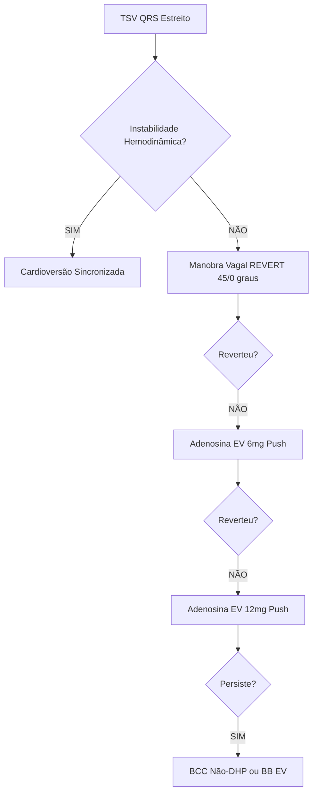

Aqui está o **Cheat Sheet Ultrabizurado** para a Prova de Título (TEMI/AMIB), focado exclusivamente no altíssimo rendimento à beira do leito e nas pegadinhas clássicas de prova sobre Taquicardias Supraventriculares (TSV).

---

# CHEAT SHEET TEMI / UTI: TAQUICARDIAS SUPRAVENTRICULARES (TSV) NO PACIENTE CRÍTICO

## 1. QUADRO CLÍNICO + EPIDEMIOLOGIA INTEGRADOS (FENÓTIPOS DE CHEGADA)

*   **Definição Operacional & Conceito Fisiopatológico Chave:** Taquiarritmias cujo circuito se origina **acima da bifurcação do feixe de His** (átrios/nó AV). Definidas por **FC > 100 bpm** e, na vasta maioria, **QRS Estreito (< 120 ms)**. A instabilidade decorre da falência de perfusão sistêmica, não do número da FC isolada.
*   **Fenótipos Sindrômicos de Chegada + Probabilidade Pré-Teste (Epidemio):**
    *   **[Fenótipo 1 - Secundário / Mascarado]:** Choque distributivo, sepse, hipovolemia disfarçados de arritmia primária. Início e fim *graduais* (warm-up/cool-down). → **Epidemio:** **Taquicardia Sinusal (TS) (~35%)** e Taquicardia Atrial Focal (TAF) (~4-10%).
    *   **[Fenótipo 2 - Clássico / Paroxístico]:** Paciente jovem, coração estruturalmente normal, palpitação súbita ("em clique"). → **Epidemio:** **TRN (20-60%)** e **TRAV (10-30%)**.
    *   **[Fenótipo 3 - Respiratório / Metabólico]:** DPOC exacerbado, acidose, hipóxia, distúrbio K/Mg. Início irregular. → **Epidemio:** **Taquicardia Atrial Multifocal (TAM)**.
    *   **[Fenótipo 4 - Fulminante / Catastrófico]:** Paciente instável, QRS largo, **RR bizarramente irregular e caótico**, **FC 350-600 bpm**. → **Epidemio:** Fibrilação Atrial Pré-Excitada (**FA + WPW**). Acesso direto aos ventrículos via feixe anômalo sem freio nodal.
*   **🚨 Pegadinhas de Exame Físico / Prova:**
    *   **Sinal da Rã (*Frog Sign*):** Pulsações venosas jugulares proeminentes (ondas 'a' em canhão) no pescoço. Típico da **TRN**, ocorre pela contração atrial contra valva tricúspide fechada.
    *   **Instabilidade Hemodinâmica (O Falso Positivo):** A magnitude isolada da frequência cardíaca (ex: **FC = 190 bpm**) **NÃO** caracteriza instabilidade! Instabilidade exige: Hipotensão/Choque, Rebaixamento do nível de consciência, Dor isquêmica ou EAP.

## 2. ETIOLOGIA + PESQUISA DIRECIONADA + PROPEDÊUTICA ARMADA

*   **O que NÃO pedir / NÃO fazer de rotina:** NÃO prescrever cronotrópicos negativos empíricos para Taquicardia Sinusal sem reverter a causa (risco de colapso). NÃO pedir exames invasivos na fase aguda de TSV estável antes de tentar bloqueio vagal/farmacológico.

| Grupo Etiológico / Mecanismo | Prevalência & Letalidade | Quando & Como Pesquisar (ECG) | Critério Exato e Eletrocardiográfico |
| :--- | :--- | :--- | :--- |
| **[TRN - Reentrada Nodal]** | ~20-60% (Mais comum QRS Estreito) | R-R Estritamente Regular, Início/Fim súbito. | **RP Muito Curto (< 70 ms)**; pseudo-r' em V1; pseudo-s em D2, D3, aVF. |
| **[TRAV - Ortodrômica]** | 90-95% das TRAVs | R-R Estritamente Regular. Desce Nó AV, sobe Feixe Anômalo. | **RP Curto (> 70 ms, porém RP < PR)**. Onda P' separada do QRS (no segmento ST/T). |
| **[TRAV - Antidrômica]** | 5-10% das TRAVs | Desce via acessória, sobe Nó AV. Mimetiza Taquicardia Ventricular (TV). | **QRS Largo (≥ 120 ms)**. Ritmo regular bizarro. |
| **[TAM - Atrial Multifocal]** | Exclusivo UTI/Enfermarias | Exacerbação DPOC; Hipocalemia (**K < 3.5**); Hipomagnesemia (**Mg < 2.0**); Intoxicação Xantinas. | R-R bizarramente irregular; **≥ 3 morfologias de P**; Linha isoelétrica mandatória (diferencia de FA/Flutter). |

## 3. ESTRATIFICAÇÃO QUE MUDA CONDUTA (GATILHOS DE AÇÃO RÁPIDA)

*   🔴 **[Gatilho Clínico]** TSV com Hipotensão, Dor anginosa, Síncope ou EAP → **[Diagnóstico]** TSV Instável → **[Conduta Imediata]** **Cardioversão Elétrica Sincronizada Imediata** (Botão SYNC obrigatório).
*   🔴 **[Gatilho ECG + Laboratório]** RR irregular + QRS estreito + 3 ondas P + pCO2 62, K 3.2, Mg 1.5 → **[Diagnóstico]** Taquicardia Atrial Multifocal (TAM) → **[Conduta Imediata]** Otimizar VM/VNI + Reposição agressiva de **MgSO4 intravenoso** + Suspender aminofilina. CVE é INEFICAZ.
*   🔴 **[Gatilho ECG + Clínico]** Falha da manobra vagal em TSV paroxística regular de QRS estreito com paciente estável → **[Diagnóstico]** Reentrada (TRN/TRAV) refratária ao vago → **[Conduta Imediata]** **Adenosina 6 mg EV** *push* rápido.
*   🔴 **[Gatilho ECG]** QRS francamente largo (≥ 120ms) + RR *absolutamente* caótico + FC > 250 bpm → **[Diagnóstico]** FA Pré-excitada (WPW) → **[Conduta Imediata]** **Cardioversão Elétrica Sincronizada** imediata (seja estável ou instável na UTI, não arrisque drogas).

## 4. WORKUP À BEIRA-LEITO (MONITORIZAÇÃO, GRÁFICOS E POCUS)

*   **ECG de 12 Derivações - A Regra do R-P (Chave Diagnóstica):**
    *   **RP < PR (Curto):** Ativação atrial retrógrada.
        *   Se *RP < 70 ms*: **TRN típica** (Onda P fundida ao QRS, gerando entalhe pseudo-r').
        *   Se *RP > 70 ms*: **TRAV ortodrômica** (Onda P visível atrasada no ST/T).
    *   **RP > PR (Longo):** Tempo ventrículo-atrial dilatado. Pensa em **Taquicardia Sinusal, TAF ou TRN atípica**.
*   **Síndrome de Wolff-Parkinson-White (Pré-excitação Basal - ECG):**
    *   **Intervalo PR Curto:** < 120 ms.
    *   **Onda Delta:** Empastamento da rampa ascendente do QRS.
    *   **QRS Alargado:** > 100 - 120 ms + Alterações secundárias de repolarização (ST/T).
*   **Detalhamento Prático da Manobra Vagal Modificada (Ensaio REVERT):**
    1.  Paciente sentado a **45º**.
    2.  Esforço expiratório contra êmbolo de seringa de 10 mL por **15 segundos** (pressão ~40 mmHg).
    3.  Término imediato dos 15s: Reclinar leito para **0º** e **elevar membros inferiores a 45º** por mais **15 segundos** (aumenta retorno venoso e potencializa reflexo barorreceptor). Sucesso passa de ~17% para **> 40%**.

## 5. TRATAMENTO POR PERFIL, INTERAÇÃO MULTISSISTÉMICA E FLUXO DECISÓRIO

### A. Fisiopatologia Aplicada ao Manejo (Fluxo Decisório)

### B. Manejo Direcionado por Perfil & Escolha Fina de Fármacos

*   **1ª Linha Farmacológica (Adenosina):**
    *   **Mecanismo:** Agonista dos receptores purinérgicos A1, causa bloqueio AV transitório ultra-rápido.
    *   **Posologia:** Dose inicial **6 mg EV** em *bolus ultrarrápido* (*push* direto), imediatamente seguido por *flush* de **20 mL de SF 0,9%** e elevação do membro por 10-20s.
    *   **Repique:** Sem resposta em 1-2 min → **12 mg EV** (Pode repetir 12-18 mg). Dose máxima cumulativa: **30 mg**.
    *   **🚨 Ajuste Fino (Pegadinha CVC):** Se acesso venoso central, **REDUZIR a dose inicial pela metade (3 mg)** para evitar assistolia prolongada.
    *   **Efeito Adverso Esperado:** Avisar paciente lúcido sobre *flushing*, sensação de morte iminente/opressão e broncoespasmo transitório.
*   **2ª Linha (Controle de Frequência em TAF/TRN/TRAV refratárias):**
    *   **BCC Não-Di-hidropiridínicos:** Diltiazem ou Verapamil EV.
    *   **Betabloqueadores (BB):** EV. Evitar se broncoespasmo ativo.

### C. Interação Multissistêmica na UTI (Coração-Pulmão)

*   **Encurtamento Diastólico:** FC extrema reduz drasticamente o tempo de perfusão coronariana diastólica e aumenta o MVO2. Em cardiopatias dependentes de enchimento diastólico lento (Estenose Mitral, ICFEP), causa perda crítica de débito sistólico.
*   **TAM vs. Pulmão:** O foco central do tratamento da Taquicardia Atrial Multifocal NÃO é o coração, mas eliminar os gatilhos: **reduzir hipercapnia (pCO2)**, corrigir hipoxemia e repor Mg2+ para estabilizar o sarcolema. O uso de antiarrítmicos convencionais aqui é erro crasso.

### D. O QUE É ESTRITAMENTE PROIBIDO NA FASE AGUDA (Iatrogenias Fatais)

1.  🚨 **[Erro Fatal 1 - Bloqueadores Nodais na FA Pré-Excitada (WPW)]:** Fazer **Adenosina, Verapamil, Diltiazem, Betabloqueador ou Digoxina** em FA com QRS largo por via acessória. O bloqueio nodal remove a refratariedade retrógrada e desvia 100% dos impulsos atriais (350-600 bpm) para a via anômala desprotegida → **Degeneração imediata para Fibrilação Ventricular (FV) e PCR.** Conduta correta: Cardioversão Elétrica Sincronizada.
2.  🚨 **[Erro Fatal 2 - CVE ou Amiodarona na Taquicardia Atrial Multifocal]:** Dar choque ou antiarrítmicos em TAM. A cardioversão é **completamente ineficaz e formalmente desaconselhada**, pois não há substrato reentrante anatômico estável, são múltiplos focos automáticos.
3.  🚨 **[Erro Fatal 3 - Cronotrópicos Negativos na Taquicardia Sinusal]:** Reduzir a frequência cardíaca (com BB ou Ivabradina) de um paciente em choque séptico ou hipovolêmico não compensado. A taquicardia é mecanismo compensatório de débito cardíaco; retirá-la gera **colapso hemodinâmico imediato**.
4.  🚨 **[Erro Fatal 4 - Massagem do Seio Carotídeo sem Checagem]:** Realizar compressão bilateral simultânea OU realizar compressão unilateral em pacientes com: sopro carotídeo, AVC/AIT nos últimos 3 meses ou doença ateromatosa carotídea conhecida.

## 6. TRANSIÇÃO DE CUIDADO, REAVALIAÇÃO & FOLLOW-UP

*   **Reavaliação Pós-Adenosina:** Avaliar o traçado durante o bloqueio nodal. Pode desmascarar as ondas P e revelar um diagnóstico oculto (Flutter Atrial ou Taquicardia Atrial Focal subjacente) sem interromper o circuito.
*   **Descalonamento e Alta:** Pacientes com TRN ou TRAV revertidas, com sucesso terapêutico na emergência/UTI e estabilidade clínica, devem ser encaminhados para **Investigação Eletrofisiológica Ambulatorial (Ablação de Via/Nó)**, visto ser uma arritmia curável.
*   **TAM Sustentada:** Reversão depende exclusivamente do desmame ventilatório bem-sucedido e estabilização do quadro respiratório de base. Sem indicação de antiarrítmico de manutenção.