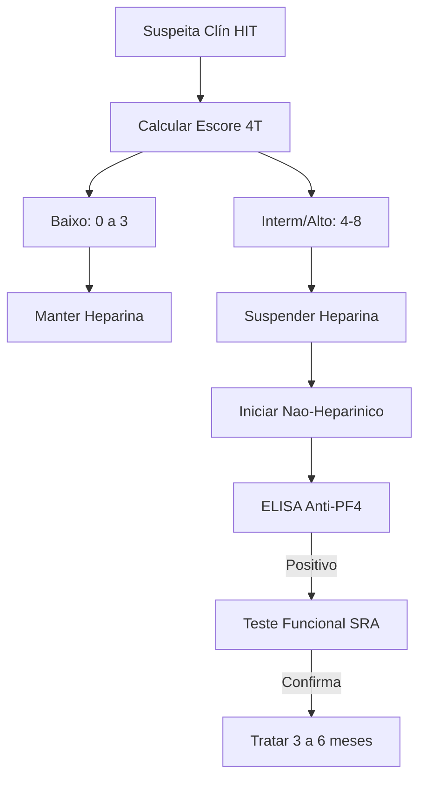

Aqui está o "Cheat Sheet Ultrabizurado", processado com rigor para a Prova de Título de Especialista em Medicina Intensiva (TEMI/AMIB) e para tomada de decisão em frações de segundos à beira do leito. Sem gordura, 100% acionável.

# CHEAT SHEET TEMI / UTI: COAGULOPATIA NA UTI (CIVD E HIT)

## 1. QUADRO CLÍNICO + EPIDEMIOLOGIA INTEGRADOS (FENÓTIPOS DE CHEGADA)

*   **Definição Operacional & Conceito Fisiopatológico Chave:** Distúrbio dinâmico do modelo celular da coagulação. Desequilíbrio entre hemostasia e fibrinólise gerando síndromes hemorrágicas severas ou micro/macrotrombóticas letais na fase aguda.
*   **A "Pegadinha" Fisiológica (Tríade Letal):** Antes de culpar fatores ou plaquetas, corrija o meio enzimático. A cascata falha com **Cálcio Iônico baixo** ($Ca^{2+}$ é cofator essencial), **Acidose** (inativa enzimas) e **Hipotermia** (retarda cinética e disfunciona plaquetas).
*   **Fenótipos Sindrômicos de Chegada:**
    *   **[Fenótipo 1 - Distúrbio Primário]:** [Sangramento Mucocutâneo: petéquias, equimoses, epistaxe, gengivorragia, sangramento prolongado em punções venosas]. $\to$ **Mecanismo:** Defeito no Tampão Plaquetário (Adesão/FvW, Ativação ou Agregação).
    *   **[Fenótipo 2 - Distúrbio Secundário]:** [Sangramento Profundo: hematomas musculares, hemartroses, retroperitoneal e intra-abdominal espontâneos]. $\to$ **Mecanismo:** Falha na Rede de Fibrina (Via Extrínseca [TAP/INR] ou Intrínseca [TTPA]).
    *   **[Fenótipo 3 - CIVD / Consumo]:** [Microtrombose + Isquemia Orgânica + Sangramento Grave Paradoxal]. $\to$ **Epidemio/Gatilhos:** Sepse grave, trauma severo, DPP (obstetrícia), pancreatite grave.
    *   **[Fenótipo 4 - HIT Tipo 2 - A Pegadinha Maior]:** [Plaquetopenia Severa + ZERO Sangramento + TROMBOSE Venosa/Arterial Grave]. $\to$ **Epidemio:** Ocorre em 5 a 14 dias de uso de heparina (ou dia 1 se exposição prévia < 3 meses).
*   **Classificação de Gravidade / Estratificação Dinâmica:**
    *   **Escore SIC (Sepsis-Induced Coagulopathy):** [Queda de Plaquetas + Aumento de INR + Escore SOFA]. Fenótipo inicial e brando da sepse.
    *   **Escore ISTH (CIVD Franca):** [Plaquetas < 50.000 + Alargamento TAP/TTPA + Fibrinogênio muito baixo + D-Dímero intensamente elevado + Esquizócitos (anemia microangiopática)].
    *   **Critério 4T (HIT):** [**T**hrombocytopenia: queda > 50% do basal | **T**iming: 5-10 dias | **T**hrombosis: nova ou necrose de pele | o**T**her causes: exclusão].

## 2. ETIOLOGIA + PESQUISA DIRECIONADA + PROPEDÊUTICA ARMADA

*   **O que NÃO pedir de rotina / Armadilhas de Investigação:** NÃO atrase a suspensão da heparina na suspeita de HIT aguardando painel imunológico. NÃO trate exames em CIVD se não houver sangramento ativo (exceto profilaxia extrema).

| Grupo Etiológico / Mecanismo | Fisiopatologia Chave | Quando & Como Pesquisar (Gatilho Clínico) | Critério Exato p/ Propedêutica Armada (Laboratório Específico) |
| :--- | :--- | :--- | :--- |
| **[CIVD]** | FT maciço $\to$ Hiperativação sistêmica $\to$ Microtrombos $\to$ Consumo | Sangramento ativo em vigência de Sepse, Trauma ou Neoplasia. | **Laboratório:** Plaq < 50k, Fibrinogênio baixo, D-Dímero muito alto, TAP/TTPA longos. |
| **[HIT Tipo 2]** | Imunológico. Complexo Heparina-PF4 $\to$ Anticorpos IgG $\to$ Ativa receptor Fc $\gamma$ RIIA $\to$ Degranulação maciça $\to$ Trombose. | Escore 4T $\ge$ 4 (Intermediário/Alto) + Uso de Heparina recente. | **Diagnóstico:** 1º Passo: ELISA (Anti-PF4). 2º Passo (Confirmação Ouro): SRA (Teste Funcional). |
| **[Disfunção Plaquetária]** | Falha na ponte de ligação ou liberação do FvW (adesão celular). | Sangramento de mucosa em doente com Uremia ou Estenose Aórtica (Síndrome de Heyde). | **Avaliação:** Sangramento clínico desproporcional à contagem de plaquetas (>100k mas não funcionam). |

*   **Fórmulas e Índices de Prova:**
    *   **TAP / INR:** Mede Via Extrínseca (Fator VII) e Comum. Altera precoce na insuficiência hepática e deficiência de Vitamina K (Fatores II, VII, IX, X).
    *   **TTPA:** Mede Via Intrínseca (Fatores VIII, IX, XI, XII). Alvo de ação principal da Heparina Não Fracionada (HNF).

## 3. ESTRATIFICAÇÃO QUE MUDA CONDUTA (GATILHOS DE AÇÃO RÁPIDA)

*   🔴 **[Gatilho Clínico: Queda de plaquetas > 50% entre 5º-14º dia de UTI]** $\to$ [Diagnóstico: Suspeita de HIT Tipo 2] $\to$ **[Conduta Salvadora Imediata: SUSPENDER toda heparina (incluindo flush de cateter) e iniciar anticoagulação alternativa não-heparínica].**
*   🔴 **[Gatilho Laboratorial: Sangramento Ativo + Fibrinogênio < 100 mg/dL]** $\to$ [Mecanismo Fisiopatológico: CIVD com alto consumo na rede de fibrina] $\to$ **[Ajuste Terapêutico: Transfundir Crioprecipitado IMEDIATAMENTE].**
*   🔴 **[Gatilho Hemodinâmico/Clínico: Uremia severa + Sangramento ativo de punções]** $\to$ [Disfunção primária reversível] $\to$ **[Conduta: Prescrever DDAVP para liberar FvW do endotélio $\pm$ Diálise].**

## 4. WORKUP À BEIRA-LEITO (MONITORIZAÇÃO, GRÁFICOS E POCUS)

*   **Exame Físico e Monitorização Invasiva:**
    *   Vigilância absoluta de microcirculação (isquemia de extremidades em vigência de HIT ou CIVD).
    *   Monitorização rigorosa da temperatura (alvo > 36ºC), pH (alvo > 7.20 na gasometria) e $Ca^{2+}$ (alvo normal) antes de liberar hemocomponentes.
*   **Checklist Mental de Imagem / POCUS (Perguntas Rápidas):**
    *   1. **[Rastreio Obrigatório em HIT]:** Fez o Escore 4T $\ge$ 4? **SOLICITAR USG Doppler de membros inferiores bilaterais**, *mesmo em doentes assintomáticos*, pela altíssima incidência de TVP subclínica/iminente colapso pulmonar.

## 5. TRATAMENTO POR PERFIL, INTERAÇÃO MULTISSISTÉMICA E FLUXO DECISÓRIO

### A. Fisiopatologia Aplicada ao Manejo (Fluxo Decisório HIT)

### B. Manejo Direcionado por Perfil & Escolha Fina de Fármacos

*   **Alvos Volêmicos e Hemoterápicos (Apenas se sangramento ativo / invasão):**
    *   **Plaquetas:** Manter $> 50.000$ (se sangrando/cirurgia) ou $> 10.000$ a $20.000$ (alvo profilático para evitar sangramento espontâneo no SNC).
    *   **Fibrinogênio:** Crioprecipitado se $< 100~mg/dL$.
    *   **TAP/TTPA alargado severo:** Complexo Protrombínico (CCP) ou Plasma Fresco Congelado (PFC).
*   **Escolha Fina de Fármacos (Droga A vs. Droga B):**
    *   **[Anticoagulantes na HIT - Classe de Ouro]:** HNF / HBPM estão PROIBIDAS. Usar **Fondaparinux** (inibidor seletivo Xa dependente de ATIII), **Argatroban** ou **DOACs** (Rivaroxabana/Apixabana - inibidores diretos anti-Xa).
    *   **[Reversores do Coágulo - Fibrinolíticos vs. Antifibrinolíticos]:** Alteplase (rTPA) ativa plasminogênio destruindo coágulo vs. **Ácido Tranexâmico** (análogo da lisina, bloqueia sítio de ligação do plasminogênio à fibrina, protegendo o coágulo da dissolução).
    *   **[Antiagregantes Plaquetários - Mecanismos Específicos]:** AAS (inibe COX-1/TXA2) vs. Clopidogrel (inibe receptor P2Y12 de ADP) vs. Tirofiban (bloqueio direto da ponte GP2b/3a).
    *   **[Varfarina]:** Cumarínico (bloqueia Vit K epóxido redutase, zerando fatores II, VII, IX, X). **Proibido iniciar na HIT aguda** (reduz Proteína C rápida $\to$ estado hipercoagulável agudo $\to$ gangrena venosa dos membros).

### C. Interação Multissistémica na UTI (Coração-Pulmão-Rim)

*   **Renal/Metabólico:** Pacientes com falência renal aguda grave (Uremia) desenvolvem disfunção qualitativa plaquetária (incapacidade de ligação do FvW). Respondem a Diálise e DDAVP.
*   **Hepático:** O fígado produz quase todos os fatores. Fator VII (avaliado pelo TAP/INR) tem a meia-vida mais curta (poucas horas). TAP alarga primeiro na disfunção hepática fulminante.

### D. O QUE É ESTRITAMENTE PROIBIDO NA FASE AGUDA (Iatrogenias Fatais)

1.  🚨 **[Erro Fatal 1 - Transfundir Plaquetas na HIT]:** A plaquetopenia da HIT não é por falta de produção, é imunoconsumo. Transfundir plaquetas = "Jogar gasolina no fogo", fornece mais substrato para trombose maciça e óbito. *Exceção: Sangramento com risco iminente de morte.*
2.  🚨 **[Erro Fatal 2 - Iniciar Varfarina precocemente na HIT]:** Causa depleção rápida de Proteína C (anticoagulante natural), levando à **Necrose Cutânea Fulminante** e Gangrena Venosa dos Membros. Só iniciar Varfarina quando plaquetas se recuperarem.
3.  🚨 **[Erro Fatal 3 - Tratar exames de coagulação no doente grave sem sangramento]:** Dar plasma para corrigir INR alterado sem intenção de intervir ou sangramento ativo gera sobrecarga de volume (TACO), TRALI e perpetuação da resposta inflamatória.
4.  🚨 **[Erro Fatal 4 - Esquecer da Tríade Letal]:** Transfundir bolsas e mais bolsas de sangue sem aquecer o paciente, dar cálcio empírico e reverter a acidose severa.

## 6. TRANSIÇÃO DE CUIDADO, REAVALIAÇÃO & FOLLOW-UP

*   **Marcos de Reavaliação (HIT):** Monitorar contagem diária de plaquetas após suspensão da heparina. O início do repique plaquetário indica resolução do consumo imunológico.
*   **Critérios de Alta e Retorno:**
    *   **Transição de Anticoagulação:** A introdução de Varfarina só é permitida após recuperação completa das plaquetas **($\ge 150.000$)**.
    *   **Tempo de Tratamento:** Caso a HIT tenha cursado com Trombose (arterial ou venosa), a anticoagulação plena deve ser mantida rigidamente por **3 a 6 meses**.