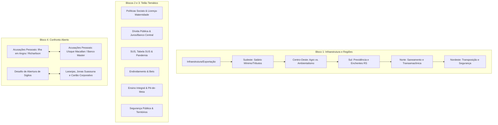
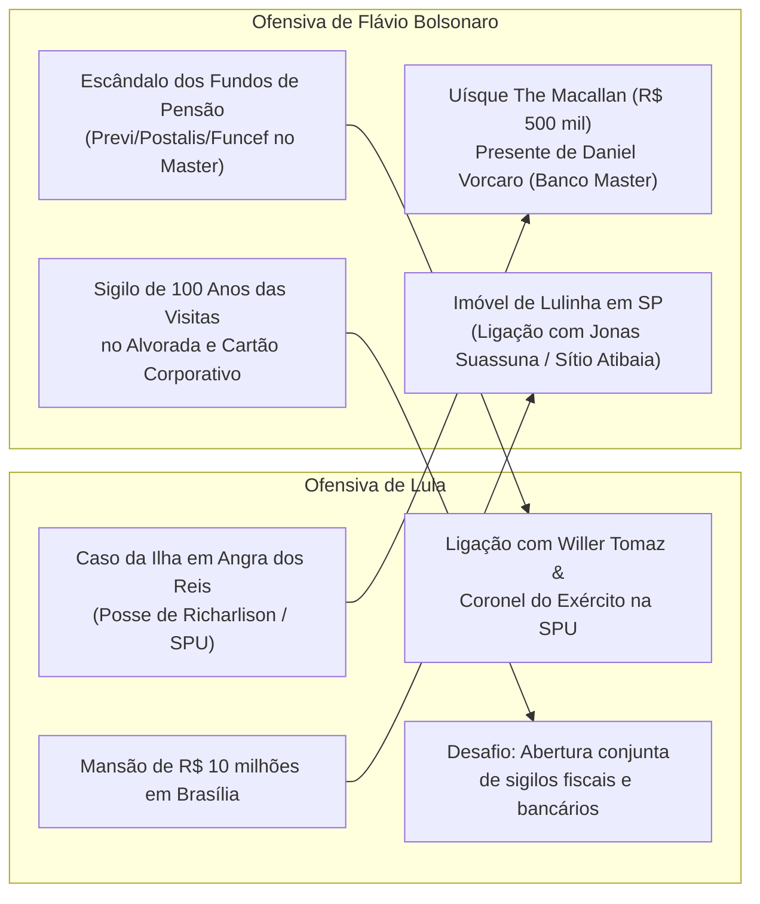

[[Rx Lula III]]

# Relatório Analítico: Debate Presidencial (2º Turno)
**Veículo:** TV Globo / Estúdios Globo  
**Mediação:** César Tralli  
**Candidatos:** Luiz Inácio Lula da Silva (PT) × Flávio Bolsonaro (PL)  
**Contexto Simulado:** Eleições Presidenciais 2026 — 2º Turno  

---

## 1. Visão Geral & Dinâmica Política

O debate expôs uma fratura geracional e metodológica: de um lado, **Lula (PT)** ancorou sua retórica no resgate histórico de legados sociais, grandes obras estatais (PAC, Transposição) e na deslegitimação moral do clã Bolsonaro via pautas da pandemia e milícias. De outro, **Flávio Bolsonaro (PL)** adotou a estratégia do "choque de realidade do presente", explorando a perda do poder de compra (inflação de alimentos, "reduflação", endividamento) e apresentando um programa de segurança pública abertamente hiper-punitivista, associado a promessas de modernização liberal (ensino técnico, inteligência artificial, microcrédito bancário).

---

## 2. Bloco 1 — Temas Regionais e Infraestrutura

### 2.1. Infraestrutura e Exportações (Sorteado para Lula)
* **Pergunta (Flávio Bolsonaro):** TCU apontou mais de 11.500 obras paralisadas no governo atual. Como promete destravar a infraestrutura do mapa se o país voltou a ser um "cemitério de obras"?
* **Resposta (Lula):**
  * Afirma ter lançado o novo PAC de R$ 1,7 trilhão (com R$ 800 bi já executados).
  * Argumenta que herdou 6.000 obras paradas da gestão anterior.
  * Obras estruturantes não se encerram em um único mandato de quatro anos.
* **Réplica (Flávio Bolsonaro):**
  * Promessa de "rasgar o Brasil de ferrovias": conclusão da Transnordestina (ligando a Suape e Pecém) e Ferrovia FICO/FIOL.
  * Integração do Centro-Oeste ao Oeste do Paraná e Santa Catarina para baratear o escoamento de suínos e grãos.
  * Isenção total de pedágio para motociclistas em todas as novas concessões rodoviárias.
  * Classificação de internet como infraestrutura básica (promessa de conectividade em aldeias, postos de saúde e escolas).
* **Tréplica (Lula):**
  * Compara o adversário a um "aluno que decora, mas não aprende".
  * Cita obras em andamento: BR-319 (Porto Velho–Manaus), Serra das Araras (RJ), Contorno de Florianópolis, Túnel Santos–Guarujá, VLT de Salvador e metrô de SP/BH.
* **Buracos e Omissões:**
  * Lula não explicou a métrica concreta do relatório recente do TCU sobre as 11.500 obras paralisadas.
  * Flávio não detalhou a fonte orçamentária para a expansão ferroviária prometida sem romper o equilíbrio fiscal.

---

### 2.2. Região Sudeste (Sorteado para Flávio)
* **Pergunta (Lula):** O adversário tem noção de quanto seria o salário mínimo em SP e no Sudeste se não fosse a política de valorização do PT (acima da inflação)?
* **Resposta (Flávio Bolsonaro):**
  * Evasão da pergunta direta: foca no poder de compra corroído ("hoje é dia 23 de outubro, o seu salário já acabou?").
  * Culpa o governo pela gastança pública que força o Banco Central a manter juros altos, encarecendo a dívida das famílias.
* **Réplica (Lula):**
  * Afirma que o mínimo seria de apenas R$ 900 se seguisse a regra de Temer/Bolsonaro (sem reajuste real).
  * Emenda com proposta de Tarifa Zero nos transportes aos fins de semana após o fim da escala 6x1.
* **Tréplica (Flávio Bolsonaro):**
  * Declara-se a favor da Tarifa Zero nos fins de semana.
  * Denuncia a reforma tributária e a projeção do IVA em 28%: "Lula dá com uma mão e tira com os nove dedos".
  * Denuncia a reduflação nos mercados: dúzia de ovos vendida com 10 unidades, sabão em pó reduzido de 1kg para 800g, barra de chocolate de 80g e papel higiênico reduzido.
* **Buracos e Omissões:**
  * Flávio não rebateu o número histórico do salário mínimo e usou a réplica para introduzir o fenômeno da reduflação.
  * Lula teve sobra de tempo por má gestão de cronômetro, gerando atrito procedimental com a moderação.

---

### 2.3. Região Centro-Oeste (Sorteado para Lula)
* **Pergunta (Flávio Bolsonaro):** Por que o governo trata o agronegócio com raiva, chama o setor de "fascista" e sufoca os produtores com crédito caro no Plano Safra?
* **Resposta (Lula):**
  * Afirma ter realizado os maiores Planos Safra da história tanto para o agronegócio quanto para a agricultura familiar.
  * Argumenta abertura de 700 novos mercados internacionais em 57 países e superávit comercial próximo a US$ 85 bi.
  * Ironiza a política externa anterior ("lambedeira do Trump").
* **Réplica (Flávio Bolsonaro):**
  * Apresenta credenciais pessoais (advogado, pós-graduado, senador).
  * Afirma que os juros reais do Plano Safra chegam a quase 20% com custos burocráticos; promete seguro rural com previsibilidade e blindagem contra contingenciamento.
  * Digitalização da aposentadoria rural no INSS para eliminar filas.
  * Questiona Lula: "Qual foi a última vez que você foi a um supermercado?".
* **Tréplica (Lula):**
  * Explica que os juros do crédito agrícola são equalizados pelo Tesouro/BNDES/Banco do Brasil, não seguindo a Selic cheia.
  * Afirma que o incômodo da oposição decorre da inclusão social da classe trabalhadora e das políticas contra a fome (33 milhões de famintos herdados).
* **Buracos e Omissões:**
  * Lula não respondeu sobre a retórica pejorativa atribuída a membros de sua base contra o agronegócio tradicional.
  * Flávio ignorou os dados de recorde de exportação e abertura de novos mercados internacionais do agro.

---

### 2.4. Região Sul (Sorteado para Flávio)
* **Pergunta (Lula):** O Sul concentra a maior proporção de aposentados. Pergunta se o candidato vai ou não reajustar o salário mínimo e aposentadorias (inclusive BPC) acima da inflação ou se vai aplicar a "motosserra" de Javier Milei.
* **Resposta (Flávio Bolsonaro):**
  * Garante que manterá o reajuste acima da inflação para aposentados e salário mínimo.
  * Afirma que não privatizará Caixa, Banco do Brasil ou Petrobras.
  * Critica a herança deixada pela esquerda na Argentina (inflação de 211% e pobreza de 40%) que forçou medidas drásticas de Milei.
* **Réplica (Lula):**
  * Pressiona para que o adversário responda de forma taxativa se o reajuste real valerá para os 26 milhões de beneficiários do INSS ou se desindexará a folha.
* **Tréplica (Flávio Bolsonaro):**
  * Reitera o compromisso com o reajuste acima da inflação.
  * Explora a tragédia climática do Rio Grande do Sul (2024), acusando o governo de ter abandonado municípios (cita visita a Sarandi e Porto Alegre).
  * Promete pactos com governadores: Zucco (RS, reconstrução e diques), Sergio Moro (PR, segurança portuária em Paranaguá com a Marinha) e Jorginho Mello (SC, rodovias federais).
* **Buracos e Omissões:**
  * Lula não respondeu às críticas sobre a resposta federal às enchentes do RS de 2024.
  * Flávio evitou detalhar a equação fiscal: como conceder ganho real a todas as aposentadorias e manter o equilíbrio orçamentário sem aumento de arrecadação.

---

### 2.5. Região Norte (Sorteado para Lula)
* **Pergunta (Flávio Bolsonaro):** 90 milhões de brasileiros sem esgoto e 40 milhões sem água tratada. Por que a bancada do PT votou contra o Marco Legal do Saneamento Básico?
* **Resposta (Lula):**
  * Acusa o adversário de desconhecer a região e lembra o episódio da pandemia em que Jair Bolsonaro imitou pessoas com falta de ar durante a crise de oxigênio em Manaus.
  * Aponta investimentos federais em portos, aeroportos, saúde e estradas no Amazonas.
* **Réplica (Flávio Bolsonaro):**
  * Ironiza a dependência de Lula ao Google: "Quem governa o Brasil, você ou o Google?".
  * Promete atingir as metas de 90% de saneamento até 2033; compromisso com saneamento em Belém (parceria com Dr. Daniel).
  * Promessa de asfaltar a Transamazônica (região de Altamira), acusando órgãos ambientais federais de travarem licenças.
  * Defesa da Zona Franca de Manaus aliada a investimentos em Data Centers e exploração do gás da bacia amazônica para fertilizantes.
* **Tréplica (Lula):**
  * Rebate a política ambiental bolsonarista ("passar a boiada" de Ricardo Salles).
  * Sustenta que a bioeconomia e a floresta em pé geram mais valor do que pasto ou mineração ilegal; celebra a reativação do Fundo Amazônia.
* **Buracos e Omissões:**
  * Lula esquivou-se completamente de explicar por que o PT votou contra o Marco Legal do Saneamento de 2020.
  * Flávio não esclareceu como conciliará a aceleração do licenciamento da Transamazônica e exploração de gás com compromissos climáticos internacionais.

---

### 2.6. Região Nordeste (Sorteado para Flávio)
* **Pergunta (Lula):** Relembra investimentos históricos na região (expansão universitária, ITA no Ceará, polo automotivo, Transposição). Questiona o que o governo anterior fez pelo Nordeste além de tratá-lo com desdém.
* **Resposta (Flávio Bolsonaro):**
  * Diz que "o Nordeste não é problema, é solução" e que será "o carioca mais nordestino".
  * Tenta desmentir a narrativa do vídeo de deboche de Bolsonaro na Covid, afirmando que o vídeo fora descontextualizado.
  * Ataca a expansão do crime organizado: afirma que o PT e governadores aliados entregaram o Nordeste ao Comando Vermelho.
* **Réplica (Lula):**
  * Desafia o candidato a citar uma única grande obra estruturante entregue por Bolsonaro na região Nordeste.
* **Tréplica (Flávio Bolsonaro):**
  * Reivindica para Jair Bolsonaro a entrega final das águas da Transposição do São Francisco.
  * Defende o Auxílio Brasil de R$ 600 em substituição ao antigo Bolsa Família de R$ 190.
  * Promete criar a "Rampa de Transição": manter o benefício social temporariamente para quem arrumar emprego formal ou virar MEI.
  * Promete ferrovia litorânea de passageiros entre Salvador e São Luís para fomentar o turismo.
* **Buracos e Omissões:**
  * Ambos disputam os louros da Transposição do São Francisco sem admitir os atrasos de cronograma em ambas as gestões.
  * Lula não abordou a crise crônica de segurança pública e a hegemonia das facções no Nordeste.

---

## 3. Blocos 2 e 3 — Temas do Telão

| Tema Escolhido | Quem Escolheu | Proposta Central / Argumento (Flávio) | Proposta Central / Argumento (Lula) | Fator Crítico / Evasão |
| :--- | :--- | :--- | :--- | :--- |
| **Políticas Sociais** | Lula | Admite erro passado ao votar contra licença-maternidade; promete "Casa da Mulher Brasileira" e tornozeleira/botão do pânico para agressores. | Cobra coerência do voto passado de Flávio; questiona a expressão pejorativa "Bolsa Farelo" usada pela oposição no passado. | **Incidente:** Flávio usa o termo depreciativo *"nove dedos"*, gerando protesto indignado de Lula e direitos de resposta mútuos concedidos. |
| **Dívida Pública** | Flávio | Criar o *"Banco da Prosperidade"* na Caixa: compra de dívidas bancárias das famílias e renegociação com carência de 6 meses (PF) e 1 ano (PJ). | Afirma que a proposta copia o programa *"Desenrola"*; sustenta que a dívida diminui através do crescimento do PIB e aumento do emprego, não com teto fiscal. | Lula não explicou a curva ascendente da Dívida Bruta/PIB no atual mandato; Flávio não detalhou como o Tesouro lastreará a compra massiva de carteiras inadimplentes. |
| **SUS** | Lula | Reajuste da Tabela SUS (médico recebe R$ 10 por consulta; parto R$ 443), espelhando a Tabela SUS Paulista; renegociação das dívidas das Santas Casas. | Exalta o papel do SUS na pandemia contra a gestão negacionista de Bolsonaro; questiona planos da oposição de privatizar ou cobrar pelo atendimento público. | Flávio evitou dar custo fiscal ao reajuste nacional da Tabela SUS; Lula usou a pauta da pandemia como escudo para evitar dados sobre as filas atuais oncológicas. |
| **Endividamento** | Flávio | Denuncia 80 milhões de negativados e juros bancários altos; critica o Desenrola e alerta para amortização negativa nos financiamentos da Caixa. | Anuncia nova etapa de leilão de dívidas pelo Desenrola com deságio de 95% e perdão de R$ 15 bi de dívidas de MEIs; ataca a destruição da renda familiar pelas bets. | Flávio tocou na fratura da classe média (financiamento imobiliário e parcelamento de comida); Lula defendeu a regulação das bets mas ignorou o rombo causado antes de agir. |
| **Ensino Integral** | Lula | Promete manter Pé-de-Meia e FIES; criar o Auxílio-Creche na rede privada; ensino técnico/IA no contraturno; e-Sports nos jogos escolares e modelo dual (escola/empresa). | Meta de 100% de escolas integrais até o ensino médio; expansão do Pé-de-Meia para universitários; retomada de 5.600 creches e escolas abandonadas. | Debate foi parcialmente sequestrado por ataques cruzados sobre cassinos online/bets ("Jogo do Tigrinho" e "Lulinha"). |
| **Retomada de Territórios** | Flávio | Classificar PCC e Comando Vermelho como *"Narcoterroristas"*; penas de até 80 anos; trabalho obrigatório em presídios; maioridade penal aos 14 anos para estupro; castração química. | Evoca o assassinato da menina Ana Clara (5 anos) por tiro policial para questionar a postura de Flávio com a PM; defende a PEC da Segurança Pública e criação de Ministério específico. | **Momento Mais Tenso:** Confronto ético sobre a letalidade policial e o controle territorial das facções versus a blindagem política de milícias. |

---

## 4. Bloco 4 — Tema Livre e Confronto Direto

No formato de banco de tempo (8 minutos livres para cada candidato), o debate abandonou o verniz programático e degenerou em um embate de denúncias de corrupção, patrimônio pessoal e conexões criminais.

### Mapa de Ataques Cruzados

### Detalhamento dos Pontos Levantados

1. **A Ilha de Angra dos Reis (Caso Richarlison):**
   * *Acusação (Lula):* O jogador Richarlison teria sido lesado na compra de uma ilha em Angra dos Reis por manobras de Willer Tomaz (advogado ligado a Flávio), beneficiado por decisão rápida de um coronel do SPU indicado pela bancada bolsonarista.
   * *Defesa (Flávio):* Alega que o caso transitou em julgado na Justiça a favor do proprietário legal; nega sociedade com Willer Tomaz e diz que o atleta foi induzido a erro por invasores de terra.

2. **O Uísque de R$ 500 mil e o Banco Master:**
   * *Acusação (Flávio):* Acusa Lula de receber uma garrafa de uísque escocês *The Macallan* avaliada em R$ 500 mil de Daniel Vorcaro (controlador do Banco Master), relacionando o agrado a aportes de R$ 10 bilhões dos fundos de pensão estatais (Previ, Petros, Funcef) no banco.
   * *Defesa (Lula):* Nega veementemente a acusação ("deve ter ido para sua casa"), acusa a oposição de ter inventado banqueiros escusos e sustenta que as instâncias de governança dos fundos são autônomas.

3. **O Desafio dos Sigilos:**
   * *Lula:* Propõe que ambos compareçam à Justiça no dia seguinte para abrir simultaneamente todos os sigilos fiscais, bancários e de familiares (inclusive de seus filhos e esposas).
   * *Flávio:* Aceita retoricamente o desafio, mas devolve exigindo a abertura imediata dos gastos com cartão corporativo do atual mandato e a lista de entradas no Palácio da Alvorada sem sigilo de 100 anos.

---

## 5. Considerações Finais e Recursos Retóricos

### Luiz Inácio Lula da Silva (PT)
* **Tática de Encerramento:** Resgate memorialístico e apelo emocional. Pediu desculpas ao público pelas ofensas trocadas no estúdio; relembrou sua trajetória desde a infância paupérrima (vendedor de laranjas/tapioca e torneiro mecânico) até a presidência.
* **Linha Divisória:** Enquadrou o pleito como um plebiscito existencial entre a manutenção da "democracia institucional" e a entrega do poder a "um grupo ligado a milícias".

### Flávio Bolsonaro (PL)
* **Tática de Encerramento:** Apelo moral e religioso combinado a garantias materiais. Conectou a eleição à herança de Jair Bolsonaro; prometeu foco total no poder de compra popular e na desarticulação do crime violento nas periferias.
* **Gesto Simbólico:** Encerrou convocando a audiência a rezar um *Pai-Nosso*, buscando consolidar o eleitorado conservador cristão e conectando segurança pública ao direito da família de "colocar a cadeira na calçada e ver o pôr do sol em paz".

---

## 6. Avaliação Crítica Independente

| Eixo Analítico        | Candidato: Flávio Bolsonaro                                                                                                                                                                                                                                                                   | Candidato: Luiz Inácio Lula da Silva                                                                                                                                                                                                                                                    |
| :-------------------- | :-------------------------------------------------------------------------------------------------------------------------------------------------------------------------------------------------------------------------------------------------------------------------------------------- | :-------------------------------------------------------------------------------------------------------------------------------------------------------------------------------------------------------------------------------------------------------------------------------------- |
| **Pontos Fortes**     | Explorou com precisão a deterioração econômica imediata sentida na ponta (inflação de supermercado, distorções da reduflação, aperto dos juros); demonstrou preparo técnico ao citar tabelas e projetos em São Paulo (Tarcísio); pautou segurança pública com medidas de forte apelo popular. | Manteve postura dominante ao cobrar explicações sobre o histórico legislativo do rival; usou com eficácia emocional a tragédia da Covid-19 e o caso Ana Clara para frear o discurso de lei e ordem do adversário; reforçou sua biografia popular.                                       |
| **Vulnerabilidades**  | Deslizou para o ataque pessoal físico (*"nove dedos"*), perdendo tempo de exposição e gerando direitos de resposta evitáveis; demonstrou desconforto evidente ao ser confrontado sobre o caso do SPU/Angra dos Reis e suas conexões políticas com milícias no RJ.                             | Evidenciou cansaço em temas contemporâneos de gestão microeconômica (regulamentação de bets, juros bancários, tabela SUS); recorreu reiteradamente ao artifício de mandar o eleitor "dar um Google" para não responder sobre dados desfavoráveis do TCU e do Marco Legal do Saneamento. |
| **Saldo Estratégico** | Conseguiu nacionalizar o modelo paulista (Tarcísio de Freitas) como fiador de sua capacidade de gestão, afastando parcialmente a imagem de inexperiência executiva, embora tenha terminado o debate enredado em denúncias patrimoniais.                                                       | Falhou em apresentar uma visão de futuro inovadora para o país além do aprofundamento de programas pré-existentes (PAC, Pé-de-Meia, Desenrola), apostando todas as fichas no antipetismo vs. antibolsonarismo tradicional.                                                              |