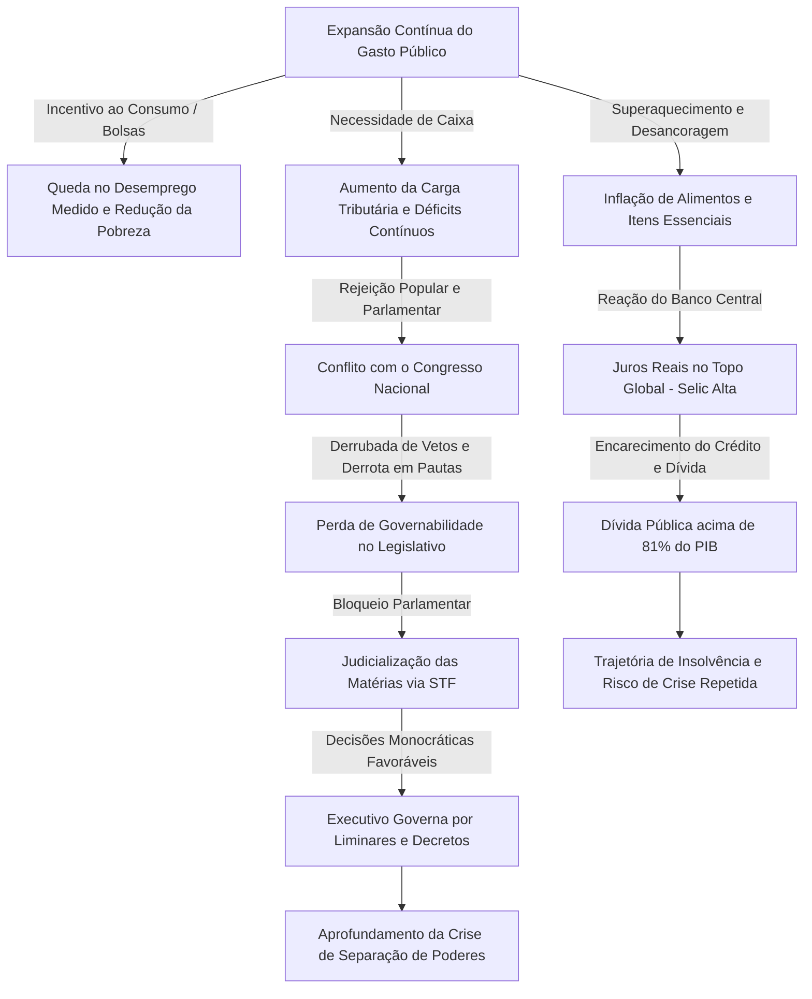

# Dossier de Análise: Raio-X do Governo Lula 3 — Fatos, Tensões Institucionais e Impasse Fiscal

> **Classificação:** Análise Crítica Independente / Jornalismo Investigativo  
> **Tema Central:** Balanço do terceiro mandato de Luiz Inácio Lula da Silva, contrastando indicadores oficiais, articulação política, narrativa de campanha e sustentabilidade fiscal.

---

## 1. Síntese Executiva

O material articula uma investigação retrospectiva e prospectiva sobre o governo Lula 3 (projetando o encerramento do mandato rumo ao ciclo eleitoral de 2026). A tese central sustenta que, sob a superfície de indicadores macroeconômicos tradicionalmente populares (queda do desemprego, crescimento do PIB e redução da pobreza), opera uma **engrenagem de alto risco fiscal e institucional**: explosão de gastos primários, inflação no custo de vida de itens básicos, aumento recorde de carga tributária e judicialização sistemática do processo político via Supremo Tribunal Federal (STF) para contornar um Congresso hostil.

---

## 2. Tópicos Temáticos & Fatos Apresentados

### 2.1. Macroeconomia: O Paradoxo dos Números vs. Sensação de Piora
* **Indicadores Oficiais Apresentados:**
  * **Desemprego:** Recuo de **7,9%** para **5,1%** (mínima histórica da série).
  * **Subutilização da Força de Trabalho:** Queda de **18,5%** para **12,9%**.
  * **Desalento:** Queda de **3,7 milhões** para **2,3 milhões** de pessoas.
  * **PIB:** Crescimento médio próximo a **3% ao ano** no primeiro triênio (acima da média histórica brasileira recente de 2,2% e da média global).
  * **Pobreza e Fome:** Pobreza caiu de **31,6%** para **23,1%**; extrema pobreza recuou de **5,9%** para **3,5%**; saída do Mapa da Fome da ONU (<2,5% da população em subnutrição severa).
* **O Contraponto Técnico & Percepção Popular:**
  * **Metodologia de Desemprego:** Argumenta-se que a expansão de programas sociais (Bolsa Família, Pé-de-Meia) retira de 60 a 90 milhões de pessoas da busca ativa por trabalho; pela metodologia do IBGE/PNAD Contínua, quem não busca ativamente não conta como desempregado, gerando escassez artificial de mão de obra de base (construção civil e agro).
  * **A Ruptura na Renda da Classe Média:** Apesar do PIB em alta, pesquisa indica que **42% dos brasileiros relataram piora financeira** pessoal (salto de 23 pontos na percepção de piora em 7 meses), contra 38% que sentiram melhora.
  * **Custo dos Essenciais:** Alta concentrada em alimentos básicos (café, carnes), combustíveis e tarifas de energia elétrica.

---

### 2.2. A Dinâmica Fiscal: Expansão de Gastos e Conflito com o Banco Central
* **Gasto Primário Contínuo:** Trajetória de despesas federais em aceleração constante, repetindo os padrões de Lula 1 e Dilma 1 (com taxa de crescimento real acima de 6% a.a.).
* **Divergência entre Política Fiscal e Monetária:**
  * O Executivo injeta liquidez (estímulo ao consumo, crédito direcionado via bancos públicos, aumento real do salário mínimo e liberação de mais de R$ 185 bilhões em medidas de alívio no ano pré-eleitoral).
  * O Banco Central (com diretorias indicando desancoragem de expectativas) vê a economia rodando acima do potencial e é forçado a elevar a taxa Selic para frear a inflação.
  * **Resultado:** O Brasil consolida uma das maiores taxas de **juros reais** do mundo, encarecendo o crédito produtivo, financiamento imobiliário e os aluguéis (alta acumulada de 57% desde o fim de 2022).
* **Evolução da Dívida:** Dívida bruta superando **81,9% do PIB** (acima de R$ 10,8 trilhões), com projeções de déficits nominais consolidados da ordem de 10% do PIB (R$ 1,3 trilhão) quando computados os juros da dívida.

---

### 2.3. Carga Tributária e a "Taxa das Blusinhas"
* **Esforço Arrecadatório:**
  * Recorde nominal consecutivo de arrecadação da Receita Federal (atingindo 32,4% do PIB).
  * Registro de **43 iniciativas do Executivo** para aumentar impostos ou alíquotas (36 aprovadas pelo Congresso).
* **O Caso Remessa Conforme / Compras Internacionais:**
  * Fixação de ICMS estadual padrão (17%) e criação do tributo de 20% sobre compras até US$ 50, que somados elevam a carga real sobre o e-commerce de varejo popular para patamares entre 44% e quase 90% (acima de US$ 50).
  * **Inconsistência de Narrativa:** Defesa inicial de que o imposto "recaía sobre empresas e não consumidores" (tese desmentida na prática de cobrança na fonte); veto e manobras parlamentares com apoio velado da base governista; posterior manobra via Medida Provisória em ano eleitoral para reduzir os 20%, visando recuperar capital político sem desarmar o arcabouço fiscal consolidado.

---

### 2.4. Transparência, Sigilos e Cumprimento do Plano de Governo
* **Contradição do "Sigilo de 100 Anos":**
  * Campanha focada na abertura de sigilos impostos na gestão Bolsonaro (revisão de casos como o cartão de vacinação).
  * Na prática de gestão, **1.339 pedidos de Lei de Acesso à Informação (LAI)** receberam negativa com sigilo centenário no primeiro ano (superando os 1.332 do último ano da gestão anterior).
  * **99,5% das despesas** do Cartão de Pagamento do Governo Federal (cartão corporativo da Presidência), totalizando mais de R$ 55 milhões, foram mantidas em sigilo sob justificativa de segurança institucional.
* **Placar de Promessas (Levantamento G1):** 26 compromissos cumpridos de 36 monitorados, centrados em reajuste do Bolsa Família, faixa de isenção de IR, ganho real no salário mínimo e Minha Casa Minha Vida.

---

### 2.5. Meio Ambiente e Crise Humanitária
* **Luzes:** Redução de quase 50% nos índices de desmatamento consolidado na Amazônia Legal (dados do INPE).
* **Sombras:**
  * **2024 registrou o pior índice de queimadas** na Amazônia em 41 anos (15,8 milhões de hectares atingidos).
  * **Território Yanomami:** Apesar de o governo ter classificado as omissões do mandato anterior como "genocídio", a taxa média mensal de mortes indígenas aumentou 17% durante a atual gestão, com a PF e o Ministério da Saúde divergindo sobre subnotificação pregressa vs. falhas estruturais de socorro contínuo.

---

### 2.6. Comunicação, Verbas Públicas e Discursos Polêmicos
* **Comportamento Verbal & Mídia:** Declarações problemáticas do presidente (associação entre futebol e violência contra a mulher em tom jocoso; comentários depreciativos ou estereotipados sobre raça e estética) foram tratadas pela imprensa corporativa majoritariamente sob a rubrica atenuada de "gafes".
* **Distribuição de Publicidade Oficial:**
  * Aumento expressivo do gasto com verbas federais de mídia: a TV Globo recebeu R$ 461 milhões nos três primeiros anos de Lula 3 (contra R$ 228 milhões no período correspondente sob Bolsonaro).
  * Recomposição de verbas publicitárias em estatais (Petrobras +79% acima da inflação; bancos públicos +14% a.a.) e captação recorde via Lei Rouanet (R$ 3,4 bilhões/ano).

---

### 2.7. Política Externa e Alinhamentos Ideológicos
* **Gaza e Israel:** Ruptura diplomática após o presidente comparar as operações militares de Israel na Faixa de Gaza ao extermínio nazista no Holocausto, resultando no status de *persona non grata* e apoio à denúncia da África do Sul na Haia.
* **Geopolítica Autocrática:**
  * Abstenção em votações que condenavam violações de direitos humanos em regimes aliados históricos da esquerda latino-americana (Nicarágua de Ortega, Venezuela de Maduro) e do Oriente Médio (Irã).
  * Relativização da invasão da Ucrânia pela Rússia, recepção a Sergei Lavrov e posicionamentos ambíguos na ONU.
* **Relações Comerciais e Tarifas:** Acomodação pragmática comercial com a China (R$ 27 bilhões em investimentos e desvio do fluxo de exportações de commodities) em contraposição à volatilidade tarifária temporária aplicada pelo governo Trump nos EUA.

---

### 2.8. Casos de Investigação e Escândalos Administrativos
* **Fraude no INSS:** Desvios estimados pela PF em até R$ 6,3 bilhões via mensalidades associativas não autorizadas diretamente descontadas de aposentados (esquema operacionalizado entre 2019 e 2024, atingindo ambas as gestões). Prisão da cúpula do órgão e demissão ministerial.
* **Inquéritos sobre Fábio Luís Lula da Silva (Lulinha):** Investigações no STF a partir de relatórios da PF que apontam intermediação de interesses empresariais no governo. Contradição pública do presidente ao negar conhecer lobistas que apareciam ao seu lado em registros fotográficos.
* **Baixas Ministeriais:** Seis ministros desligados no mandato sob suspeitas de conflito de interesses, uso indevido de emendas ou contratos com instituições financeiras sob escrutínio (caso Banco Master envolvendo nomes como Lewandowski e Jaques Wagner).

---

### 2.9. Segurança Pública e o Congelamento no Legislativo
* **Fato:** Redução da taxa de mortes violentas para menos de 20 por 100 mil habitantes, contudo em curva descendente contínua originada em 2018.
* **Crise de Narrativa:** O tema com pior avaliação do governo em pesquisas de opinião. Contradições geradas pela recepção da "Dama do Tráfico" em dependências ministeriais com custeio público e resistência retórica do Planalto em rotular facções do narcotráfico como organizações terroristas.
* **Derrotas Acachapantes no Congresso:** Veto presidencial à restrição das "saidinhas" de presos derrubado por 314 a 126; aprovação da Lei Antifacção elaborada pela oposição por 370 a 110.

---

### 2.10. Relação com os Poderes: O Balcão de Emendas e o "Triunvirato STF"
* **Esfacelamento da Frente Ampla:** O PT monopolizou ministérios de ponta e quase 40% do orçamento discricionário, esvaziando o apoio programático de partidos de centro.
* **Hipertrofia das Emendas Parlamentares:** Emendas saltaram de R$ 25 bilhões (2022) para R$ 47 bilhões (2025), controlando quase 30% da despesa discricionária federal. Auditorias do TCU identificaram irregularidades em 82% das Emendas Pix auditadas.
* **Derrota Histórica no Senado:** Rejeição do indicado Jorge Messias para o STF em plenário (42 votos contrários a 34 a favor), marcando a primeira negativa do Senado a uma nomeação à Suprema Corte desde 1894.
* **Judicialização Compensatória:** Bloqueado pelo Congresso em pautas centrais (PL das Fake News, IOF, desonerações), o Executivo recorreu à AGU perante o STF, alcançando vitória em **89% das ações de controle concentrado** e recuperando cerca de R$ 1 trilhão em disputas fiscais pela via monocrática ou colegiada do Judiciário.

---

## 3. Fluxograma: A Engrenagem Fiscal-Institucional do Governo

---

## 4. Auditoria Jornalística: Fragilidades e Buracos Argumentativos

Como postura de jornalismo analítico sênior, identificam-se assimetrias e falhas de sustentação técnica em ambos os polos da narrativa:

### A. Fragilidades do Discurso Crítico (Vídeo/Oposição)
1. **Atribuição Monocausal da Queda do Desemprego:** Sustentar que a taxa de 5,1% deve-se primariamente à retirada de pessoas do mercado pelos benefícios sociais carece de rigor demográfico integral. Ignora-se a criação líquida recorde de postos de trabalho formais (CAGED/carteira assinada representou 60% do incremento), expansão real da massa salarial e o impacto da retomada de serviços pós-pandemia.
2. **Ciclo Pecuário e Alimentos:** A alta dos alimentos é atribuída unicamente à política do governo, negligenciando oscilações climáticas globais agudas (secas históricas no Brasil Central), choques geopolíticos internacionais em insumos e a fase biológica de retenção de matrizes do ciclo de corte da pecuária.
3. **Generalização da Dívida Externa vs. Interna:** Comparar o endividamento brasileiro com potências de moeda de reserva global (EUA e Japão) é metodologicamente desonesto por parte do governo, mas a crítica da oposição peca ao tratar a dívida pública em reais com o mesmo perfil de risco de solvência imediata de uma dívida corporativa em moeda estrangeira.

### B. Fragilidades da Defesa do Governo (Planalto/Lula)
1. **Distorção de Registros Históricos:** Na sabatina veiculada, a alegação de Lula de que foi "o único a fazer superávit primário durante oito anos no G20" e de que Bolsonaro "não entregou crescimento" omite dados consolidados: o governo anterior entregou superávit primário em 2022 (0,6% do PIB) e crescimento de 3% no último ano de gestão, mesmo após o choque global da pandemia.
2. **A Falácia da Incidência Tributária:** A insistência retórica de que tributos de importação sobre e-commerce transfronteiriço incidem sobre "as empresas estrangeiras e não sobre o consumidor final" é economicamente insustentável. O repasse aos preços ao consumidor final é imediato e documentado em notas fiscais alfandegárias.
3. **Uso de Sigilos de 100 Anos em Despesas Ordinárias:** A manutenção de 99,5% dos registros de cartões corporativos presidenciais sob cláusula de segurança nacional desmente frontalmente o discurso eleitoral de transparência irrestrita.
4. **Governança Paralela via Judiciário:** Utilizar liminares do STF como terceira casa legislativa contorna o princípio democrático e revela incapacidade de montar uma base congressual estável sem o uso bilionário de emendas impositivas.

---

## 5. Dimensões Omissas & Contexto Adicional Relevante

Para além dos recortes trazidos no material audiovisual, fatores estruturais devem ser pesados para uma avaliação completa do mandato:

* **O Peso da Herança de Precatórios e Desonerações:** Parte substancial da deterioração fiscal de 2023-2024 derivou do passivo contingente represado pela "PEC dos Precatórios" de 2021 e da perda de receitas ligada à limitação forçada do ICMS dos combustíveis implementada às vésperas da eleição de 2022.
* **Autonomia do Banco Central sob Teste:** Lula 3 foi o primeiro mandato a conviver com a lei de autonomia formal do BACEN com mandato fixo para a diretoria, criando um contrapeso institucional inédito na história da Nova República que alterou a correlação clássica de forças da autoridade monetária.
* **A Transição do Regime Fiscal:** A substituição do Teto de Gastos rígido (EC 95) pelo novo Arcabouço Fiscal flexibilizou o gasto vinculando-o à arrecadação, o que compeliu o governo a uma perseguição obsessiva por novas fontes de receita tributária para evitar o acionamento de travas de controle de gastos.