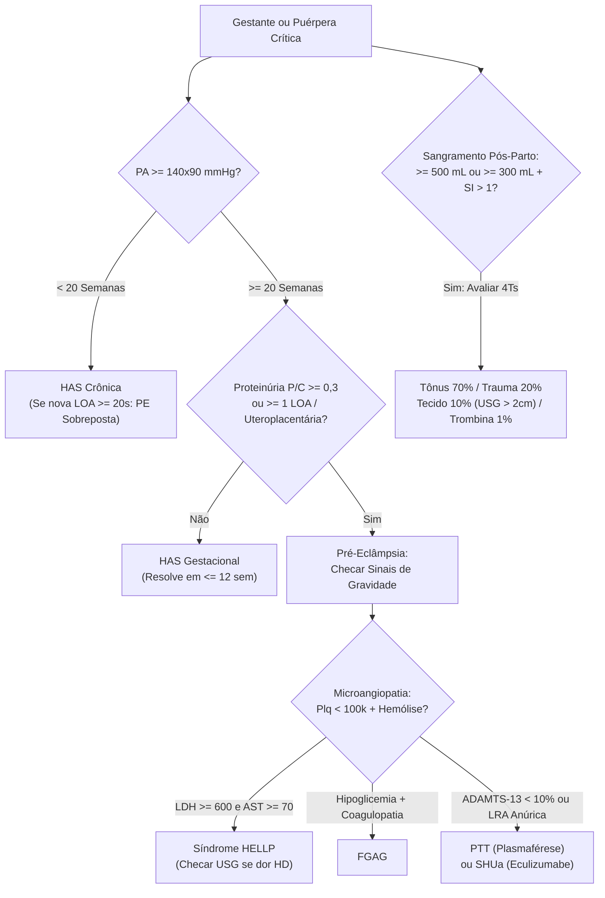
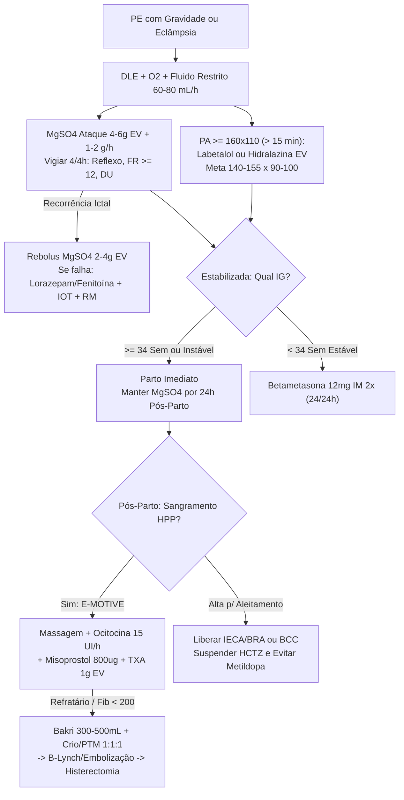
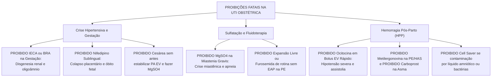

# Cartão Flash de Véspera de Prova — Hipertensão na Gestação, Eclâmpsia, HELLP & HPP

## 1. Conceitos-Chave & Raciocínio Clínico Estruturado

<b>Passo 1: O Novo Basal Fisiológico Materno na UTI (Adaptações & Armadilhas)</b>

  * **Cardiovascular e Periparto (Estado Hiperdinâmico Vasodilatado):** Estrogênio, progesterona, prostaciclinas e a fístula arteriovenosa placentária derrubam precocemente a **RVS e a RVP**, reduzindo a **PA em ~10 mmHg** (nadir na **20ª–24ª sem**, retornando ao basal a termo) → o **DC sobe 50% a 75%** (no 1º/2º tri por ↑ VS e inotropismo; no 3º tri dependente de **↑ FC +10 a 20 bpm** pela compressão aortocaval supina, que exige **Decúbito Lateral Esquerdo — DLE** imediato) ↔ **PCO cai** por hemodiluição da albumina com **PVC/PCP estáveis ou reduzidas** (alto risco de extravasamento capilar).
    * **Dinâmica do Parto e Cardiopatias Críticas:** Contrações ejetam **300–500 mL/contração** e a dequitação gera **"auto-hemotransfusão" de ~500 mL** (pico máximo de DC no pós-parto imediato; retorno ao basal em **2 sem a 3 meses**) → descompensação letal em **Hipertensão Pulmonar**, **IC NYHA III–IV**, **Estenose Mitral** (taquicardia encurta diástole → EAP) e **Síndrome de Marfan** (dissecção aórtica).
    * **Exames Fisiológicos ↔ Patológicos:** Sopro sistólico suave I–II/VI, ECG com eixo à esquerda e onda T achatada/invertida em DIII (+ extrassístoles/TSV), RX com aparente cardiomegalia/trama hilar e ECOTT com aumento das 4 câmaras/massa VE/ânulo valvar são fisiológicos ↔ **sopro diastólico ou pansistólico é SEMPRE patológico**.
  * **Renal, Hematológico, Endócrino e Gasométrico:**
    * **Renal:** Aldosterona expande o plasma em **30%–50%** (balanço cumulativo **+6,5 a 8,0 L**: ~3,5 L feto/placenta/LA, ~1,5 L sangue, ~2,5 L interstício); fluxo renal **↑ 70%** e **TFG ↑ 50%** → **Cr normal 0,4–0,8 mg/dL** (**Cr ≥ 1,1 a 1,4 mg/dL já é LRA severa com perda > 50% da TFG!**), Ur 15–25 mg/dL, **Na+ 135–138 mEq/L**, **Osm ~280 mOsm/kg** (-10 por *reset* do osmostato), glicosúria/bicarbonatúria fisiológicas, proteinúria até **260–300 mg/24h** e **hidronefrose leve D > E** (dextrorrotação uterina + veia ovariana D → risco de pielonefrite/sepse; evitar BH muito negativo no oligoâmnio).
    * **Hematológico:** Expansão plasmática (+40%–50%) supera a eritrocitária (+20%–30%) → anemia dilucional (OMS: **Hb < 11 g/dL no 1º/3º tri e < 10,5 g/dL no 2º tri**) + hipercoagulabilidade (**Fibrinogênio 400–600 mg/dL**, ↑ VII, VIII, IX, X, FvW e **D-dímero**; ↓ AT-III e Proteína S livre), leucocitose **12.000–16.000/µL** (até **25.000/µL** no parto) e tolerância a perda de **25%–35% da volemia (~1.500 mL)** sem hipotensão materna, mas **já com sofrimento fetal** por vasoconstrição uterina!
    * **Endócrino e Gasometria:** Resistência insulínica (hPL/cortisol) + lipólise → risco de hipoglicemia e **CAD Euglicêmica (< 200 mg/dL)**; ↑ T3/T4 totais (↑ TBG) com **T4L/T3L normais** (TSH ↓ 1º tri); **Betametasona/Dexametasona** cruzam a placenta, mas **Metilprednisolona/Hidrocortisona são inativadas pela 11-beta-HSD2 placentária**. Progesterona estimula o bulbo → **VM ↑ 30%–40%** por ↑ VT com **FR inalterada**, diafragma +4 cm (**CRF ↓ 20%**, CPT ↓ 200 mL) → **pH 7,39–7,45**, **PaCO2 27–32 mmHg** (PaCO2 40–45 = falência ventilatória! *Nota: slide 17 inverteu graficamente PCO2 e PaO2*), **PaO2 100–110 mmHg**, **HCO3- 16–22 mEq/L** → metas: **SatO2 ≥ 95% (PaO2 ≥ 70–75)**, **PaCO2 < 45 (ideal 28–34)** e **prona permitida** na SDRA com coxins.

<b>Passo 2: Classificação (20 Semanas), Fisiopatologia (2ª Onda / sFlt-1) & Gravidade</b>

  * **Nomenclatura pelo Marco de 20 Semanas (~10% das gestações; #1 morte materna no Brasil c/ HPP):** **HAS Crônica** (< 20 sem ou persiste > 12 sem pós-parto) ↔ **HAS Gestacional** (≥ 20 sem, ≥ 2 medidas c/ ≥ 4h, sem proteinúria/LOA, resolve em ≤ 12 sem) ↔ **Pré-Eclâmpsia — PE** (≥ 20 sem + **Proteinúria P/C ≥ 0,3 mg/mg, ≥ 300 mg/24h ou fita ≥ ++/4** OU **≥ 1 LOA / disfunção uteroplacentária**: RCIU, Doppler umbilical alterado, natimorto) ↔ **PE Sobreposta** (HAS crônica + nova proteinúria/LOA ≥ 20 sem).
    * **Prevenção Primária (alto risco: nulípara, PE prévia/familiar, IMC > 30, > 35a, gemelar, FIV, DM/HAS/DRC/autoimunes, afrocaribenhas):** **AAS 100–150 mg VO/noite** (**12ª–16ª sem** até 36–37 sem) + **Cálcio 1,5 g/d** desde o 1º tri se baixa ingesta (< 600 mg/d).
  * **Fisiopatologia e Critérios de PE com Sinais de Gravidade:** Falha da **2ª onda de invasão trofoblástica (16ª–20ª sem)** nas espiraladas miometriais → isquemia placentária → **↑ sFlt-1 e ↑ sEng** (sequestram VEGF/PlGF) + **↑ Tromboxano A2 / ↓ PGI2** → **endoteliose capilar glomerular** (proteinúria não seletiva), vasoespasmo e **hipovolemia intravascular efetiva com edema de 3º espaço**.
    * **Qualquer 1 define Gravidade:** **PA ≥ 160×110 mmHg (> 15 min)**, **Plaquetas < 100.000/µL**, **AST/ALT > 2× LSN (> 40 U/L)** ± dor epigástrica/HD, **Cr > 1,1 mg/dL** (slide: ≥ 1,0; ou 2× basal ou oligúria **< 500 mL/24h / < 25 mL/h**), **EAP**, **sintomas cerebrais/visuais** (cefaleia refratária, clônus, escotomas, fotopsia, amaurose, AVC) ou **HELLP**.

<b>Passo 3: Crise Hipertensiva, Fluidos, Momento do Parto & Transição para Lactação</b>

  * **Controle Pressórico Agudo (PA ≥ 160×110 por > 15 min):** Placenta não tem autorregulação → reduzir **20%–30%** na 1ªh para **PAS 140–155 (140–150) e PAD 90–100 mmHg** (**jamais < 120×80**!).
    * **Parenterais/Imediatos:** **Labetalol EV** (1ª linha int., mantém DC: **20 → 40 → 80 → 80 mg** q10min; BI **0,5–1 mg/kg/h**; CI: asma, DPOC, BAV; risco RN: bradicardia/hipoglicemia) ↔ **Hidralazina EV** (1ª linha Brasil: **5 mg EV em 1–2 min → 5–10 mg após 15–20 min**, máx 20 mg crise / 40 mg 12h; cautela: **hipotensão abrupta + taquicardia/SFA** em hipovolêmicas!) ↔ **Nicardipina EV** (bolus 0,5 mg até 3×; BI **0,5–4 mg/h**, máx 15 mg/h) ↔ **Nifedipino VO rápida** (**10 → 20 → 20 mg** q20min inteiro; **PROIBIDO sublingual**; CI estenose aórtica) ↔ **Nitroprussiato** (resgate extremo < 4–6h: cianeto/tiocianato fetal).
  * **Manutenção VO, Fluidos, Parto e Amamentação:** Associar 2º agente se falha em dose média (**Metildopa** máx 2.250 mg/d, **Nifedipina AP/XL** máx 120 mg/d, **Labetalol VO** máx 1.200 mg/d, Hidralazina VO, Amlodipino, Pindolol, Clonidina, Prazosin). **IECA/BRA são PROIBIDOS na gestação, mas LIBERADOS no aleitamento**; no pós-parto, **suspender HCTZ** (reduz leite) e **evitar Metildopa** (depressão materna).
    * **Fluidos e Resolução (SEMPRE após estabilizar PA + MgSO4!):** Basal restritivo **60–80 mL/h** (Furosemida só se EAP!); se hipotensão pós-vasodilatador/oligúria hipovolêmica → PLR/POCUS em DLE + bolus **250–300 mL**. Parto: PE sem gravidade ≥ 37 sem; PE c/ gravidade **≥ 34 sem = parto imediato pós-estabilização**; **< 34 sem estável = Betametasona 12 mg IM 2× 24/24h** (*slide 35 grafou Beclometasona, usar Betametasona*); interromper em qualquer IG se deterioração materna/fetal (eclâmpsia refratária, EAP, DPP, CIVD, HELLP grave, LRA anúrica, rotura hepática ou SFA).

<b>Passo 4: Sulfatação, Toxicidade por Mg, Eclâmpsia (PRES/RCVS) & Síndrome HELLP</b>

  * **Sulfato de Magnésio (bloqueia NMDA/Ca2+ e vasodilata SNC; manter 24h pós-parto ou 24h após última crise):** Indicado na PE c/ gravidade, eclâmpsia ou PA ≥ 160×100 c/ pródromos (**CI absoluta: Miastenia Gravis**). **AMIB c/ BI:** **4–6 g EV 20–30 min + 1,2 g/h (1–2 g/h)**; **Zuspan:** 4 g EV + 1 g/h; **Sibai:** 6 g EV + 2–3 g/h; **Pritchard:** 4 g EV + **10 g IM (5 g/glúteo) + 5 g IM 4/4h**; **AMIB s/ acesso:** 10 g IM + 5 g IM 4/4h.
    * **Vigilância 4/4h e Intoxicação:** Checar reflexo patelar/bicipital, **FR ≥ 12 irpm** e **diurese > 25–30 mL/h** (99% excreção renal: dosar Mg 4/4h **só se LRA/oligúria**, reduzindo 50% na LRA e suspendendo na oligúria/anúria). Faixas: **4–7 mg/dL** terapêutica → **8–10 (slide: 9 mg/dL)** arreflexia (se > 9 sem dispneia: pausar, dosar 2/2h, reiniciar 50% quando **≤ 8,4 mg/dL**) → **10–12 (slide: 12 mg/dL)** FR < 12 (**suspender MgSO4 + Gluconato de Cálcio 10% 1 g / 10 mL EV em 3–5 min** ± Furosemida + O2/IOT) → **> 15** BAV/coma → **> 25–30** PCR (+ hemodiálise).
  * **Eclâmpsia (30% sem HAS/proteinúria prévias; pico 48h pós-parto) e HELLP:** Se crise recorrer sob MgSO4 → **1º Rebolus MgSO4 2–4 g EV em 3–5 min**; **2º Refratária:** **Lorazepam 4 mg EV** (Diazepam 5–10 mg) / **Fenitoína 15–18 mg/kg EV** / Barbitúrico + **IOT + TC/RM crânio obrigatória** (**PRES** parieto-occipital T2/FLAIR, **RCVS**, AVCh). Na **HELLP** (**Tennessee:** esquizócitos + **LDH ≥ 600** + **BT ≥ 1,2** + **AST ≥ 70** + **Plq < 100.000**; *Mississippi:* C1 < 50k, C2 50–100k, C3 100–150k), vigiar **rotura hepática** (choque + dor HCD → laparotomia c/ *packing*/Pringle/embolização) e transfundir plaquetas se **< 20k** (vaginal), **< 50k** (cesárea/sangramento) e contraindicar neuroeixo se **< 70–80k**.

<b>Passo 5: Hemorragia Pós-Parto (HPP), Pacote E-MOTIVE & Ressuscitação Hemostática</b>

  * **Gatilho Operacional e 4Ts:** FIGO define ≥ 1.000 mL ou instabilidade em 24h, mas o **gatilho imediato E-MOTIVE** é perda medida **≥ 500 mL** OU **≥ 300 mL + alteração vital** (FC > 100, PAS < 100, PAD < 60 ou **Shock Index FC ÷ PAS > 1,0**). Etiologias: **Tônus 70%** (atonia), **Trauma 20%**, **Tecido 10%** (faixa endometrial **> 2 cm** ao USG → varredura/curetagem) e **Trombina < 1%**.
  * **Pacote E-MOTIVE, Escalonamento e Coagulopatia:** Campo coletor + **Massagem bimanual (Hamilton)** + **Ocitocina** (profilaxia 10 UI IM/EV lento; HPP **10–40 UI em 1.000 mL SF a 15 UI/h** — **PROIBIDO bolus EV rápido = assistolia!**) + **Misoprostol 800 µg retal** + **Ácido Tranexâmico 1 g EV em 10 min na 1ªh (máx 3h; repetir +1 g em 30 min)** + fluidos mornos parcimoniosos.
    * **Refratários e Hemostasia (labs q30–120 min):** 2ª linha = **Metilergonovina 0,2 mg IM 2–4h (PROIBIDA na PE/HAS!)**, **Carboprost 0,25 mg IM 15–90 min máx 8× (PROIBIDO na asma!)**, Dinoprostona 20 mg retal → **Balão de Bakri (300–500 mL)** → **B-Lynch**/Hayman, ligadura/embolização uterina → **Histerectomia**. Manter **Fibrinogênio > 200 mg/dL** (**Crioprecipitado 1–2 UI/10 kg** ou **Conc. Fibrinogênio 25–50 mg/kg / 2–4 g EV** guiado por **ROTEM/FIBTEM**), **PTM 1:1:1** (se ≥ 1.500 mL), **Ca2+ iônico > 1,1–1,2 mmol/L** (Gluconato Ca a cada 4 CH), T > 36 °C, pH > 7,20 e PAS permissiva 80–90 mmHg (**PROIBIDO Cell Saver** se contaminação amniótica/bacteriana!).

---

## 2. Equações, Escores, Doses & Cortes Secos

* **Novos Basais & Gasometria:** **DC ↑ 50%–75%** | **FC +10–20 bpm** | **TFG ↑ 50%** (**Cr normal 0,4–0,8 mg/dL**; **≥ 1,1 = LRA grave**) | **Na+ 135–138 mEq/L** | **Osm ~280 mOsm/kg** | **Fibrinogênio 400–600 mg/dL** | **pH 7,39–7,45**, **PaCO2 27–32 mmHg** (≥ 40 = fadiga grave), **PaO2 100–110 mmHg**, **HCO3- 16–22 mEq/L**.
* **Escores de PE & HELLP:** **PE** = PA ≥ 140×90 após 20 sem + **P/C ≥ 0,3 mg/mg** ou **≥ 300 mg/24h** ou LOA | **Tennessee (HELLP):** Esquizócitos + **LDH ≥ 600 U/L** + **BT ≥ 1,2 mg/dL** + **AST ≥ 70 U/L** + **Plq < 100.000/µL** (*Mississippi:* C1 **< 50k**, C2 **50–100k**, C3 **100–150k**).
* **Crise Hipertensiva (PA ≥ 160×110 > 15 min → Meta 140–155 × 90–100 mmHg, ↓ 20%–30%):** **Labetalol EV** 20→40→80→80 mg q10min (BI 0,5–1 mg/kg/h) | **Hidralazina EV** 5 mg → 5–10 mg q15–20min (máx 20 mg crise / 40 mg 12h) | **Nicardipina EV** 0,5–4 mg/h | **Nifedipino VO** 10→20→20 mg q20min.
* **Esquemas & Níveis de MgSO4 (manter 24h pós-parto/última crise):** **AMIB BI** 4–6 g EV + 1,2 g/h (1–2 g/h) | **Pritchard** 4 g EV + 10 g IM + 5 g IM 4/4h | **Zuspan** 4 g + 1 g/h | **Sibai** 6 g + 2–3 g/h | **Mg sérico:** **4–7 mg/dL** alvo; **8–10 (9)** arreflexia; **10–12 (12)** FR < 12 → **Gluconato de Ca 10% 1 g (10 mL) EV em 3–5 min**; **> 25–30** PCR.
* **Plaquetas, Fluidos & Marcos Temporais:** Transfundir Plq se **< 20.000/µL** (vaginal) ou **< 50.000/µL** (cesárea/sangramento); neuroeixo CI se **< 70.000–80.000/µL** | Fluidos na PE: **60–80 mL/h** (bolus teste **250–300 mL**) | Maturação < 34 sem: **Betametasona 12 mg IM 2× (24/24h)** | Resolução da PE em **≤ 12 semanas**.
* **HPP & Pacote E-MOTIVE:** Gatilho **≥ 500 mL** ou **≥ 300 mL + Shock Index (FC ÷ PAS) > 1,0** | **Ocitocina** 10–40 UI/1.000 mL a **15 UI/h** + **Misoprostol 800 µg retal** + **TXA 1 g EV em 10 min (≤ 3h, repetir 30 min)** + **Bakri 300–500 mL** | Se **Fibrinogênio < 200 mg/dL**: **Crioprecipitado 1–2 UI/10 kg** ou **Conc. Fibrinogênio 25–50 mg/kg (2–4 g)** + **PTM 1:1:1** + **Ca2+ > 1,1–1,2 mmol/L**.

---

## 3. Diferenciações Matadoras de Pegadinha

* **HAS Crônica ↔ HAS Gestacional ↔ Pré-Eclâmpsia:** HAS Crônica surge **< 20 sem** (ou persiste **> 12 sem** pós-parto) ↔ HAS Gestacional surge **≥ 20 sem** sem proteinúria/LOA e some em **≤ 12 sem** ↔ PE surge **≥ 20 sem** com proteinúria **OU qualquer disfunção orgânica/uteroplacentária** (mesmo sem proteinúria!).
* **Anti-Hipertensivos na Gestação ↔ Aleitamento Materno:** **IECA e BRA** são teratogênicos/proibidos na gestação (disgenesia renal/oligoâmnio) ↔ **seguros e liberados no aleitamento**; **HCTZ** pode ser mantida na HAS crônica gestacional ↔ **suspender no aleitamento** (seca o leite); **Metildopa** é 1ª linha na gestação ↔ **evitar no pós-parto** (depressão materna).
* **Betametasona/Dexametasona ↔ Metilprednisolona/Hidrocortisona:** Betametasona/Dexametasona atravessam a barreira placentária (escolha para **maturação pulmonar fetal < 34 sem**) ↔ Metilprednisolona/Hidrocortisona são inativadas pela enzima placentária **11-beta-HSD2** (efeito restrito à mãe).
* **Labetalol EV ↔ Hidralazina EV na Crise:** Labetalol (alfa-1/beta-bloqueador) preserva o DC, sendo contraindicado em **asma/DPOC/BAV** (risco de bradicardia/hipoglicemia neonatal) ↔ Hidralazina (vasodilatador arteriolar puro) causa **hipotensão materna abrupta e taquicardia/sofrimento fetal** na PE hipovolêmica.
* **HELLP ↔ FGAG ↔ PTT ↔ SHUa:** **HELLP** cursa com LDH ≥ 600, AST ≥ 70, Plq < 100k e cura com o parto ↔ **FGAG** destaca **hipoglicemia severa**, insuficiência hepática/coagulopatia profunda e BD ↔ **PTT** traz plaquetopenia extrema, sintomas neurológicos e **ADAMTS-13 < 10%** (**plasmaférese**) ↔ **SHUa** predomina **LRA anúrica pós-parto** (**eculizumabe**).
* **Metilergonovina ↔ Carboprost ↔ Ocitocina na HPP:** **Metilergonovina** (0,2 mg IM) é **proibida na PE/HAS** (crise hipertensiva/AVCh) ↔ **Carboprost** (0,25 mg IM) é **proibido na asma** (broncoespasmo fatal) ↔ **Ocitocina** é **proibida em bolus EV rápido não diluído** (hipotensão súbita e assistolia).

---

## 4. POCUS, Gráficos/CTG, Propedêutica Armada & Grandes Trials

* **POCUS Cardiopulmonar & VCI na Pré-Eclâmpsia:** (Linhas B pulmonares difusas em gestante com PCO baixa e pós-carga alta) → (EAP incipiente) → (Proibir cristaloide e iniciar O2/VNI + Furosemida EV; avaliar VCI sempre em **DLE** e fluido-responsividade por **PLR + VTI aórtico**, pois contorno de onda de pulso perde acurácia pela distensibilidade aórtica).
* **POCUS Abdominal e Pélvico na HELLP & HPP:** (Hematoma subcapsular ou líquido livre peritoneal na HELLP com dor em barra em HD + choque) → (Rotura hepática) → (Laparotomia imediata com *packing*/manobra de Pringle ou embolização); (Eco endometrial uterino **> 2 cm** na HPP com útero contraído) → (Retenção de restos/Tecido) → (Varredura manual/curetagem e guia para Balão de Bakri).
* **Neuroimagem & ROTEM/TEG à Beira-Leito:** (Eclâmpsia recorrente/refratária ao rebolus de MgSO4 ou déficit focal) → (IOT + TC/RM de crânio obrigatória: hiperintensidade subcortical parieto-occipital em T2/FLAIR = **PRES**; vasoespasmo multifocal = **RCVS**); (Queda precoce do **FIBTEM** no ROTEM ou Fibrinogênio **< 200 mg/dL** na HPP) → (Hiperfibrinólise obstétrica) → (Crioprecipitado ou Concentrado de Fibrinogênio imediato).
* **Pacote OMS E-MOTIVE & Protocolo Fishel Bartal (2022):** E-MOTIVE usa campo coletor graduado (gatilho **≥ 500 mL** ou **≥ 300 mL + FC > 100, PAS < 100, PAD < 60 ou Shock Index > 1,0**) disparando Massagem + Ocitocina + Misoprostol + TXA na 1ªh; Fishel Bartal padroniza titulação/cruzamento a cada 10–20 min entre Labetalol EV, Hidralazina EV e Nifedipino VO na PA ≥ 160×110 (> 15 min) + rebolus de MgSO4 2 g → Lorazepam 4 mg EV na eclâmpsia refratária.

---

## 5. Gabarito Instantâneo das Questões & Gatilhos Críticos da Aula

* **Se o enunciado trouxer TEMI 2008 — Gestante 20 sem com cefaleia, dor em HD, PA 192×126 mmHg, ↑ BT, ↑ TGO/TGP e plaquetopenia → Marque Repouso em DLE e anti-hipertensivo IV (Alt. A):** Estabilizar PA parenteral e infundir ataque de MgSO4 **SEMPRE antecedem** a interrupção cirúrgica da gestação (elimina cesárea imediata sem estabilização e restrição de sódio/metildopa VO).
* **Se o enunciado trouxer TEMI 2008 — Tratamento da DHEG (~10% das gestantes), pedindo a INCORRETA → Marque Drogas anti-hipertensivas mais usadas causam anormalidades fetais significativas (Alt. D):** Metildopa, labetalol, hidralazina e nifedipino são seguros (quem causa teratogênese/disgenesia renal é IECA/BRA); hidralazina exige cautela na hipovolemia da PE.
* **Se o enunciado trouxer TEMI 2010 — Alterações fisiológicas da gestação → Marque Aumento da FC e queda da RVS (Alt. C):** Na gravidez normal, VM, DC e TFG sobem, porém **CRF (-20%), RVS, RVP e HCO3- sérico (16–22 mEq/L) CAEM**.
* **Se o enunciado trouxer Gestante no 3º tri em decúbito dorsal com hipotensão súbita e bradicardia reflexa → Marque Síndrome da Hipotensão Supina:** Posicionar imediatamente em **DLE** ou deslocar manualmente o útero para a esquerda.
* **Se o enunciado trouxer Nova convulsão em gestante já em manutenção de MgSO4 → Marque Rebolus de MgSO4 2 a 4 g EV em 3–5 min:** Só escale para Lorazepam 4 mg / Fenitoína 15–18 mg/kg / Barbitúrico + IOT + TC/RM de crânio se persistir após o rebolus!
* **Se o enunciado trouxer Arreflexia patelar + FR < 12 irpm em uso de MgSO4 → Marque Suspender MgSO4 + Gluconato de Cálcio 10% 1 g (10 mL) EV em 3–5 min:** Se apenas Mg > 9 mg/dL sem dispneia ou oligúria/LRA, pausar/monitorar Mg 4/4h e reiniciar a 50% quando **≤ 8,4 mg/dL**.
* **Se o enunciado trouxer Hipotensão ou oligúria logo após Hidralazina EV na PE grave → Marque Hipovolemia intravascular desmascarada:** Avaliar fluido-responsividade (PLR/POCUS em DLE) e fazer prova cautelosa de **250–300 mL de cristaloide**.
* **Se o enunciado trouxer Gestante com Cr 1,2 mg/dL, PaCO2 42 mmHg ou sangramento pós-parto com PA normal e perda de 1.200 mL → Marque Gravidade Extrema Mascarada:** Traduzem respectivamente LRA severa (> 50% perda de TFG), falência ventilatória aguda e choque compensado com sofrimento fetal.

---

## 6. Fluxogramas Decisórios de Beira-Leito

### Mermaid 1 — Diagnóstico Diferencial, Estratificação & Propedêutica

### Mermaid 2 — Manejo Terapêutico Escalonado & Marcos de Reavaliação

### Mermaid 3 — Armadilhas de Prova & Iatrogenias Fatais (Proibições Absolutas)
