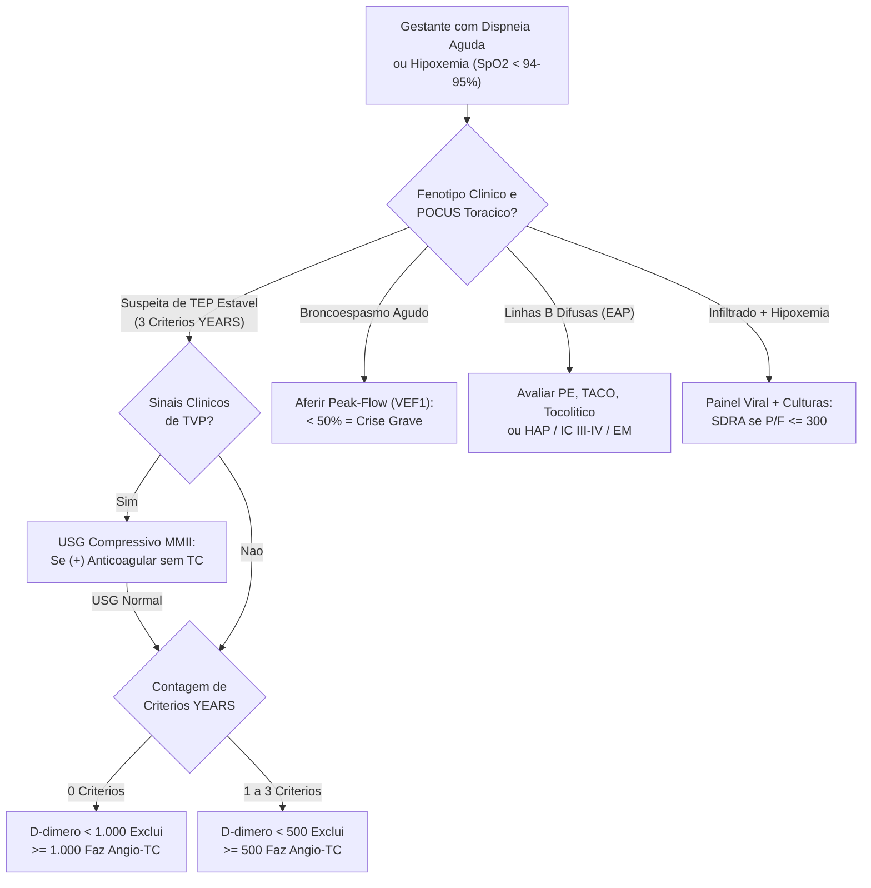
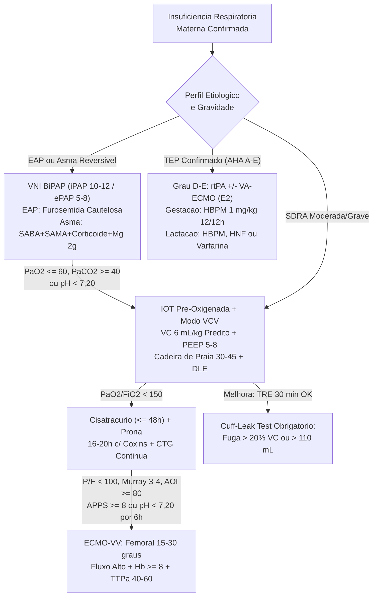
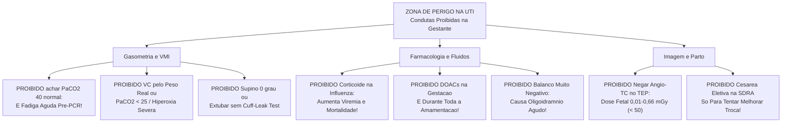

# Cartão Flash de Véspera de Prova — Manejo Respiratório na Gestação (Aula 02)

## 1. Conceitos-Chave & Raciocínio Clínico Estruturado

<b>Passo 1: Tríade Hormonal, Cinemática Diafragmática, Volumes Pulmonares e Armadilhas Propedêuticas</b>

- **Adaptação Hormonal e Parede Torácica:** A gestação impõe hiperventilação alveolar crônica compensada com reserva crítica de apneia e via aérea anatomicamente difícil:
  - **Progesterona (Drive Central):** Sensibiliza diretamente o centro bulbar ao CO2 → eleva o **Volume Corrente (VC +30% a +40%, até +50%)** e a **Ventilação Minuto (VM +30% a +50%)**, mantendo a **Frequência Respiratória (FR) inalterada (12 a 20 irpm)**.
  - **Estrogênio (Via Aérea Difícil):** Causa hiperemia capilar e edema mucoso difuso nas vias aéreas → laringoscopia estreita, friável e sangrante.
  - **Relaxina (Compensação Parietal):** Relaxa ligamentos costovertebrais/condroesternais → abre o **ângulo subcostal de 68,5° para 103,5°** e aumenta o diâmetro torácico em **≥ 2 cm** (circunferência **+5 a 7 cm**).
- **Mecânica Diafragmática, Espirometria e Apneia:** O útero eleva o diafragma em repouso em **≥ 4 cm (até 5 cm)**, mas sua excursão dinâmica **aumenta +2 cm** (maior zona de aposição).
  - **Quedas Volumétricas:** **CRF cai -20% a -30%**, **VRE cai -15% a -20%**, **VR cai -15% a -20%** e **CPT cai leve (-200 mL / -5%)**, enquanto a **CI sobe +5% a +10%**.
  - **Parâmetros Preservados:** **Capacidade Vital (CV)**, **VEF1** e **VEF1/CVF permanecem inalterados**. Somando **↓ CRF** com **↑ VO2 (+20% a +35%)** e **↑ VCO2 (+30%)**, o tempo seguro de apneia despenca → **dessaturação abrupta na indução** (pré-oxigenação rigorosa obrigatória!).
- **Gasometria do 3º Trimestre e Armadilhas de Exames:** Alcalose respiratória compensada (**pH 7,39–7,45**; **PaCO2 27–32 mmHg**; **PaO2 100–110 mmHg** — *errata Slide 9: rótulos PCO2 e PaO2 aparecem trocados no slide!* —; **HCO3- 16–22 mEq/L**).
  - **Armadilha Fatal de UTI:** **PaCO2 = 40 mmHg + HCO3- = 20 mEq/L NÃO é acidose metabólica pura**, e sim **acidose respiratória aguda por fadiga neuromuscular**!
  - **Falsos Positivos Fisiológicos:** **RX de tórax** (trama basilar aumentada + coração rodado = falsa cardiomegalia/congestão); **ECG** (eixo desviado à esquerda + onda T achatada inferior + taquicardia sinusal); **ECOTT** (dilatação das 4 câmaras + leve ↑ massa de VE); **D-dímero** (sobe toda a gestação = baixa especificidade isolada, mas alto VPN no algoritmo YEARS).

<b>Passo 2: Equação da Troca Placentária (Os 4 Vilões), VNI, Ajuste Fino da VMI e Protocolo de Extubação</b>

- **Os 5 Elos e os 4 Vilões Placentários:** A hematose fetal (pH, CO2, O2 e TAX) depende em série de: **Ventilação materna → Pulmão → Débito Cardíaco → Vascularização placentária → Afinidade da HbF**. Como o fluxo uterino não tem autorregulação, **4 vilões** derrubam a perfusão placentária:
  - **(1) Catecolaminas** (dor, agitação, excesso de vasopressor); **(2) Alcalose respiratória materna (PaCO2 < 25 mmHg)** → vasoconstrição direta da artéria uterina + desvio da curva de Hb à esquerda (*efeito Bohr reverso*, prendendo O2 na mãe); **(3) Contrações uterinas**; **(4) Compressão aortocava supina** (↓ retorno venoso). Inversamente, **PaCO2 > 45–50 mmHg** impede a difusão do CO2 fetal → **acidose respiratória fetal** (↓ afinidade da HbF).
  - **Metas:** **SpO2 ≥ 94–95%** (92–96% individualizável em COVID/IRA), **PaO2 ≥ 70 mmHg** (60–100 mmHg; **evitar hiperóxia** por estresse oxidativo e vasoconstrição placentária!), **PaCO2 28–32 mmHg** (30–32) e **HCO3- 18–22 mmol/L** (18–21).
- **VNI, Mecânica na VMI e Posicionamento:**
  - **VNI (BiPAP iPAP 10–12 / ePAP 5–8 cmH2O):** Apesar da hipotonia do esfíncter esofágico (progesterona), supera o risco de aspiração em causas rapidamente reversíveis (**EAP** e **asma**), mantendo contraindicações clássicas (Glasgow < 8/RNC, vômitos, instabilidade grave, indicação imediata de IOT).
  - **VMI (preferir VCV em neurocríticas, obstruídas e SDRA):** **VC 6 mL/kg de Peso Predito pela altura** (6–8 mL/kg em não-SDRA, jamais pelo peso real!), **PEEP 5–8 cmH2O**, **FR 16–18 irpm**, Fluxo 60 L/min, alarme P.Pico 35 cmH2O, **Pplatô < 25–30 cmH2O** e **Driving Pressure < 12–15 cmH2O** (em PCV: Pinsp 12–15 cmH2O p/ VC 6 mL/kg, Tins 0,8–1,0 s, I:E 1:2).
  - **Cadeira de Praia (30–45°) + DLE (15–30°):** Desloca o vetor uterino caudalmente, **reduzindo imediatamente a Pplatô**; quando disponível, usar **balão esofágico** para pressão transpulmonar.
- **Desmame e Extubação:** Causa resolvida + drive + oxigenação + estabilidade → **TRE de 30 min** (Tubo T ou Psup 5–8 cmH2O, PEEP 0–5 cmH2O, FiO2 < 40%) + **Cuff-Leak Test obrigatório** (exigir fuga audível, diferença **> 20% do ar inspirado** ou fuga **> 110 mL**).

<b>Passo 3: Crise de Asma, Edema Agudo de Pulmão Periparto e Infecções Respiratórias Graves</b>

- **Asma na Gestação (Regra dos Terços: 1/3 melhora, 1/3 estável, 1/3 piora):** Como o **VEF1 / Peak-Flow (PFE)** não altera na gravidez, é o marcador objetivo padrão-ouro (crônica: leve ≥ 80%, mod 60–80%, grave < 60%).
  - **Crise Grave:** Palavras isoladas/irresponsiva, **FR > 30 irpm**, **FC > 120 bpm**, **PFE/VEF1 < 50%** ou **SpO2 < 90% AA** (leve/mod: frases, FR 18–29, FC 100–120, PFE 50–75%, SpO2 90–95%).
  - **Conduta Escalonada:** O2 (**SpO2 ≥ 95%**) + **Salbutamol 4–8 puffs 20/20min** (depois 1–4h) + **Ipratrópio 4–8 puffs de 20 µg 20/20min** (*errata Slide 20: grafado "20mg"*) + **Prednisona 40–60 mg VO 5d** (ou **Hidrocortisona 100 mg IV 6/6h**) + **MgSO4 2 g IV em 20 min** (controle crônico: beta-2 + **Beclometasona** preferencial; alta se **VEF1 > 70%**, sintomas mínimos e **SpO2 ≥ 94% AA**).
  - **4 Critérios de IOT na Asma:** **(1) PaO2 ≤ 60 mmHg**, **(2) PaCO2 ≥ 40 mmHg**, **(3) Exaustão materna com pH < 7,20** apesar de broncodilatação, **(4) Alteração de consciência / instabilidade**.
- **Edema Agudo de Pulmão (EAP):** Causado por pré-eclâmpsia, TACO, tocolíticos (± corticoide/MgSO4), CMPP ou pelas **3 cardiopatias que mais descompensam** (**Hipertensão Pulmonar**, **IC CF III–IV** e **Estenose Mitral**), com pico no parto (**300–500 mL/contração**) e pós-parto imediato (**"auto-hemotransfusão"** pós-dequitação) → **VNI + Vasodilatador IV (Nitroglicerina) + Furosemida IV cautelosa** (**evitar balanço muito negativo pelo risco de oligoidrâmnio!**).
- **Infecções Respiratórias e Barreira Placentária:**
  - **Influenza:** **Oseltamivir 75 mg VO 12/12h por 5d** para TODAS as suspeitas; **corticoides são CONTRAINDICADOS** (↑ replicação viral/mortalidade)!
  - **COVID-19 Grave:** **Dexametasona 6 mg/d por 10d** (só se internada precisando de O2) + **Heparina profilática**.
  - **PAC Bacteriana Grave:** ATB empírico IV + **Hidrocortisona 50 mg IV 6/6h**. *Nota placentária:* **Dexametasona e Betametasona** cruzam a placenta (*errata Slide 33: cita "Beclometasona"*), enquanto **Hidrocortisona e Prednisona** são inativadas pela 11-beta-HSD2 placentária.

<b>Passo 4: SDRA Moderada/Grave na Gestante: Hipercapnia Limitada, Prona, ECMO-VV e Papel do Parto</b>

- **Ventilação Protetora e Limites na SDRA:** Causas diretas (Influenza, COVID, PAC, aspiração de Mendelson) ou indiretas (sepse urinária/uterina, pré-eclâmpsia, TRALI, embolia amniótica). Ajustar **VC 6 mL/kg predito**, **Pplatô < 25–30 cmH2O**, **DP < 12–15 cmH2O**, PEEP 5–8 cmH2O, evitando balanço muito negativo (**risco de oligoidrâmnio**) e restringindo hipercapnia permissiva a no máximo **PaCO2 < 50–60 mmHg** (com **pH ≥ 7,20–7,30**).
- **Resgate em PaO2/FiO2 < 150 mmHg:** **Cisatracúrio IV contínuo** (eliminação de Hofmann, menor tempo possível **≤ 48h**) + **Posição Prona** (**6–8h até 16–20h/dia** com coxins extras sob tórax superior e pelve suspendendo abdome gravídico e mamas + **CTG contínua**).
  - **Resposta positiva:** Aumento da **P/F em ≥ 20% ou ≥ 20 mmHg**. **Interromper imediatamente** se ausência de resposta/piora da troca, piora hemodinâmica, piora da mecânica pulmonar ou sofrimento fetal agudo.
- **ECMO Veno-Venosa (Mortalidade Estimada ≥ 80%):** Indicada se **(1) P/F < 100 mmHg com FiO2 > 90% ou Murray 3–4**, **(2) AOI ≥ 80**, **(3) APPS ≥ 8 por ≥ 6h**, ou **(4) Hipercapnia com pH < 7,20 por ≥ 6h** (*CI absoluta:* futilidade; *7 CIs relativas:* VMI não protetora > 7d, imunossupressão grave, hemorragia SNC, comorbidade irreversível, CI à anticoagulação, **IMC > 45 kg/m²**, pós-PCR).
  - **Circuito (drenagem femoral D → reinfusão jugular interna D) e 3 Particularidades Gestacionais:** **(1) Angulação de 15–30° na punção femoral ecoguiada** (reduz compressão uterina na cava); **(2) Fluxo da bomba elevado (↑)** p/ suprir o DC materno (+30–50%); **(3) Metas dedicadas:** **pH > 7,30**, **PaCO2 30–40 mmHg**, **PaO2 > 70 mmHg**, **Hb ≥ 8 g/dL**, **TTPa 40–60 s** e ajuste pelo **↑ clearance de drogas** (*principal complicação do paciente = hemorragia!*).
- **Resolução Obstétrica:** O parto **NÃO melhora desfechos se usado apenas para tentar melhorar troca gasosa na SDRA** (guiar estritamente por indicação obstétrica/causa obstétrica; na **PCR > 20 semanas** sem ROSC → **Cesariana Perimortem em 4 a 5 min**).

<b>Passo 5: Tromboembolismo Pulmonar (Algoritmo YEARS, AHA/ACC 2026, Radiação e Anticoagulação)</b>

- **Algoritmo YEARS (Gestante Estável — pico de TEV no puerpério pós-cesárea):** Avaliar **3 critérios YEARS** — **(1) Sinais clínicos de TVP**, **(2) Hemoptise**, **(3) TEP diagnóstico mais provável**:
  - **Com sinais de TVP:** Fazer **USG compressivo do membro sintomático** → se anormal (TVP), iniciar **anticoagulação plena imediata sem Angio-TC**; se normal, seguir YEARS.
  - **0 Critérios YEARS:** **D-dímero < 1.000 ng/mL exclui TEP** | **≥ 1.000 ng/mL → Angio-TC**.
  - **1 a 3 Critérios YEARS:** **D-dímero < 500 ng/mL exclui TEP** | **≥ 500 ng/mL → Angio-TC**.
- **Segurança da Radiação Fetal (Limiar Teratogênico > 50 a 100 mGy):** Jamais omitir imagem torácica! **RX tórax = 0,0005–0,01 mGy**; **Angio-TC = 0,01–0,66 mGy**; **Cintilo V/Q baixa dose = 0,1–0,5 mGy** (vs. TC pelve/PET-CT = 10–50 mGy). Janelas críticas: 0–2 sem (50–100 mGy morte/nada), 2–8 sem organogênese (200 mGy anomalias / 200–250 mGy RCIU), **8–15 sem** maior risco neurológico (**60–310 mGy** deficiência intelectual grave — perda de 25 pontos de QI/1.000 mGy — e **200 mGy** microcefalia), 16–25 sem (250–280 mGy).
- **Estratificação AHA/ACC 2026 (A–E ± Modificador R) e Anticoagulação:** Integrar Troponina/BNP + ECOTT (VD) + Lactato + Disfunção orgânica + Hemodinâmica + Modificador Respiratório **R**:
  - **A** (subclínico), **B** (B1 subsegmentar / B2 não-subsegmentar), **C** (escore clínico elevado: C1 VD/biomarcadores normais, C2 1 alterado, C3 ambos alterados), **D** (falência incipiente: D1 hipotensão transitória / D2 choque normotensivo → considerar reperfusão 2b) e **E** (falência cardiopulmonar: E1 choque cardiogênico / E2 choque refratário ou PCR → **Trombólise sistêmica rtPA**, CDL/MT/embolectomia cirúrgica 2a + **VA-ECMO na E2** 2a).
  - **Anticoagulação Plena (iniciar empírica se alta probabilidade; manter ≥ 3 meses E ≥ 6–8 semanas pós-parto):** **Gestação** = **HBPM (Enoxaparina 1 mg/kg SC 12/12h)** ou **HNF** (**Varfarina e DOACs proibidos — Classe 3: Harm**; *Slide 29 riscou Varfarina no 2º/3º tri!*); **Puerpério COM lactação** = **HBPM, HNF ou Varfarina** INR 2,0–3,0 (**DOACs proibidos!**); **Puerpério SEM lactação** = HBPM, HNF, Varfarina ou DOACs.

---

## 2. Equações, Escores, Doses & Cortes Secos

- **Mecânica & Novo Basal (3º Tri):** **Complacência Estática = VC ÷ Driving Pressure** | **Driving Pressure = Pplatô − PEEP (< 12–15 cmH2O)** | **VC +30–40%**, **VM +30–50%**, **CRF -20–30%**, **VO2 +20–35%**, **pH 7,39–7,45**, **PaCO2 27–32 mmHg**, **PaO2 100–110 mmHg**, **HCO3- 16–22 mEq/L** (**PaCO2 40 = fadiga aguda!**).
- **Suporte Ventilatório & Extubação:** **VNI BiPAP iPAP 10–12 / ePAP 5–8 cmH2O** | **VMI:** **VC 6 mL/kg peso predito** (6–8 não-SDRA), **PEEP 5–8 cmH2O**, **Pplatô < 25–30 cmH2O**, **SpO2 ≥ 94–95% (PaO2 ≥ 70 mmHg)**, **PaCO2 28–32 mmHg** (SDRA máx **< 50–60** c/ **pH ≥ 7,20**) | **TRE 30 min** (Psup 5–8, PEEP 0–5, FiO2 < 40%) + **Cuff-Leak > 20% VC ou > 110 mL**.
- **Asma Aguda Grave & IOT:** **PFE/VEF1 < 50%**, **FR > 30**, **FC > 120**, **SpO2 < 90%** → **Salbutamol 4–8 puffs 20/20min** + **Ipratrópio 4–8 puffs (20 µg) 20/20min** + **Prednisona 40–60 mg VO 5d** (ou **Hidrocortisona 100 mg IV 6/6h**) + **MgSO4 2 g IV em 20 min** | IOT se **PaO2 ≤ 60**, **PaCO2 ≥ 40**, **pH < 7,20 + exaustão** ou RNC (alta: **VEF1 > 70%** e **SpO2 ≥ 94% AA**).
- **SDRA Resgate, ECMO-VV & PCR:** **P/F < 150** → **Cisatracúrio IV (≤ 48h)** + **Prona 16–20h/d** (resposta: **↑ P/F ≥ 20% ou ≥ 20 mmHg**) | **ECMO-VV:** **P/F < 100 (FiO2 > 90%)**, **Murray 3–4**, **AOI ≥ 80**, **APPS ≥ 8 (≥ 6h)** ou **pH < 7,20 (≥ 6h)** → punção femoral **15–30°**, fluxo **↑**, **Hb ≥ 8 g/dL**, **TTPa 40–60 s** | **PCR > 20 sem:** cesárea perimortem em **4–5 min**.
- **YEARS & Radiação Fetal:** **0 critérios YEARS + D-dímero < 1.000 ng/mL** ou **1–3 critérios + D-dímero < 500 ng/mL** excluem TEP (acima → **Angio-TC**) | Limiar teratogênico **> 50–100 mGy** (pico QI **8–15 sem**: **60–310 mGy**); **RX tórax 0,0005–0,01 mGy**, **Angio-TC 0,01–0,66 mGy**, **Cintilo V/Q 0,1–0,5 mGy**.
- **Infecções & Anticoagulação TEP:** **Influenza:** **Oseltamivir 75 mg VO 12/12h 5d** (zero corticoide!) | **COVID c/ O2:** **Dexametasona 6 mg/d 10d** + Heparina profilática | **PAC grave:** ATB + **Hidrocortisona 50 mg IV 6/6h** | **TEP (≥ 3m e ≥ 6–8 sem pós-parto):** **Enoxaparina 1 mg/kg SC 12/12h** ou HNF (**rtPA** nos graus **D–E**).

---

## 3. Diferenciações Matadoras de Pegadinha

- **PaCO2 40 mmHg + HCO3- 20 mEq/L** (acidose respiratória aguda mascarada por exaustão diafragmática iminente) ↔ **PaCO2 < 25 mmHg** (alcalose respiratória severa que induz vasoconstrição uterina + efeito Bohr reverso e hipóxia fetal).
- **CRF (-20 a -30%), VRE (-15 a -20%) e VR (-15 a -20%)** caem pela elevação diafragmática ≥ 4 cm ↔ **CV, FR basal, VEF1 e VEF1/CVF permanecem inalterados** (validando o Peak-Flow/VEF1 como parâmetro fiel na crise de asma).
- **Gestação em curso** aceita apenas **HBPM ou HNF** (Varfarina e DOACs proibidos — Classe 3: Harm) ↔ **Puerpério com lactação** libera **HBPM, HNF e Varfarina** mas **proíbe DOACs** (passam ao leite) ↔ **Puerpério sem lactação** libera **DOACs**.
- **Influenza** contraindica corticoides (aumentam viremia/mortalidade; fazer Oseltamivir) ↔ **COVID-19 com O2** usa **Dexametasona 6 mg/d** (cruza placenta como a Betametasona) ↔ **PAC grave** usa **Hidrocortisona 50 mg 6/6h** (inativada na placenta pela 11-beta-HSD2, como a Prednisona).
- **Decúbito dorsal 0° na VMI** soma o peso uterino ao tórax, comprime a cava e eleva artificialmente a **Pplatô** ↔ **Cabeceira 30–45° ("cadeira de praia") + DLE 15–30°** desloca o útero caudalmente e reduz imediatamente a **Pplatô**.
- **Parto eletivo na SDRA não-obstétrica** NÃO melhora troca gasosa nem sobrevida materna (guiar por indicação obstétrica) ↔ **Cesariana Perimortem em 4–5 min na PCR > 20 semanas** é mandatória para descomprimir a cava e recuperar retorno venoso.

---

## 4. POCUS, Gráficos, Propedêutica Armada & Diretrizes

- **Curva Pressão-Tempo na VMI + Balão Esofágico:** **Pplatô elevada em supino 0° que despenca após cabeceira 30–45° + DLE 15–30°** → Compressão toracoabdominal extrínseca pelo útero → Manter cadeira de praia/DLE e passar **balão esofágico** para titular pressão transpulmonar.
- **POCUS Pulmonar + ECOTT Periparto:** **Linhas B difusas bilaterais** → EAP por PE, tocolíticos, TACO ou autotransfusão periparto (300–500 mL/contração nas cardiopatias críticas: HAP, IC III–IV, Estenose Mitral) → **VNI + vasodilatador + Furosemida cautelosa** (sem negativar demais o balanço = oligoidrâmnio!) ↔ **Padrão A + VD dilatado/hipocinético** → TEP C2–E ou Embolia Amniótica → **Anticoagulação / rtPA / VA-ECMO**.
- **USG Vascular & Monitorização Fetal:** **USG compressivo de MMII positivo** na suspeita de TEP com sinais de TVP → Anticoagular plenamente sem Angio-TC | **USG femoral com angulação 15–30°** → Vence compressão da cava na canulação da ECMO-VV | **CTG contínua** → Obrigatória na prona (desacelerações sustentadas = suspender prona!).
- **Algoritmo YEARS & Diretriz AHA/ACC Acute PE 2026:** **YEARS** ajusta o corte do D-dímero (**1.000 vs. 500 ng/mL**) poupando tomografias sem perder segurança (**Angio-TC = 0,01–0,66 mGy**), enquanto a **AHA/ACC 2026** estratifica o TEP em **Categorias A–E (± R)** indicando **rtPA/embolectomia** em **D–E** e **VA-ECMO** em **E2**.

---

## 5. Gabarito Instantâneo das Questões & Gatilhos Críticos da Aula

- **TEMI 2011:** Se o enunciado cobrar as alterações cardiopulmonares do 3º trimestre → Marque **Alt. E: ↑ FC, ↑ FR (aceita por eliminação pela banca!), ↑ DC, ↑ volume plasmático, ↓ hematócrito (anemia dilucional) e ↓ PaCO2** (elimine opções com ↑ Ht, ↓ volume plasmático ou ↑ PaCO2).
- **TEMI 2010:** Se o enunciado cobrar as causas mais frequentes de IRespA na gestação → Marque **Alt. D: embolia de líquido amniótico, TEV, aspiração de suco gástrico (Mendelson), infecção respiratória e asma** (elimine distratores não respiratórios como osteoporose, ascaridíase ou diabetes gestacional).
- Se o enunciado trouxer gestante taquipneica com **PaCO2 = 40 mmHg e HCO3- = 20 mEq/L** → Marque **acidose respiratória aguda mascarada (fadiga muscular)** e escale suporte ventilatório/IOT imediata.
- Se o enunciado trouxer asma aguda com **PFE/VEF1 < 50%, FR > 30 ou SpO2 < 90%** → Marque **Salbutamol + Ipratrópio + Prednisona 40–60 mg VO + MgSO4 2 g IV**, indicando **IOT (modo VCV)** se **PaO2 ≤ 60, PaCO2 ≥ 40 ou pH < 7,20 com exaustão**.
- Se o enunciado trouxer gestante com suspeita clínica de **Influenza** → Marque **Oseltamivir 75 mg VO 12/12h por 5d para todas** e **proíba corticoides** (usando Dexametasona 6 mg/d na COVID-19 hipoxêmica e Hidrocortisona 50 mg 6/6h na PAC grave).
- Se o enunciado trouxer suspeita de **TEP estável sem sinais de TVP** → Aplique **YEARS**: **Angio-TC se 0 critérios + D-dímero ≥ 1.000 ng/mL** ou **1–3 critérios + D-dímero ≥ 500 ng/mL** (nunca omita Angio-TC por medo fetal: **0,01–0,66 mGy**).
- Se o enunciado trouxer **TEP com choque cardiogênico/PCR (AHA/ACC D ou E)** ou transição de alta na **lactação** → Marque **Trombólise sistêmica (rtPA)** na instabilidade (+ VA-ECMO no E2) e **HBPM ou Varfarina** na amamentação (**DOACs proibidos**).
- Se o enunciado trouxer **SDRA refratária (P/F < 150 → P/F < 100 ou pH < 7,20 ≥ 6h)** ou **extubação pós-TRE** → Marque **Cisatracúrio + Prona com coxins → ECMO-VV (cânula femoral 15–30° e fluxo ↑)** sem cesárea eletiva para "melhorar troca", exigindo **Cuff-Leak > 20% VC ou > 110 mL** antes de extubar.

---

## 6. Fluxogramas Decisórios de Beira-Leito

### Mermaid 1 — Diagnóstico Diferencial, Estratificação & Propedêutica (YEARS, Asma, EAP e SDRA)

### Mermaid 2 — Manejo Terapêutico Escalonado & Marcos de Reavaliação

### Mermaid 3 — Armadilhas de Prova & Iatrogenias Fatais (Proibições Absolutas)

