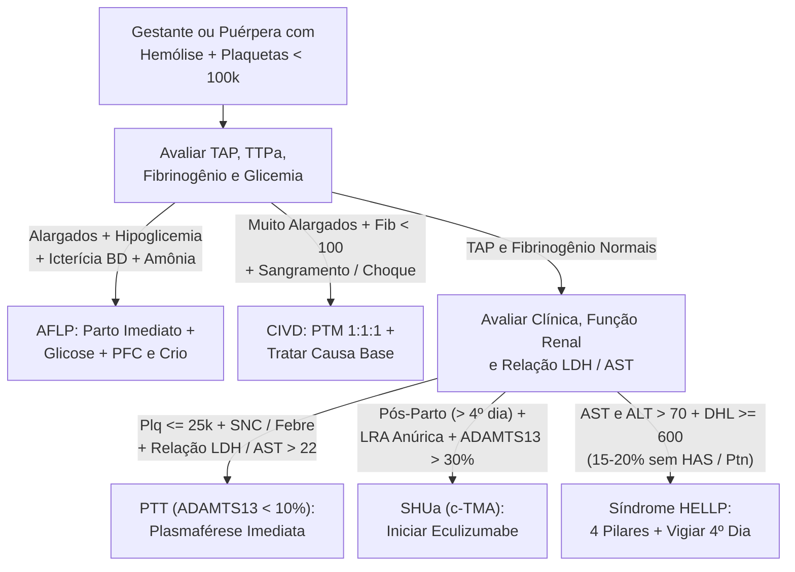
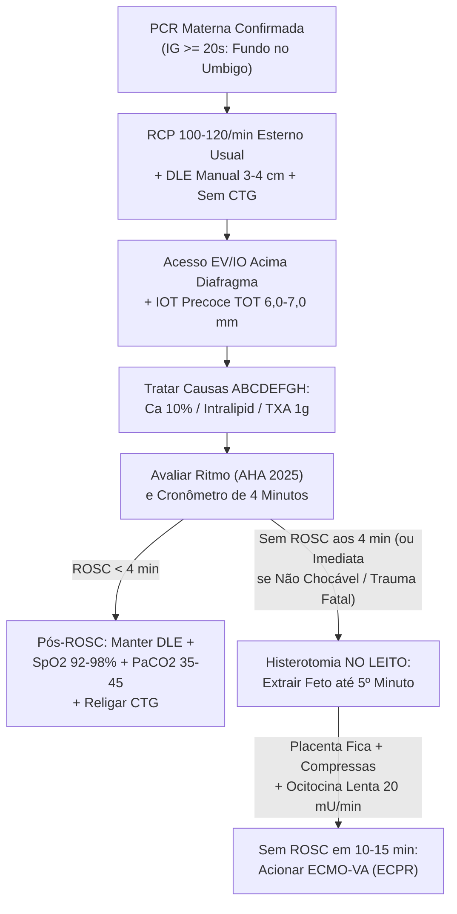
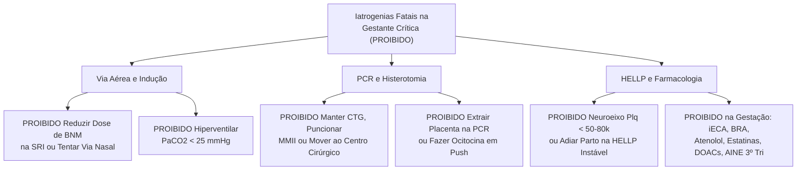

# Cartão Flash de Véspera de Prova — UTI Obstétrica: Via Aérea, PCR & Síndrome HELLP (Aula 03)

## 1. Conceitos-Chave & Raciocínio Clínico Estruturado

<b>Passo 1: Tríade da Via Aérea Difícil Gestacional & Checklist dos 9 Passos da IOT</b>

- **Por que a via aérea falha rápido (Tríade Fisiológica, Anatômica e Psicológica):**
  - *Fisiológica:* **↑ VO2 fetoplacentário** somado à **↓ CRF e ↓ CPT** (elevação diafragmática de **4 cm**) esgota o reservatório de O2 e gera dessaturação em segundos; progesterona relaxa o esfíncter esofágico inferior + **↑ PIA + ↓ pH gástrico** → alto risco de broncoaspiração (Síndrome de Mendelson); compressão aortocava agrava a hipotensão pós-indução; hiperventilação bulbar basal mantém **PaCO2 28–32 mmHg** e **HCO3- 18–22 mEq/L** (**PaCO2 de 38–40 mmHg já traduz fadiga muscular aguda!**).
  - *Anatômica e Psicológica:* Estrogênio e hipervolemia causam edema/friabilidade mucosa (sangramento fácil e glote estreita), **piora dinâmica do Mallampati** no trabalho de parto e mamas volumosas bloqueando o laringoscópio, somados ao estresse de manejar dois pacientes.
- **Execução dos 9 Passos da IOT (indicações idênticas ao adulto: proteção, IRespA ou curso clínico/transporte):**
  - **Equipe e Método:** Sempre o **operador mais experiente** + obstetrícia pronta à beira-leito; **Sequência Rápida de Intubação (SRI)** (ou *Awake* se falha anatômica prevista; **via nasotraqueal proibida!**).
  - **Posicionamento, Pré-O2 e Pré-Tratamento:** Cabeceira **30° em rampa** (alinhar tragus ao manúbrio) + **DLE de 15° (3–4 cm)**; pré-oxigenar **sentada com O2 100% ≥ 3 min** (ou **8 inspirações em capacidade vital**) + oxigenação apneica via **CNAF (THRIVE)** ou CN 15 L/min (cautela com VNI por aerofagia/aspiração e hipocapnia); **Fentanil 1–2 µg/kg** para simpatólise na PE/TACO/HIC + fluidos/DVA se hipovolemia.
  - **Indução, Passagem e Metas Pós-IOT:** **Doses plenas habituais de adulto** de sedativo e BNM (**Rocurônio 1,2 mg/kg** c/ Sugamadex ou **Succinilcolina 1,0–1,5 mg/kg**) → **laringoscópio de cabo curto (Stubby) + Videolaringoscópio + Bougie na 1ª tentativa + TOT 0,5–1,0 mm menor (6,0–7,0 mm)** + aspirador Yankauer (falha em **2 tentativas → máscara laríngea de 2ª geração menor**) → confirmar com **capnografia em curva** e ajustar **VC 6 mL/kg peso ideal, PEEP 5–8 cmH2O, SpO2 ≥ 94%, PaO2 > 70 mmHg e PaCO2 28–32 mmHg** (evitar **PaCO2 < 25 mmHg**: vasoconstrição uterina e desvio da curva de Hb para a esquerda).

<b>Passo 2: Farmacologia Intensiva Materno-Fetal, Placa Motora & Lista Vermelha JACC</b>

- **Passagem Placentária & Sinergismo Neuromuscular:**
  - Quase todos os sedativos e opioides cruzam a placenta por difusão passiva (**avisar neonatologia se parto imediato!**), enquanto os BNMs são compostos de amônio quaternário ionizados que **praticamente não atravessam a placenta**.
  - **Interação Crítica (MgSO4 + BNM):** O magnésio inibe a liberação pré-sináptica de acetilcolina e reduz a sensibilidade da placa motora, **exacerbando drasticamente os BNMs** → exigir monitorização com **TOF e BIS (alvo 40–60)**.
- **Escolha Fina na UTI Obstétrica:**
  - *Analgésicos:* **Paracetamol** (1ª linha), **Fentanil** (escolha em instáveis: cardioestável, sem metabólito renal) e **Remifentanil** (esterases plasmáticas, não acumula) ↔ evitar **Morfina** (histamina/hipotensão e acúmulo na LRA), **Dipirona** apenas adjuvante crítica e **AINEs proibidos no 3º tri** (fechamento precoce do canal arterial e oligoâmnio).
  - *Sedativos e BNMs (< 48h):* Evitar benzodiazepínicos (**Midazolam** acumula > 48h/LRA; **Lorazepam** contém propilenoglicol → acidose láctica e *floppy infant*/abstinência); **Propofol** exige suporte volêmico (hipotensor; risco de PRIS > 4–5 mg/kg/h); **Dexmedetomidina** (desmame) e **Cetamina** (altas doses) podem contrair o útero. BNM contínuo preferencial: **Cisatracúrio** (**reação de Hofmann**, independe de rim/fígado) sobre Vecurônio.
  - *Vasopressores e Lista JACC:* Após DLE + fluido, **Noradrenalina é 1ª escolha** (restaurar PAM materna protege o feto; evitar **Efedrina** na UTI pois cruza placenta e **causa acidose metabólica fetal**; **Adrenalina** na anafilaxia/PCR; **Vasopressina** adjuvante; Labetalol/Metoprolol/Esmolol causam bradicardia/hipoglicemia fetal). **Seguros JACC:** HNF/HBPM, Alteplase, Adenosina, Lidocaína, Digoxina, Metoprolol, Furosemida, Hidralazina/Nitratos, Sildenafil/Epoprostenol. **7 Classes Estritamente Proibidas na Gestação:** **(1) Atenolol** (RCIU), **(2) iECA** e **(3) BRA** (disgenesia renal/oligoâmnio — **liberados na lactação!**), **(4) Espironolactona** (feminização fetal), **(5) Estatinas**, **(6) DOACs** (proibidos na gestação **e** lactação!) e **(7) Bosentana/ERAs** — além de **Amiodarona fora da PCR** (hipotireoidismo fetal; **na PCR faz 300 mg IV!**) e **Varfarina na gestação** (**segura na lactação**).

<b>Passo 3: Deterioração Clínica (OEWS) & ACLS na PCR Materna (AHA 2020 vs. AHA 2025)</b>

- **Racional Hemodinâmico e Epidemiologia:**
  - A partir de **IG ≥ 20 semanas** (fundo uterino na ou acima da cicatriz umbilical), o útero obstrui a veia cava inferior em supino e anula o débito das compressões sem alívio mecânico. Mais de **70% das PCRs são em ritmos não chocáveis** (AESP/Assistolia); causas #1 no **Brasil** = Síndromes Hipertensivas, Hemorragia e Infecções; nos **EUA/Reino Unido** = TEP, Hemorragia e Sepse.
  - **Triagem OEWS** (Temp, Pulso, FR, PAS, Diurese, Via de Parto, Consciência): **≥ 2 pts** repetir em 30 min; **≥ 3 pts** médico imediato; **> 6 pontos = mortalidade materna de 6,3%** → acionar TRR/UTI + DLE + O2 (SpO2 ≥ 94%) + **2 acessos 14–16G em MMSS**.
- **Modificações Invioláveis do ACLS & Atualização AHA 2025:**
  - **Desconectar monitores fetais imediatamente** (Classe 3 AHA: atraso e risco elétrico); manter prancha supina rígida (não inclinar maca!) com **compressões 100–120/min (5–6 cm, 30:2 pré-IOT) na metade inferior habitual do esterno** + **DLE manual contínuo de 3 a 4 cm (1,5–2 pol)**.
  - **Acessos EV/IO exclusivos acima do diafragma**; desfibrilação bifásica padrão **120–200 J** ântero-apical; após via aérea avançada, **8–10 ventilações/min (1/6s)** visando **ETCO2 > 10–20 mmHg**.
  - **Refinamentos AHA 2025:** Time dedicado (*Cardiac Arrest in Pregnancy Team*), **supraglótico precoce** se sem intubador qualificado, **Ácido Tranexâmico 1 g IV** na hemorragia periparto e histerotomia **imediata nos ritmos não chocáveis ou PCR não testemunhada** (e em **até 5 min ou pós-falha do 1º choque** nos chocáveis).

<b>Passo 4: Histerotomia de Reanimação, Causas ABCDEFGH (Mg/LAST) & Embolia Amniótica</b>

- **Histerotomia de Reanimação (Regra dos 4 a 5 Minutos em IG ≥ 20 semanas):**
  - Manobra cirúrgica **primariamente materna**: esvaziar o útero descomprime a cava, **eleva o DC da RCP em 30–40%** e melhora a complacência torácica.
  - Sem ROSC aos **4 min** → operar **NO PRÓPRIO LEITO** para extrair o feto em **1 min (até o 5º min)** (imediata se trauma materno fatal, tempo desconhecido ou falha do 1º choque; considerar mesmo após 5 min; fórceps/vácuo só se expulsivo **< 1 min**): incisão vertical mediana + histerotomia mediana → **NÃO remover a placenta!** (tamponar útero com compressas) → **Ocitocina lenta (20 mU/min / 20 mL/min diluída — proibido bólus rápido!)** + ATB amplo → massagem cardíaca direta transdiafragmática até 15 min; se sem ROSC em **10–15 min → ECMO-VA (ECPR)**.
  - **Pós-ROSC:** Manter **DLE** (mesmo pós-histerotomia!), **SpO2 92–98%**, **PaCO2 35–45 mmHg**, **PAS > 90 mmHg (PAM ≥ 65)**, **Glicemia 150–180 mg/dL**, temperatura **36–37,5 °C** e religar CTG se feto *in utero*.
- **Antídotos do ABCDEFGH & Embolia de Líquido Amniótico (ELA):**
  - *Intoxicação por MgSO4:* suspender infusão + **Gluconato de Cálcio 10% 15–30 mL EV** (ou **Cloreto de Cálcio 10% 10 mL EV**).
  - *Toxicidade por Anestésico Local (LAST):* **Emulsão Lipídica 20% bólus 1,5 mL/kg em 1 min + 15 mL/kg/h (0,25 mL/kg/min)** (repetir bólus até 2× a cada 5 min e subir p/ 0,5 mL/kg/min).
  - *Embolia Amniótica (ELA):* reação anafilactoide → vasoespasmo pulmonar (**falência aguda de VD**) + hipóxia/SDRA + **CIVD** → **PTM 1:1:1 + Ácido Tranexâmico 1 g EV + NOi/Epoprostenol inalatório + ECMO-VA** (*Atropina sem bradicardia é Classe 3!*).

<b>Passo 5: Síndrome HELLP (Os 4 Pilares, Regra do 4º Dia) & Diferencial das 5 MATs</b>

- **Fisiopatologia, Armadilhas & Escores:**
  - Falha da 2ª onda trofoblástica → isquemia placentária → **↑ sFlt-1 e ↑ sEng** (sequestram VEGF/PlGF) → redes de fibrina nos sinusoides hepáticos (**esquizócitos** + necrose periportal + trombocitopenia). **Armadilhas:** **15–20% são normotensas e sem proteinúria**; **15–30% surgem no pós-parto** (48h até 7º dia); Hb falseada por hemoconcentração e icterícia rara (5–10%) → repetir lab em **8–12h** e seriar de **12/12h**!
  - **Tennessee** (3 domínios = completa; 2 = parcial): Esquizócitos + **BT > 1,2 mg/dL / DHL ≥ 600 UI/L / Haptoglobina < 25 mg/dL** + **AST/ALT > 70 UI/L** + **Plaquetas < 100.000/µL**. **Mississippi:** Classe 1 **≤ 50k** (40–60% morbidade), Classe 2 **50–100k**, Classe 3 **100–150k** (AST ≥ 40).
- **Os 4 Pilares Terapêuticos & Auditoria do 4º Dia Pós-Parto:**
  - **(1) MgSO4 até 24h pós-parto** (AMIB BI 4–6 g + 1–2 g/h; Pritchard 4 g EV + 10 g IM + 5 g IM 4/4h; CI: **miastenia gravis**, hipocalcemia, anúria, BAV, miocardite; vigiar 4/4h patelar, FR ≥ 12 e DU > 25–30 mL/h, dosando Mg sérico 4/4h só na LRA; se arreflexia ≥ 9 mg/dL ou FR < 12 ≥ 12 mg/dL → suspender + **Gluconato Ca 10% 1 g / 10 mL em 3–5 min** ± Furosemida); **(2) PA ≥ 160×110 (> 15 min):** cair 20–30% p/ **140–155×90–100 mmHg** com Hidralazina EV, Labetalol EV, Nicardipina EV ou Nifedipino VO 10–20 mg; **(3) Hemoterapia:** Plq se **< 25–30k** sangrando, **< 50k** p/ cesárea, **> 50–80k** p/ neuroeixo; CH se **Ht < 25%**; Fibrinogênio manter **> 150–300 mg/dL** c/ Crioprecipitado; **(4) Parto resolutivo:** imediato se **≥ 34 sem** ou instável em qualquer IG (< 34 sem estável: Betametasona máx 48h, **jamais adiar parto se instável!** Palpar fígado na cesárea se dor HCD/Chaussier ou Kehr/ombro D + dreno subfascial).
  - **Regra do 4º Dia (5 MATs):** Plaquetas/DHL pioram em 24–48h e melhoram após o **4º dia pós-parto**. Se persistirem após o 4º dia, contestar HELLP: **PTT** (**Plq ≤ 20–25k**, SNC 60–70%, febre, coagulograma normal, **LDH/AST > 22**, **ADAMTS13 < 10%** → **Plasmaférese**, parto não cura!) ↔ **SHUa** (pós-parto, **100% LRA anúrica**, ADAMTS13 > 30% → **Eculizumabe**) ↔ **AFLP** (**hipoglicemia**, icterícia BD, ↑ amônia, leucocitose > 13k, ác. úrico ~11, ↓ AT-III, TAP ↑ e Fibrinogênio ↓↓ → Parto + Glicose + PFC/Crio) ↔ **CIVD**.

---

## 2. Equações, Escores, Doses & Cortes Secos

- **Basal Gasométrico & Metas Ventilatórias:** Basal 3º tri **PaCO2 28–32 mmHg** e **HCO3- 18–22 mEq/L**; Pós-IOT **VC 6 mL/kg peso ideal, PEEP 5–8 cmH2O, SpO2 ≥ 94%, PaO2 > 70 mmHg, PaCO2 28–32 mmHg**; Pós-ROSC **SpO2 92–98%, PaCO2 35–45 mmHg, PAS > 90 mmHg, Glicemia 150–180 mg/dL, CDT 36–37,5 °C**.
- **OEWS & Escores de HELLP:** **OEWS ≥ 2** reavaliar 30 min, **≥ 3** médico imediato, **> 6 pts = 6,3% mortalidade** (UTI/TRR); **Tennessee** = Esquizócitos + **BT > 1,2 mg/dL / DHL ≥ 600 UI/L / Haptoglobina < 25 mg/dL** + **AST/ALT > 70 UI/L** + **Plq < 100.000/µL** (**Mississippi:** Classe 1 **≤ 50k**, Classe 2 **50–100k**, Classe 3 **100–150k**).
- **Métricas da PCR & Histerotomia (IG ≥ 20 sem / umbigo):** RCP **100–120/min (5–6 cm)** + **DLE manual 3–4 cm (1,5–2 pol)** + Choque **120–200 J** + **8–10 vent/min (ETCO2 > 10–20 mmHg)** → sem ROSC aos **4 min = Histerotomia no leito** (feto até **5 min**) + **Ocitocina lenta 20 mU/min**; refratária **10–15 min = ECMO-VA**.
- **Esquemas de MgSO4 & Faixas de Toxicidade:** **AMIB BI** **4–6 g EV (20–30 min) + 1–2 g/h** (slide **1,2 g/h**); **Pritchard** **4 g EV + 10 g IM + 5 g IM 4/4h**; **Zuspan** **4 g + 1 g/h**; **Sibai** **6 g + 2–3 g/h** — Terapêutico **4,8–8,4 mg/dL**, Arreflexia **9 mg/dL**, FR < 12 **12 mg/dL**, PCR **30 mg/dL**.
- **Antídotos & Anti-Hipertensivos EV (PA ≥ 160×110 por > 15 min):** Toxicidade Mg **Gluconato Ca 10% 1 g (10 mL) em 3–5 min** (PCR: **15–30 mL** ou **Cloreto Ca 10% 10 mL**); LAST **Intralipid 20% 1,5 mL/kg bólus + 15 mL/kg/h**; **Labetalol EV 20→40→80→80 mg** (máx 300 mg; BI **0,5–1 mg/kg/h**); **Hidralazina EV 5 mg → 5–10 mg** (máx **40 mg/12h**); **Nicardipina BI 0,5–4 mg/h**.
- **Gatilhos Hemoterápicos & Rendimento:** **Plaquetas** se **< 25–30k** sangrando, **< 50k** p/ cesárea, **> 50–80k** p/ neuroeixo (**1 CP ↑ 5–10k**; **1 Pool ↑ 30–50k**); **CH** se **Ht < 25%** pré-parto ou **Hb < 7–8 g/dL**; **Fibrinogênio** basal **400–600 mg/dL**, se **< 100–150** manter **> 150–300 mg/dL** (**6 Crio ↑ 25–50 mg/dL** vs. **1 PFC ↑ 5–10 mg/dL**).

---

## 3. Diferenciações Matadoras de Pegadinha

- **Síndrome HELLP Pura ↔ Esteatose Hepática Aguda (AFLP):** Na HELLP o **TAP/TTPa, Fibrinogênio e Glicemia são normais** e a icterícia é rara (5–10%) ↔ na AFLP há **hipoglicemia refratária (50–100%), icterícia colestática por BD (40–90%), ↑ amônia, leucocitose > 13.000, ácido úrico ~11 mg/dL, ↓ AT-III e Fibrinogênio muito baixo**.
- **HELLP ↔ PTT ↔ SHU Atípica (Regra do 4º Dia):** A HELLP tem **AST/ALT > 70, LDH/AST < 22** e melhora após o **4º dia pós-parto** ↔ a **PTT** cursa com **Plq ≤ 20–25k, sintomas neurológicos (60–70%), febre, LDH/AST > 22 e ADAMTS13 < 10%** (parto não cura → **Plasmaférese**) ↔ a **SHUa** explode no pós-parto com **100% de LRA anúrica** e ADAMTS13 > 30% (**Eculizumabe**).
- **Fármacos na Gestação ↔ Lactação:** **iECA, BRA e Varfarina** são **proibidos na gestação** (disgenesia renal/embriopatia), mas **SEGUROS e liberados no aleitamento** ↔ **DOACs** são **proibidos na gestação E na lactação**, enquanto **HCTZ** pode ser mantida na HAS crônica gestacional mas deve ser **suspensa na amamentação** (inibe lactogênese).
- **Noradrenalina ↔ Efedrina & Cisatracúrio ↔ Vecurônio:** **Noradrenalina** é 1ª escolha no choque na UTI ↔ **Efedrina** cruza a placenta e **causa acidose metabólica fetal**; no bloqueio contínuo, **Cisatracúrio** (Hofmann) não acumula ↔ **Vecurônio** acumula na LRA e hepatopatia.
- **Amiodarona Crônica ↔ Amiodarona na PCR & Dose de BNM na SRI:** Fora da PCR a **Amiodarona é Categoria D** (hipotireoidismo fetal), mas **na PCR chocável refratária faz-se 300 mg IV normalmente** ↔ na SRI usa-se **dose PLENA de adulto de BNM** (ionizado, não cruza placenta; subdosar gera laringoespasmo/aspiração).
- **Histerotomia AHA 2020 ↔ Refinamento AHA 2025 (IG ≥ 20 sem):** Regra clássica inicia aos **4 min sem ROSC** p/ parto até **5 min** no leito ↔ **AHA 2025** indica **imediata nos ritmos não chocáveis ou PCR não testemunhada** e **até 5 min (ou pós-falha do 1º choque)** nos chocáveis.

---

## 4. POCUS, Gráficos, Propedêutica Armada & Diretrizes

- **Capnografia em Curva na IOT e Intra-PCR:** Padrão-ouro confirmatório da IOT + qualidade da RCP → **ETCO2 > 10–20 mmHg** indica bom retorno venoso (**ETCO2 > 20 mmHg** favorece prolongar RCP; **ETCO2 < 10 mmHg persistente após 20 min** em assistolia favorece interromper esforços).
- **POCUS Cardiopulmonar e VCI no Colapso Periparto:** Sobrecarga/dilatação aguda de VD aponta **Embolia Amniótica ou TEP maciço** → acionar **PTM + TXA 1 g + NOi + ECMO-VA** (ou **Alteplase** no TEP); diante de **VCI colabada**, repetir avaliação após **DLE de 15° (3–4 cm)** para excluir pseudo-hipovolemia por compressão aortocava.
- **USG Hepático com Doppler / TC de Abdome na HELLP:** Dor em barra/HCD (**Sinal de Chaussier**), dor no ombro direito (**Sinal de Kehr**) ou choque exige rastreio imediato de **hematoma subcapsular, infarto ou queda de fluxo ao Doppler** → **cesariana + laparotomia com empacotamento** (se operada sem imagem: **palpar o fígado na cesárea**).
- **Vigilância Neuromuscular & Classes AHA:** Em gestantes sulfatadas sob BNM contínuo, monitorar **TOF + BIS (40–60)** pelo sinergismo na placa motora; diretrizes **AHA Classe 1** exigem DLE manual, IOT precoce e histerotomia *in loco*, sendo **Classe 3 (Sem Benefício)** manter CTG na PCR ou usar Atropina sem bradicardia na ELA.

---

## 5. Gabarito Instantâneo das Questões & Gatilhos Críticos da Aula

- **Se o enunciado cobrar a caracterização da Síndrome HELLP (TEMI 2008 — Gab A) →** Marque **anemia hemolítica, plaquetopenia e elevação de enzimas hepáticas** (elimine HAS/proteinúria — ausentes em 15–20% —, convulsões da eclâmpsia e hipoglicemia da AFLP).
- **Se o enunciado pedir os critérios definidores da Síndrome HELLP (TEMI 2009 — Gab D) →** Marque **hemólise, provas hepáticas alteradas e trombocitopenia** (elimine distratores com lipólise, trombocitose, hiperesplenismo ou elevação de lipase).
- **Se o enunciado trouxer PCR em gestante de 34 semanas com pré-eclâmpsia na enfermaria (Autoral — Gab C) →** Marque **deslocar o útero 3–4 cm para a esquerda** mantendo sequência C-A-B, mãos na metade inferior habitual do esterno e pás ântero-apicais com 120–200 J.
- **Se o enunciado trouxer gestante de 32 semanas com síndrome gripal e SpO2 90% precisando de IOT de emergência (Autoral — Gab C) →** Marque **SRI pelo intubador mais experiente com tubo de calibre menor (6,0–7,0 mm)** e **dose plena de BNM** (não retardar com VNI nem indicar parto só pela IOT).
- **Se gestante em uso de MgSO4 evoluir com arreflexia patelar (≥ 9 mg/dL) ou FR < 12 irpm (≥ 12 mg/dL) →** Suspenda o MgSO4 imediatamente e aplique **Gluconato de Cálcio 10% 1 g (10 mL) EV em 3–5 min** (ou **15–30 mL EV** se PCR) ± Furosemida.
- **Se ocorrer arritmia ou PCR após bloqueio anestésico peridural/raquidiano (LAST) →** Administre **Emulsão Lipídica 20% em bólus de 1,5 mL/kg EV em 1 min + infusão de 15 mL/kg/h**.
- **Se surgir tríade periparto de choque súbito + hipoxemia refratária + CIVD/sangramento em punções (ELA) →** Acione **PTM 1:1:1 + Ácido Tranexâmico 1 g EV + NOi/Epoprostenol inalatório + ECMO-VA**.
- **Se plaquetopenia e DHL persistirem sem melhora após o 4º dia pós-parto →** Conteste HELLP, colete **ADAMTS13** e inicie **Plasmaférese imediata** se Plq ≤ 25k + sintomas neurológicos (**PTT**) ou **Eculizumabe** se LRA anúrica com ADAMTS13 > 30% (**SHUa**).

---

## 6. Fluxogramas Decisórios Mermaid

### Mermaid 1 — Diagnóstico Diferencial & Estratificação das MATs na Gestação

### Mermaid 2 — Manejo Escalonado da PCR Materna, Histerotomia & Pós-ROSC

### Mermaid 3 — Armadilhas de Prova & Iatrogenias Fatais (Proibições Absolutas)
