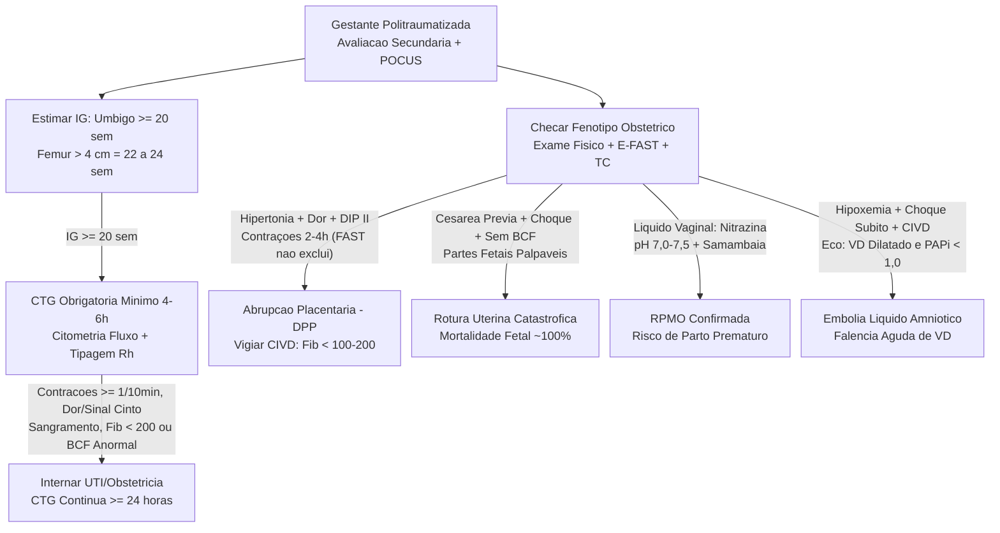
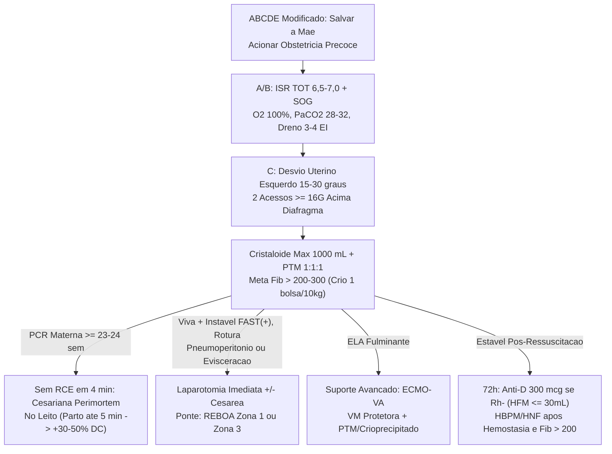
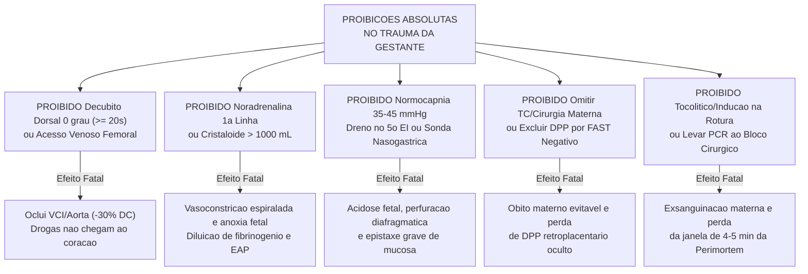

# Cartão Flash de Véspera de Prova — Trauma na Gestante & Ressuscitação Materno-Fetal

## 1. Conceitos-Chave & Raciocínio Clínico Estruturado

<b>Passo 1: Epidemiologia, Marcos de Idade Gestacional & ABCDE Modificado (ATLS 11ª Edição)</b>

- **Doutrina e Epidemiologia Crítica:** Principal causa **não obstétrica** de morte materna (**6% a 8%** das gestações; pico no **3º trimestre** por peso uterino, mudança do centro de gravidade e frouxidão ligamentar). Prioridade absoluta: **salvar a mãe é a melhor ressuscitação fetal** (choque materno acarreta **~80% de mortalidade fetal**; **fratura de pelve** é a lesão óssea isolada mais letal ao feto por impacto no polo cefálico e laceração venosa pélvica).
  - **Contuso (70–80%, ~70% auto, quedas e violência doméstica em face/tórax/abdome)** ↔ **Penetrante (20–30%, FAF/FAB):** o útero protege vísceras maternas superiores, mas eleva o óbito fetal direto; ferimentos **abaixo do 4º espaço intercostal anterior (linha mamilar)** ou **ponta da escápula posterior** atravessam o diafragma elevado e lesam o abdome superior; a distensão peritoneal atenua defesa e descompressão brusca (hemoperitônio silencioso).
- **Marcos Anatômicos de Idade Gestacional (IG):**
  - **≥ 12 semanas:** útero torna-se abdominal (exposto a trauma direto) → **< 15 semanas:** janela teratogênica/microcefalia à radiação (**> 50–100 mGy**) → **≥ 20 semanas:** fundo uterino na **cicatriz umbilical** (compressão de VCI/aorta em supino reduz retorno venoso e DC em **25–30%** + **CTG obrigatória**) → **≥ 22–24 semanas:** viabilidade fetal (**fêmur fetal > 4 cm** no POCUS).
- **ABCDE Modificado à Beira-Leito:**
  - **A (Via Aérea e Estômago Cheio):** Estrogênio gera edema e friabilidade mucosa (via aérea difícil) e progesterona reduz tônus do esfíncter esofágico inferior/esvaziamento gástrico → ISR com pré-oxigenação a **100%**, **TOT menor (6,5–7,0 mm)** e **Sonda Orogástrica — SOG** (**proibido SNG** por epistaxe maciça).
  - **B (Ventilação e Espaço Pleural):** **VO2 ↑ 20%** + **CRF ↓ 20%** causam hipóxia ultrarrápida na apneia; progesterona eleva o volume corrente em **~40%**, exigindo na VM **PaCO2 alvo de 28–32 mmHg (ideal ~30 mmHg)** — PaCO2 de 35–45 mmHg (**≥ 40 mmHg**) gera acidose respiratória e vasoconstrição uterina. Pela subida diafragmática de **até 4 cm**, drenar tórax **1 a 2 espaços acima** do habitual (**3º ou 4º EI**, linha axilar média).
  - **C, D e E:** **Desvio uterino manual à esquerda** ou inclinação da prancha **15–30°** (se ≥ 20 sem) + **2 acessos ≥ 16G acima do diafragma** + prevenir hipotermia (**< 35,6 °C**), diferenciar rebaixamento sensorial de eclâmpsia e **acionar obstetrícia no exame primário**.

<b>Passo 2: Choque Hipovolêmico Mascarado, Restrição Volêmica & Alvo de Fibrinogênio</b>

- **Fisiopatologia do Choque Oculto:** O plasma triplica até o 3º trimestre (**+40% a 50%**) superando a massa eritrocitária (**+20% a 30%** → anemia dilucional: **Hb 10,5–11 g/dL**, **Ht 32–34%**). A mãe perde **1.200 a 1.500 mL (30–35% da volemia)** mantendo PA e FC normais às custas de **vasoconstrição alfa-adrenérgica precoce das artérias espiraladas**, gerando sofrimento fetal antes da hipotensão materna.
- **Ressuscitação Hemostática e Posição sobre Vasopressores:**
  - **Limitar cristaloides isotônicos a ≤ 1.000 mL (1 L)** (evita coagulopatia dilucional, queda da pressão oncótica com EAP e hipotermia) e ativar **PTM 1:1:1** precoce.
  - **Evitar ao máximo vasopressores (noradrenalina/fenilefrina):** agonismo alfa-1 colapsa a perfusão placentária causando anóxia fetal rápida (reservar apenas à falência circulatória terminal/PCR iminente ou Embolia Amniótica).
- **Metas Transfusionais e Alerta do Fibrinogênio:**
  - Manter **Hb ≥ 7–8 g/dL** (Ht > 21–24%), **Plaquetas > 50.000/mm³** (**> 100.000/mm³** se hemorragia obstétrica grave/neurocirurgia/peridural) e **RNI < 1,5**.
  - O fígado hipermetabólico eleva fatores **I, VII, VIII, IX e X** (**Fibrinogênio basal 400–600 mg/dL**): exigir **Fibrinogênio > 200 mg/dL (ideal > 300 mg/dL)** — **< 200 mg/dL** é alerta vermelho de consumo grave e **< 100 mg/dL** confirma **CIVD instalada** → infundir **Crioprecipitado (1 bolsa/10 kg)** ou concentrado de fibrinogênio liofilizado.

<b>Passo 3: Lesões Obstétricas — Abrupção Placentária (DPP), Rotura Uterina, RPMO & ELA</b>

- **Abrupção Placentária — DPP (Complicação Grave #1 e Causa #1 de Óbito Fetal no Contuso):**
  - **Cisalhamento mecânico** entre **miométrio elástico** e **placenta rígida/inelástica** → hematoma retroplacentário + liberação de **tromboplastina tecidual** (**CIVD**).
  - Tríade clássica (dor contínua + sangramento escuro + **hipertonia / "útero em tábua"**) falta em **20–30%** (oculto); preditor mais sensível = **contrações regulares na tocometria (2–4h pós-trauma)** + **DIP II** → estabilização materna + **cesariana de urgência** se feto viável em sofrimento.
- **Rotura Uterina (< 1% dos traumas; Mortalidade Fetal ~100%):**
  - **Cesárea/cicatriz uterina prévia** + dor lancinante (alívio passageiro das contrações) + choque refratário + perda súbita de BCF + **palpação fácil de partes fetais no abdome** + **deformidade do contorno uterino** → **Laparotomia exploradora imediata** (extração fetal + **histerorrafia ou histerectomia**; **proibido tocolíticos, indução ou conduta expectante**).
- **RPMO e Embolia por Líquido Amniótico (ELA):**
  - **RPMO:** viragem do pH vaginal (Nitrazina) de **5,0** para **7,0–7,5** + cristalização em **folha de samambaia** (maior risco fetal = **parto prematuro**, prolapso de cordão e corioamnionite).
  - **ELA:** quebra da barreira corioplacentária → influxo amniótico venoso → vasoespasmo pulmonar + **falência aguda de VD (PAPi < 1,0–1,85; CPO < 0,6 W)** + hipoxemia catastrófica + **CIVD hiperfibrinolítica** → suporte com **ECMO-VA**, VM protetora e PTM/crioprecipitado.

<b>Passo 4: Workup Secundário, Regra da CTG (4–6h vs. 24h), Imagem & Citometria / Anti-D</b>

- **História Obstétrica (CODE) e Cardiotocografia (Obrigatória se IG ≥ 20 sem):**
  - **Mínimo 4 a 6 horas** para todo trauma contuso (mesmo leve; alta segura após 6h se assintomática, sem trauma direto, **< 1 contração/10 min**, BCF 110–160 sem desacelerações, Fib > 200 e pH vaginal 5,0).
  - **Internação e CTG contínua por ≥ 24 horas** se qualquer um dos 5 gatilhos: (1) hematoma/trauma abdominal direto (sinal do cinto); (2) **≥ 1 contração/10 min**; (3) sangramento vaginal; (4) coagulopatia (plaquetopenia ou **Fibrinogênio < 200 mg/dL**); (5) FCF anormal (< 110 bpm, > 160 bpm, **DIP II** ou perda de variabilidade).
- **Imagem Sem Atrasos, Hemorragia Feto-Materna (HFM) e Tromboprofilaxia:**
  - **Jamais omitir RX (< 0,001–0,01 Gy) ou TC com contraste** essenciais à mãe; POCUS/E-FAST avalia pneumotórax/líquido livre (não exclui DPP!); **RNM é segura em toda a gestação**.
  - Solicitar **Citometria de Fluxo** (**padrão-ouro atual** para HFM, substituindo o Kleihauer-Betke) em **todas** as gestantes (Rh+ e Rh-). Se **Rh negativa não sensibilizada** + trauma contuso → **Imunoglobulina Anti-D 300 µg (1.500 UI) em até 72h** (neutraliza **30 mL de sangue fetal** / 15 mL de hemácias; titular +300 µg a cada 30 mL extras). Iniciar **HBPM/HNF** profilática assim que hemostasia e Fibrinogênio > 200–300 mg/dL estiverem estáveis.

<b>Passo 5: Laparotomia Exploradora, REBOA, Cesariana de Emergência & Perimortem</b>

- **Cirurgia Materna e REBOA (A Gravidez Nunca Posterga Laparotomia):**
  - **5 Indicações Absolutas de Laparotomia:** (1) FAST ou LPD (+) com instabilidade; (2) pneumoperitônio pré-lavagem; (3) distensão progressiva + queda de Ht/transfusão contínua; (4) ruptura/perfuração parietal com evisceração; (5) penetrante peritoneal ou choque refratário.
  - **REBOA (Zona 1 — aorta torácica descendente — ou Zona 3 — aorta infrarrenal):** ponte endovascular para elevar PAS/pós-carga no choque subdiafragmático/pélvico exsanguinante refratário.
- **Cesariana de Emergência ↔ Cesariana Perimortem (Regra dos 4 a 5 Minutos):**
  - **Cesariana de Emergência:** feto viável (**≥ 24 sem**) em sofrimento agudo, rotura uterina, choque hemorrágico maciço/exsanguinação, útero limitando mecanicamente o reparo vascular/visceral materno ou **fratura instável da coluna toracolombar**.
  - **Cesariana Perimortem:** em **PCR materna refratária com IG ≥ 23–24 semanas** (útero 1–2 polpas acima do umbigo), iniciar incisão **no 4º minuto** sem RCE e extrair feto e placenta **até o 5º minuto à beira do leito** (sem transporte ao CC), elevando o DC da RCP de **10% para 30% a 50%**.

---

## 2. Equações, Escores, Doses & Cortes Secos

- **Retorno Venoso Supino (≥ 20 sem) e RCP (≥ 23–24 sem):** **ΔDC supino = −25% a −30%** (desvio esquerdo **15–30°** restaura **+30% DC**); **DC na RCP gravídica ≈ 10%** → sobe para **30% a 50%** após **Cesariana Perimortem (incisão 4º min / parto 5º min)**.
- **Índices Hemodinâmicos (Choque / ELA):** **CPO = (PAM × DC) ÷ 451** (normal **> 0,8 W**; grave **< 0,6 W**) e **PAPi = (PAPs − PAPd) ÷ PVC** (**< 1,0 a 1,85** = falência grave de VD na Embolia Amniótica).
- **Alvos Ventilatórios, Anatômicos e Biometria:** **TOT 6,5–7,0 mm** + **SOG**; **PaCO2 alvo 28–32 mmHg (~30 mmHg)**; dreno torácico no **3º ou 4º EI**; **fêmur fetal > 4 cm = IG 22–24 semanas**; Nitrazina amniótica **pH 7,0–7,5** (vaginal **5,0**).
- **Metas Hemostáticas e Cristaloides:** Cristaloide isotônico **máx. 1.000 mL** + **PTM 1:1:1**; **Hb ≥ 7–8 g/dL**, **Plq > 50.000/mm³** (> 100.000 se HPP/neurocirurgia), **RNI < 1,5**, **Fibrinogênio > 200–300 mg/dL** (**< 200** alerta; **< 100** CIVD → **Crioprecipitado 1 bolsa/10 kg**).
- **Imunoprofilaxia Rh (até 72h):** **Imunoglobulina Anti-D 300 µg (1.500 UI)** cobre até **30 mL de sangue fetal total** (15 mL de hemácias); se **Citometria de Fluxo > 30 mL**, aplicar **+300 µg** por cada **30 mL** excedentes.
- **Segurança Radiológica Fetal:** Janela crítica **IG < 15 semanas** com risco teratogênico/microcefalia apenas acima de **50 a 100 mGy** cumulativos (RX simples **< 0,001–0,01 Gy**; **RNM segura em todos os trimestres**).

---

## 3. Diferenciações Matadoras de Pegadinha

- **Abrupção Placentária — DPP ↔ Rotura Uterina:** Cisalhamento placentário com **hipertonia ("útero em tábua")**, **DIP II** e consumo de fibrinogênio (oculto em **20–30%**) ↔ Cicatriz/cesárea prévia com choque abrupto, perda de BCF, **deformidade uterina** e **partes fetais palpáveis sob a pele**.
- **Choque Materno Inicial ↔ Síndrome da Hipotensão Supina (≥ 20 sem):** Perda oculta de **1.200–1.500 mL** com **PA/FC normais** mas sofrimento fetal precoce por vasoconstrição alfa-1 ↔ Hipotensão aguda em decúbito dorsal (0°) com volemia íntegra, revertida na hora pelo **desvio uterino esquerdo 15–30°**.
- **Alvo de Fibrinogênio Gestante ↔ Não Gestante:** Basal gravídico **400–600 mg/dL** exige meta **> 200–300 mg/dL** (**< 200** já é consumo grave!) ↔ Meta padrão no trauma não obstétrico é **> 150 mg/dL**.
- **PaCO2 na VM da Gestante ↔ Não Gestante:** Meta obrigatória de **28–32 mmHg** (alcalose respiratória fisiológica pela progesterona) ↔ "Normocapnia" de **35–45 mmHg** na grávida representa **retenção grave de CO2**, acidose fetal e vasoconstrição uterina.
- **Citometria de Fluxo ↔ Teste de Kleihauer-Betke:** **Padrão-ouro atual** de alta sensibilidade/especificidade solicitado em **todas** as traumatizadas (Rh+ e Rh-) ↔ Teste manual histórico superado na titulação fina da Hemorragia Feto-Materna.
- **CTG de 4–6 horas ↔ CTG Prolongada ≥ 24 horas:** Triagem mínima obrigatória em todo trauma contuso **≥ 20 sem** assintomático ↔ Internação mandatória se **≥ 1 contração/10 min**, trauma abdominal direto, sangramento vaginal, **Fibrinogênio < 200 mg/dL** ou FCF anormal.

---

## 4. POCUS, Gráficos/CTG, Propedêutica Armada & Grandes Trials

- **Cardiotocografia (≥ 20 sem):** **≥ 1 contração/10 min** (tocometria nas primeiras 2–4h = preditor mais precoce de DPP), **taquicardia > 160 bpm** (1º sinal de choque materno oculto), **bradicardia < 110 bpm** ou **DIP II** → **internar ≥ 24h** ou **cesariana de urgência** se viável em sofrimento.
- **E-FAST + Biometria + Eco Hemodinâmico:** Avalia pneumotórax/hemoperitônio (**FAST negativo NÃO exclui DPP/rotura!**) + **fêmur > 4 cm = 22–24 sem**; **VCI colabada** sugere hipovolemia/compressão supina ↔ **VCI > 2,1 cm + D-shape / TAPSE < 17 mm** aponta **Embolia Amniótica → ECMO-VA**.
- **Curva de PAI, Capnografia e Propedêutica Vaginal:** Queda de **25–30%** da pressão de pulso a 0° revertida com tração uterina esquerda; capnografia guiada para **PaCO2 28–32 mmHg**; **Nitrazina pH 7,0–7,5 + folha de samambaia** confirma RPMO.
- **Diretrizes ATLS 11ª Edição:** **Salvar a mãe primeiro**, cristaloide **≤ 1 L + PTM 1:1:1**, **evitar vasopressores** no choque hipovolêmico, **nunca adiar TC/laparotomia** pela gravidez, **REBOA (Zona 1 ou 3)** no choque pélvico refratário e **Cesariana Perimortem em 4–5 min** na PCR ≥ 23–24 sem.

---

## 5. Gabarito Instantâneo das Questões & Gatilhos Críticos da Aula

- **Se o enunciado trouxer** gestante de 32 sem pós-colisão auto com dor difusa, **útero hipertônico**, sangramento discreto e **desacelerações tardias (DIP II)** (Questão 1 Autoral) → **Marque Abrupção placentária — Gabarito C** (elimina rotura uterina pela hipertonia e ausência de partes fetais palpáveis, e TPP pelo sofrimento/hipertonia).
- **Se o enunciado trouxer** gestante de 36 sem com **cesárea prévia**, trauma direto, choque, perda súbita de BCF, **deformidade uterina e fácil palpação de partes fetais** (Questão 2 Autoral) → **Marque Laparotomia exploratória imediata — Gabarito C** (rotura uterina; proibido conduta expectante, indução do parto ou tocolíticos).
- **Se o enunciado trouxer** **PCR materna refratária** em IG **≥ 23–24 semanas** sem RCE aos **4 minutos** → **Marque Cesariana Perimortem à beira do leito** (incisão no **4º min**, parto até o **5º min**, sem transportar ao centro cirúrgico).
- **Se o enunciado trouxer** gestante intubada com gasometria exibindo **PaCO2 de 38–42 mmHg** → **Marque aumentar FR/volume minuto** na VM para restaurar a **PaCO2 fisiológica de 28–32 mmHg**.
- **Se o enunciado trouxer** indicação de **drenagem torácica** e descompressão gástrica na gestante traumatizada → **Marque toracostomia no 3º ou 4º EI** (1–2 EIs acima) + **Sonda Orogástrica (SOG)** (proibido SNG e 5º EI).
- **Se o enunciado trouxer** ferimento penetrante **abaixo do 4º EI anterior** ou **ponta da escápula posterior** → **Marque investigação ativa/exploração de lesão transdiafragmática e abdominal superior**.
- **Se o enunciado trouxer** politrauma gravídico com **Fibrinogênio < 200 mg/dL** (ou < 100 mg/dL) → **Marque Crioprecipitado 1 bolsa/10 kg** (ou concentrado de fibrinogênio) + **PTM 1:1:1** evitando noradrenalina.
- **Se o enunciado trouxer** gestante **Rh negativa** após trauma contuso abdominal → **Marque Imunoglobulina Anti-D 300 µg (1.500 UI) em até 72h** + **Citometria de Fluxo** quantitativa.

---

## 6. Fluxogramas Mermaid de Diagnóstico, Manejo & Iatrogenias

### Mermaid 1 — Diagnóstico Diferencial, Estratificação & Propedêutica

### Mermaid 2 — Manejo Terapêutico Escalonado & Marcos de Reavaliação

### Mermaid 3 — Armadilhas de Prova & Iatrogenias Fatais (Proibições Absolutas)

