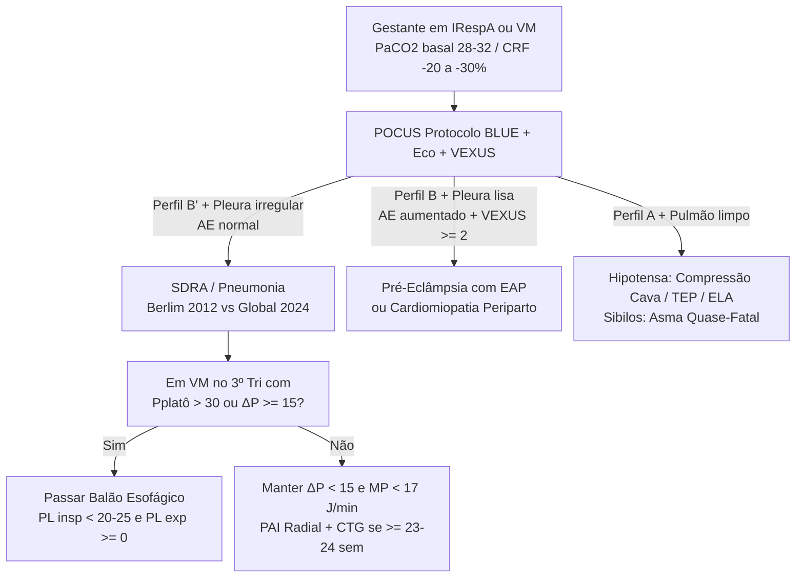
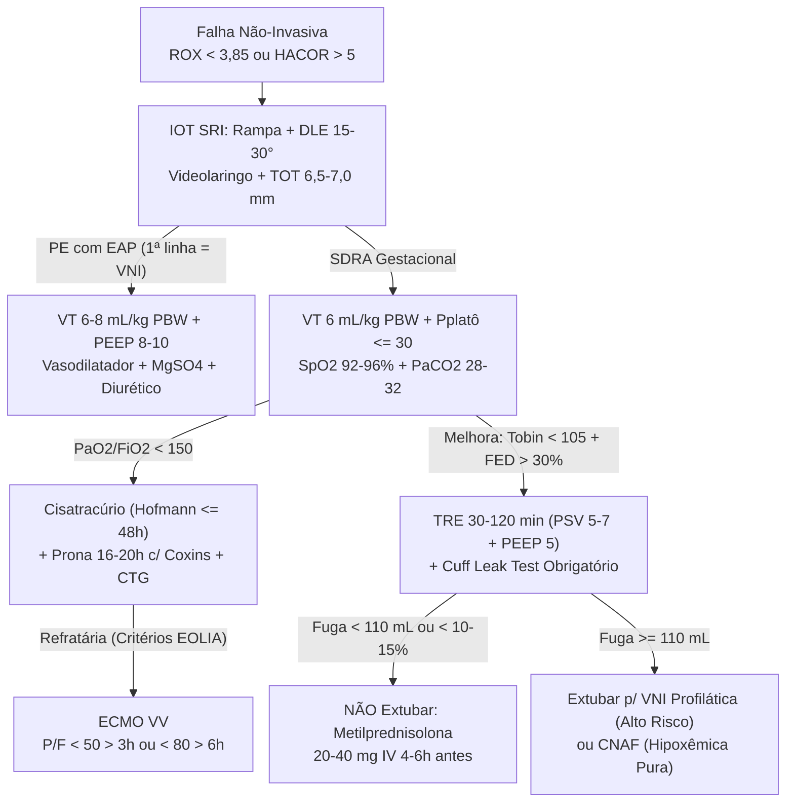
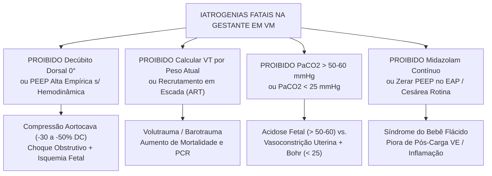

# 🫁 CARTÃO FLASH DE VÉSPERA DE PROVA — VM EM GESTANTE & PNEUMOINTENSIVISMO (TEMI / AMIB)

## 1. Conceitos-Chave & Raciocínio Clínico Estruturado

<b>Passo 1: Fisiologia Mecânica vs. Hormonal, Hard Data Espirométricos & Definições de SDRA (Berlim 2012 vs. Global 2024)</b>

- **Premissa Placentária e Eixo Mecânico ("Melancia na Barriga"):**
  - → A circulação útero-placentária **não possui autorregulação** (depende linearmente da PAM materna e inversamente da resistência vascular uterina). No 3º trimestre, o útero eleva o diafragma em **4 a 5 cm**, abre o ângulo subcostal e o diâmetro látero-lateral, mas eleva a PIA e derruba a complacência tóraco-abdominal.
  - → Em decúbito dorsal horizontal (0°), o útero comprime a veia cava inferior e a aorta abdominal → **↓ retorno venoso e ↓ DC em 30% a 50%** (Síndrome da Hipotensão Supina / choque mascarado antes da queda da PA braquial), apesar do basal hiperdinâmico (**DC ↑ 30–50% para ~6,2 vs. 4,3 L/min**, **FC ↑ 15–20% para ~83 vs. 71 bpm**, **VS ↑ 20–30%**, **↓ RVS** por progesterona/NO e PAM menor no 2º tri que normaliza no 3º).
- **Eixo Hormonal e Via Aérea Difícil (Anatômica + Fisiológica):**
  - → A **progesterona** sensibiliza o centro respiratório bulbar ao CO2, gera leve broncodilatação e relaxa o EEI ("estômago sempre cheio" = broncoaspiração). O ingurgitamento/edema mucoso orofaringolaríngeo (sangramento fácil + estridor) somado às mamas hipertrofiadas dificulta a laringoscopia.
- **Espirometria e Gasometria Basal (O Ponto Mais Cobrado em Prova):**
  - → **CRF cai 20% a 30% (~1.700 → ~1.350 mL)** pela soma de **↓ VR + ↓ VRE** → dessaturação crítica em segundos na apneia (↓ reserva + ↑ VO2) ↔ **Capacidade Vital (CV) fica NORMAL/MANTIDA (~3.200 mL)** pois o ganho da **Capacidade Inspiratória (CI ↑)** compensa a queda do VRE; **VT ↑ 30–40% (~450 → ~600 mL)**; **CPT cai ~5%**; **VEF1/CVF mantida**.
  - → **Alcalose respiratória crônica compensada:** **pH 7,40–7,45**, **PaCO2 28–32 mmHg** (**PaCO2 de 35–45 mmHg em gestante taquipneica já é hipercapnia relativa e fadiga iminente!**), **HCO3- 18–22 mEq/L** e **PaO2 > 70 mmHg (95–100 mmHg em ar ambiente)**.
- **SDRA (Berlim 2012 vs. Global 2024) e Subfenótipos de Calfee:**
  - → **Berlim 2012** (≤ 7 dias, opacidades bilaterais não-cardiogênicas, PEEP/CPAP ≥ 5 cmH2O: Leve P/F 201–300 mort ~27%; Mod 101–200 mort ~32%; Grave ≤ 100 mort ~45%) ↔ **Definição Global 2024 (Matthay et al.)** inclui **CNAF ≥ 30 L/min**, **SpO2/FiO2 ≤ 315** (se SpO2 ≤ 97%: Mod ≤ 235, Grave ≤ 148) e **POCUS pulmonar**.
  - → **Subfenótipos biológicos (Calfee et al.):** **Hipoinflamatório (~70%)** (menor choque, ↓ IL-6/IL-8/sTNFR1, mort ~20%, responde a PEEP baixa e fluido conservador) ↔ **Hiperinflamatório (~30%)** (choque refratário, acidose, ↑↑ IL-6/IL-8/PAI-1, mort > 40–50%, responde a PEEP maior).

<b>Passo 2: Mecânica Protetora, Pressão Transpulmonar, Drive Neural & Correção das 8 Assincronias</b>

- **Limites Protetores e Indicação do Balão Esofágico:**
  - → Ajustar **VT = 6 mL/kg de Peso Predito (PBW)** pela estatura (**jamais peso atual!**), **Pplatô ≤ 30 cmH2O**, **ΔP < 15 cmH2O**, **Mechanical Power < 17 J/min**, **Raw < 10–15 cmH2O/L/s** e **Cst** (normal 50–80 mL/cmH2O).
  - → Se **Pplatô > 30 cmH2O ou ΔP ≥ 15** no 3º trimestre → passar **Balão Esofágico** para medir **Pressão Transpulmonar (PL = Pvia aérea − Pesofágica)**, separando restrição abdominal gravídica de estresse alveolar real (alvos: **PL insp < 20–25 cmH2O** e **PL exp ≥ 0 cmH2O**). Na curva Pressão-Tempo (fluxo quadrado), **Stress Index < 1** indica colapso (↑ PEEP), **= 1** ideal e **> 1** hiperdistensão (↓ VT/PEEP).
- **Drive Respiratório, Esforço Muscular e Falha Não-Invasiva:**
  - → **P0.1 alvo 1,5–3,5 cmH2O** (< 1,5 superassistência; **> 3,5–4,0** risco de P-SILI; gestante tende ao limite superior pela progesterona) e **ΔPocc alvo -8 a -15 cmH2O** (mais negativo que -15 a -20 = lesão diafragmática). Intubar imediatamente se **ROX < 3,85 em 12h** (< 2,85 em 2h; < 3,47 em 6h) na CNAF ou **HACOR > 5 após 1h** de VNI (> 80% falha).
- **Diagnóstico e Correção das 8 Assincronias:**
  - → **Fase de Disparo:**
    - **Esforço Ineficaz** (mais comum: queda na pressão + convexidade no fluxo exp sem ciclo, por Auto-PEEP/sedação) → ↓ TI/suporte, titular PEEP extrínseca em **80% da Auto-PEEP** e sensibilidade a fluxo (1–2 L/min).
    - **Duplo Disparo** (*breath stacking* dobra VT por TI mecânico < TI neural) → **↑ TI** (VCV/PCV) ou ↓ % ciclagem na PSV (de 25% para 15%) e controlar *drive*.
    - **Disparo Reverso** (*entrainment* em transição de sedação) → despertar p/ PSV ou curarizar se P/F < 120; **Auto-Disparo** (ciclos sem esforço por água no circuito, fuga no cuff ou **precórdio hiperdinâmico materno**) → drenar condensado, checar cuff e ↓ sensibilidade.
  - → **Fases de Fluxo e Ciclagem:**
    - **Fome de Fluxo** (pressão escavada em "M" em VCV com P0.1 > 3,5–4 → ↑ fluxo ou mudar p/ PCV/PSV) ↔ **Overshoot** (espícula inicial em PCV/PSV → **↑ Rise Time**).
    - **Ciclagem Prematura** (entalhe no início do fluxo exp → ↑ TI ou ↓ % corte PSV p/ 15–20%) ↔ **Ciclagem Tardia** (espícula final na pressão por exalação ativa → ↓ TI ou ↑ % corte PSV p/ 40–50%).

<b>Passo 3: Capnografia, POCUS (Protocolo BLUE + VEXUS + Diafragma) & Propedêutica Armada</b>

- **Capnografia em Onda:**
  - → **Shark-Fin** (Fase III ascendente sem platô = broncoespasmo/TOT obstruído); **Curare Cleft** (fenda final na Fase III = retorno diafragmático pós-BNM); **Fase 0 > zero** (reinalação de CO2); **queda abrupta do EtCO2 a zero** = extubação/obstrução total do TOT ou PCR/TEP maciço/Embolia Amniótica.
- **POCUS Pulmonar (BLUE), Cardíaco e Diafragmático:**
  - → *Lung sliding* presente (**Sinal da Praia**, VPN 100%) descarta pneumotórax; ausente + **Código de Barras/Estratosfera + Lung Point** confirma **Pneumotórax** (Esp 100%).
  - → **Perfil B** (≥ 3 linhas B simétricas, pleura lisa + **AE aumentado + E/e' alta + VEXUS ≥ 2**, B3/turgência jugular) = **EAP da Pré-Eclâmpsia / CMPP** ↔ **Perfil B'** (linhas B coalescentes, deslizamento reduzido/abolido, pleura irregular + **AE pequeno/normal**) = **SDRA / Pneumonia**.
  - → **Perfil A** (pulmão limpo: TEP se TVP+, Embolia Amniótica, Asma/DPOC ou **compressão aortocava/hipovolemia** na gestante hipotensa); **PLAPS** = pneumonia ou atelectasia basal (diafragma +4–5 cm). No 8º–10º EIC direito, **FED > 30%** e excursão **> 10–11 mm** predizem sucesso no desmame.
- **Propedêutica Invasiva e Vigilância Fetal:**
  - → **PAI radial** preferencial (**poupar femoral** pelo útero, trombose e eventual ECMO); **Swan-Ganz via jugular interna direita** no choque misto/falha de VD refratária; **Broncoscopia com LBA** se falha em 48–72h/oportunistas (pré-oxigenar FiO2 100% 5 min + DLE + EtCO2 + CTG); **Cardiotocografia contínua** obrigatória em **IG ≥ 23–24 semanas** ("5º sinal vital" na titulação de PEEP, BNM, Prona e choque).

<b>Passo 4: IOT Segura, Manejo por Fenótipo (SDRA vs. PE+EAP vs. Obstrutivos) & Escolha Fina de Drogas</b>

- **IOT e Metas Gasométricas Placentárias:**
  - → **Rampa + DLE + pré-oxigenação com VNI/CNAF + SRI pelo mais experiente + Videolaringoscópio/cabo curto + TOT menor (6,5–7,0 mm)**: **Etomidato (0,2–0,3 mg/kg)** ou Cetamina + **Succinilcolina (1–1,5 mg/kg)** ou **Rocurônio (1,2 mg/kg)**; na PE grave, atenuar laringoscopia com **Fentanil 1–2 µg/kg** ou MgSO4/Esmolol (evitar AVCh).
  - → Manter **SpO2 92–96% (PaO2 > 70 mmHg)** e **PaCO2 28–32 mmHg** (tolerar no máx ≤ 45–50 com pH ≥ 7,30): **PaCO2 > 50–60 mmHg** anula o gradiente fetal (~10 mmHg) gerando acidose fetal grave; **PaCO2 < 25 mmHg** causa vasoconstrição uterina + **Efeito Bohr** (hipóxia fetal).
- **Ajuste Ventilatório por Fenótipo e Interação Coração-Pulmão-Placenta:**
  - → **Duplo golpe e curva em "U" da RVP:** PEEP excessiva somada à compressão da cava (se PEEP > PVC ou supino 0°) colapsa pré-carga/perfusão placentária; tanto atelectasia basal quanto hiperdistensão elevam a RVP/pós-carga do VD.
  - → **SDRA:** **VNI não recomendada de rotina**; **VT 6 mL/kg PBW** (4–6 se ΔP ≥ 15), Cabeceira 20–30° + **DLE 15–30°**; se **P/F < 150 (FiO2 > 60%)** → **Cisatracúrio + Posição Prona 16–20h/dia com coxins torácicos e pélvicos altos deixando abdome livre + CTG contínua** → **ECMO VV** (*EOLIA*: **P/F < 50 > 3h**, **P/F < 80 > 6h** ou **pH < 7,25 com PaCO2 ≥ 60 > 6h**).
  - → **Pré-Eclâmpsia com EAP:** **VNI é 1ª linha (CPAP 8–10 cmH2O ou BiPAP)**; se IOT, VT 6–8 mL/kg PBW, **PEEP 8–10 cmH2O (nunca zerar!)**, cabeceira 30° + DLE + Nitroglicerina/Nitroprussiato cauteloso + MgSO4 + Diurético guiado por VEXUS + parto pós-estabilização.
  - → **Asma Quase-Fatal / DPOC:** VT 6–8 mL/kg PBW, **FR 8–12 irpm**, **Fluxo 60–80 L/min quadrado**, **I:E 1:4–1:5**, MgSO4 2 g IV 20 min (choque pós-IOT por Auto-PEEP = desconectar 30–60 s; no DPOC retentor crônico c/ HCO3 > 28–30, **não hiperventilar** — mirar pH normal).
- **Farmacologia Intensiva:**
  - → **Cisatracúrio (ESCOLHA ABSOLUTA):** bolus **0,15–0,2 mg/kg** + **1–3 µg/kg/min** (≤ 48h) → **eliminação de Hofmann** (pH/temperatura, independe de rim/fígado na PE/HELLP) e ionizado (**não cruza placenta**).
  - → **Propofol** (0,3–3,0 mg/kg/h curto prazo; risco de **PRIS** se > 48h ou > 4 mg/kg/h) ou **Dexmedetomidina** (0,2–1,4 µg/kg/h) ↔ **Midazolam contínuo PROIBIDO** (**Síndrome do Bebê Flácido**: hipotonia, hipotermia e apneia). **Fentanil** (0,5–2 µg/kg/h) e **Remifentanil** (0,05–0,2 µg/kg/min, esterases 3–5 min) cruzam placenta (**avisar neonatologista!**). **Noradrenalina** (0,05–0,5 µg/kg/min) / **Dobutamina** (2,5–10 µg/kg/min) sempre após **DLE 15–30°**.

<b>Passo 5: Desmame Ventilatório, Cuff Leak Test Obrigatório, Pós-Extubação & Timing de TQT/Cesárea</b>

- **Prontidão e Execução do TRE:**
  - → Causa resolvida, estabilidade hemodinâmica em DLE, P/F > 150–200 com **PEEP ≤ 5–8 cmH2O** e **FiO2 ≤ 40%**, RASS 0 a -1, tosse eficaz e **Tobin (IRRS) < 105** → **TRE de 30 a 120 min** em **PSV 5–7 + PEEP 5 cmH2O** ou Tubo T (falha se FR > 35, SpO2 < 90–92%, ΔFC/PA > 20%, agitação/tiragem ou acidose).
- **Teste de Fuga do Cuff (*Cuff Leak Test*) — OBRIGATÓRIO:**
  - → Em VCV, desinsuflar o balonete e medir a diferença entre VT inspirado e VT exalado médio em 6 ciclos: se fuga **< 110 mL ou < 10–15% do VT inspirado** = alto risco de estridor laríngeo → **NÃO extubar imediatamente!** Fazer **Metilprednisolona 20–40 mg IV 4–6h antes da extubação** e manter videolaringoscópio pronto ao lado.
- **Suporte Pós-Extubação, Traqueostomia e Papel do Parto:**
  - → **Alto risco de falha** (PE com EAP, cardiopatas, obesas mórbidas, DPOC/hipercápnicas) → **VNI profilática imediata por 24–48h**; **baixo risco hipoxêmica** → **CNAF**.
  - → **Traqueostomia** se expectativa de VM **> 10–14 dias**. **Cesárea NÃO é indicada de rotina para melhorar mecânica na SDRA** (reservar para indicação obstétrica/sofrimento fetal viável, pois trauma cirúrgico + autotransfusão uterina precipitam EAP/colapso inflamatório).

---

## 2. Equações, Escores, Doses & Cortes Secos

- **Novos Basais Maternos:** Diafragma +4–5 cm, **CRF ↓ 20–30% (~1.700 → ~1.350 mL)**, **CV mantida (~3.200 mL)**, **VT ↑ 30–40% (~600 mL)**, **pH 7,40–7,45**, **PaCO2 28–32 mmHg**, **HCO3- 18–22 mEq/L**, **DC ↑ 30–50% (~6,2 L/min)**.
- **Equações de Mecânica:** **PBW feminino = 45,5 + 0,91 × (Altura cm − 152,4)**; **ΔP = Pplatô − PEEPtotal (< 15 cmH2O)**; **Cst = VT ÷ ΔP**; **Raw = (Ppico − Pplatô) ÷ Fluxo L/s (< 10–15)**; **MP = 0,098 × FR × VT(L) × (Ppico − ΔP ÷ 2) (< 17 J/min)**.
- **Balão Esofágico, Oxigenação & Drive:** **PL = Pvia aérea − Pesofágica** (alvos **PL insp < 20–25** e **PL exp ≥ 0 cmH2O**); **IO = (FiO2 × Pmédia × 100) ÷ PaO2** (grave > 16–20); **P(A-a)O2 = (FiO2 × (Patm − 47) − PaCO2 ÷ 0,8) − PaO2**; **P0.1 1,5–3,5 cmH2O**; **ΔPocc -8 a -15 cmH2O**.
- **Índices de Falha & Desmame:** **ROX = (SpO2 ÷ FiO2) ÷ FR** (IOT se **< 3,85 em 12h**, < 2,85 em 2h, < 3,47 em 6h); **HACOR > 5 em 1h** (IOT); **Tobin = FR ÷ VT(L) < 105**; **FED = ((Esp insp − Esp exp) ÷ Esp exp) × 100 > 30%**; **Cuff Leak < 110 mL ou < 10–15%**.
- **SDRA Global 2024 & ECMO VV (EOLIA):** Global 2024 = **CNAF ≥ 30 L/min** ou **SpO2/FiO2 ≤ 315** (Mod ≤ 235, Grave ≤ 148, se SpO2 ≤ 97%); ECMO VV = **P/F < 50 > 3h**, **P/F < 80 > 6h** ou **pH < 7,25 com PaCO2 ≥ 60 > 6h**.
- **Posologias Críticas:** **Cisatracúrio** 0,15–0,2 mg/kg + 1–3 µg/kg/min; **Propofol** 0,3–3 mg/kg/h; **Dexmedetomidina** 0,2–1,4 µg/kg/h; **Fentanil** 0,5–2 µg/kg/h (laringoscopia PE: 1–2 µg/kg); **Remifentanil** 0,05–0,2 µg/kg/min; **Metilprednisolona** 20–40 mg IV 4–6h pré-extubação.

---

## 3. Diferenciações Matadoras de Pegadinha

- **Capacidade Residual Funcional (CRF) ↔ Capacidade Vital (CV):** **CRF cai 20–30%** por queda de VR + VRE (hipoxemia apnéica fulminante) ↔ **CV permanece NORMAL (~3.200 mL)** pois o aumento da Capacidade Inspiratória compensa a perda do VRE.
- **SDRA na Gestante ↔ Pré-Eclâmpsia com EAP:** SDRA tem **AE normal + Perfil B' irregular**, **VNI não recomendada** e resgate com **Cisatracúrio/Prona/ECMO** ↔ PE com EAP tem **AE aumentado + Perfil B liso + VEXUS ≥ 2 + B3**, **VNI como 1ª linha (CPAP 8–10)** e vasodilatador/diurético.
- **Hipercapnia Grave (> 50–60 mmHg) ↔ Hipocapnia (< 25 mmHg):** **PaCO2 > 50–60** zera o gradiente placentário (~10 mmHg) causando **acidose fetal grave** ↔ **PaCO2 < 25** provoca **vasoconstrição uterina direta + Efeito Bohr** (impede entrega de O2 ao feto).
- **Cisatracúrio ↔ Midazolam Contínuo:** **Cisatracúrio** tem **eliminação de Hofmann** (independe de fígado/rim na HELLP/PE) e não cruza a placenta ↔ **Midazolam contínuo é PROIBIDO** pois acumula no feto e gera a **Síndrome do Bebê Flácido**.
- **↑ Ppico com Pplatô Normal ↔ ↑ Ppico com ↑ Pplatô:** **Pplatô normal** traduz ↑ isolado de **Raw** (rolha mucosa gravídica, mordedura, broncoespasmo) ↔ **↑ Pplatô (↑ ΔP)** traduz queda aguda da **Cst** (pneumotórax, seletiva, atelectasia, EAP ou HIA).
- **Asma Quase-Fatal ↔ DPOC Retentor Crônico:** Asmática exige **FR 8–12, Fluxo 60–80 L/min, I:E 1:4–1:5** e desconexão 30–60 s se choque por Auto-PEEP ↔ DPOC tem **HCO3- > 28–30 mEq/L** (**proibido hiperventilar p/ normalizar PaCO2**; guiar pelo pH).

---

## 4. POCUS, Gráficos, Propedêutica Armada & Grandes Trials

- **POCUS Torácico & Hemodinâmico:** **Perfil B' + AE normal** → SDRA | **Perfil B liso + AE ↑ + VEXUS ≥ 2** → EAP da PE (VNI + vasodilatador/diurético) | **Perfil A + hipotensão** → Compressão aortocava/TEP (**DLE 15–30° imediato**) | **FED > 30% + excursão > 10–11 mm** → apta a extubar.
- **Curvas do Ventilador & Stress Index:** Deflexão sem ciclo → **Esforço Ineficaz** (PEEP 80% Auto-PEEP) | Ciclos empilhados → **Duplo Disparo** (↑ TI / ↓ % corte PSV) | Pressão em "M" → **Fome de Fluxo** (↑ fluxo/PCV) | **Stress Index < 1** (↑ PEEP) vs. **> 1** (↓ VT/PEEP).
- **Capnografia & Monitorização Invasiva:** **Shark-Fin** → broncoespasmo/obstrução TOT | **Curare Cleft** → retorno pós-BNM | **Pplatô > 30 no 3º tri** → **Balão Esofágico** (PL insp < 20–25, PL exp ≥ 0) + **CTG contínua (IG ≥ 23–24 sem)** + **PAI radial** (poupar femoral).
- **Grandes Trials:** **ARMA** (VT 6 mL/kg PBW ↓ mort 40% → 31%), **PROSEVA** (Prona 16–20h se P/F < 150 ↓ mort 32,8% → 16%), **ACURASYS/ROSE** (Cisatracúrio ≤ 48h se P/F < 120–150), **FLORALI** (CNAF c/ ROX), **EOLIA** (ECMO VV) e **ART Trial** (recrutamento em escada **PROIBIDO** = ↑ mort/PCR).

---

## 5. Gabarito Instantâneo das Questões & Gatilhos Críticos da Aula

- **Se o enunciado perguntar qual volume/capacidade pulmonar encontra-se REDUZIDO na gestante (SIBA 2025 — Q1) → Marque Capacidade Residual Funcional — CRF (Gab D)** *(a CV mantém-se normal ~3.200 mL, o VT sobe 30–40% e VEF1/CVF não muda!).*
- **Se o enunciado pedir a ação INCORRETA/EXCETO na VM da gestante (SIBA 2025 — Q2) → Marque PEEP elevada sem monitorizar hemodinâmica pela baixa complacência torácica (Gab C)** *(PEEP cega soma-se à compressão da cava e gera colapso circulatório/placentário!).*
- **Se o enunciado trouxer gestante no 3º trimestre em VM com deterioração hemodinâmica súbita (SIBA 2025 — Q3) → Marque Decúbito Lateral Esquerdo — DLE 15–30° (Gab C)** *(descomprime cava e aorta imediatamente!).*
- **Se o enunciado trouxer gestante em VM com PaCO2 = 42 mmHg → Marque Hipercapnia Relativa e aumente FR/Volume-Minuto** *(mirar basal materno 28–32 mmHg; máximo tolerado ≤ 45–50 com pH ≥ 7,30).*
- **Se o enunciado trouxer gestante em VM com PaCO2 = 22 mmHg → Marque Alcalose Extrema e reduza FR/Volume-Minuto imediatamente** *(evita vasoconstrição uterina e Efeito Bohr).*
- **Se o enunciado trouxer SDRA gestacional com PaO2/FiO2 < 150 e FiO2 > 60% → Marque Cisatracúrio + Posição Prona (16–20h) com coxins torácicos/pélvicos altos deixando abdome livre + CTG contínua.**
- **Se o enunciado trouxer gestante apta ao desmame com Cuff Leak Test < 110 mL (ou < 10–15%) → Marque NÃO extubar imediatamente e prescreva Metilprednisolona 20–40 mg IV 4–6h antes.**
- **Se o enunciado trouxer choque obstrutivo súbito pós-IOT em gestante asmática → Marque Desconexão transitória do circuito por 30–60 s + FR 8–12 irpm + Fluxo 60–80 L/min.**

---

## 6. Fluxogramas de Decisão Clínica, Manejo & Iatrogenias

### Mermaid 1 — Diagnóstico Diferencial, Estratificação & Propedêutica

### Mermaid 2 — Manejo Terapêutico Escalonado & Desmame Seguro

### Mermaid 3 — Armadilhas de Prova & Iatrogenias Fatais (Proibições Absolutas)
